# SiliconWeaver

<p align="center">
  <strong>An agentic, evidence-driven path from hardware intent to verified RTL and open-PDK GDS.</strong>
</p>

<p align="center">
  <a href="README.md">English</a> · <a href="README.zh-CN.md">简体中文</a>
</p>

<p align="center">
  <a href="https://github.com/vpromise/SiliconWeaver/actions/workflows/ci.yml"></a>
  <a href="LICENSE"></a>
  
  
</p>

SiliconWeaver is an open-source chip agent that connects a user-confirmed
hardware specification to verified RTL generation, bounded repair, and managed
LibreLane physical implementation. It is designed around explicit contracts,
durable run identities, immutable evidence, and fail-closed release gates.

```text
natural-language intent -> confirmed specification -> verified RTL
                        -> managed physical flow -> GDS + QoR + attestations
```

SiliconWeaver is a research and engineering preview. Its open-source checks are
useful evidence, but they are not commercial foundry signoff and do not by
themselves establish tapeout readiness.

## Why SiliconWeaver?

Many AI hardware demos stop when a model emits syntactically plausible RTL.
SiliconWeaver treats generation as the beginning of the workflow:

- **Intent is explicit.** Interfaces, timing, reset behavior, architectural
  constraints, requirements, assumptions, and verification policy are bound to
  a user-confirmed specification.
- **Expected behavior is protected.** The generated RTL cannot rewrite the
  frozen oracle, expected outputs, or existing test epochs to make itself pass.
- **Repair is evidence-driven.** Simulation and formal counterexamples are
  normalized into bounded feedback, with regression and rollback on every
  candidate.
- **Physical runs are managed.** Long LibreLane jobs execute in the background
  with durable identities, resumable state, QoR extraction, artifacts, and
  integrity attestations.
- **Physical planning is explicit and evidence-bound.** Optional tool-driven
  planning probes a sealed geometry candidate set before the final Lane run;
  the public default remains `off` and the bundled bootstrap policy is not
  publishable calibration evidence.
- **Read and write operations are separated.** Status and report commands are
  pure reads; mutations such as start, stop, retry, or reconcile are explicit.

## Architecture

```mermaid
flowchart LR
    U["User intent"] --> P["Pi-Lane interactive agent"]
    P --> S["Confirmed JSON specification"]
    S --> O["Durable workflow orchestrator"]
    O --> R["RTL-Closure"]
    R --> V["Oracle quorum, simulation, formal, lint, synthesis and repair gates"]
    V --> B["Read-only RTL publication bundle"]
    B --> F["Optional fail-closed physical planning"]
    F --> L["lane-agent"]
    L --> C["LibreLane 3.0.5 Classic Flow"]
    C --> E["GDS, QoR, reports, hashes and attestations"]
    O -. "bounded status and durable events" .-> P
    R -. "explicit run identity" .-> O
    L -. "explicit run identity" .-> O
```



The repository contains two independently versioned Python distributions:

| Component | Current version | Responsibility |
|---|---:|---|
| [`pi-lane/`](pi-lane/) | 0.6.0 | Pi profile, interactive launch, durable orchestration, evidence-bound physical planning, managed LibreLane runs, QoR and artifact integrity, monitor UI |
| [`rtl-closure/`](rtl-closure/) | 0.7.0 | Specification validation, oracle quorum, RTL generation, four-state verification, bounded repair, publication, planning selection, and Lane handoff |

They share a runtime environment but keep their commands, state roots, run
identities, releases, and artifacts distinct.

## Verification Boundary

SiliconWeaver deliberately avoids treating every successful command as a
successful chip:

| Milestone | Minimum evidence | What it does **not** mean |
|---|---|---|
| Specification accepted | Schema and intent-closure validation pass | RTL exists |
| RTL generated | A candidate Verilog module exists | RTL is correct or synthesizable |
| RTL verified | Configured simulation, lint, formal, policy, random, and synthesis gates pass | Physical implementation has completed |
| RTL published | Immutable publication manifest and hashes validate | GDS exists |
| GDS generated | Canonical GDS artifact exists | QoR, DRC, LVS, and every required gate passed |
| Physical delivery passed | Required open-PDK QoR and integrity gates pass | Commercial signoff or tapeout guarantee |

See the detailed [English Pi-Lane architecture](pi-lane/docs/ARCHITECTURE.md)
and [Chinese end-to-end pipeline reference](rtl-closure/docs/PIPELINE_FLOW_CN.md).

## Requirements

- Linux on `x86_64` or `aarch64` with Docker;
- Python 3.12 and [uv](https://docs.astral.sh/uv/) (recommended);
- Node.js 24 and npm for the pinned Pi agent and monitor;
- an OpenAI-compatible model endpoint for RTL generation;
- storage and compute appropriate for LibreLane and the selected open PDK.

The tested compatibility set is:

| Layer | Version |
|---|---:|
| Pi-Lane | 0.6.0 |
| RTL-Closure | 0.7.0 |
| Pi coding agent | 0.84.2 |
| LibreLane | 3.0.5 |
| Python | 3.12 |
| Node.js | 24 |

## Quick Start

Clone and install both components into one Python environment:

```bash
git clone https://github.com/vpromise/SiliconWeaver.git
cd SiliconWeaver/pi-lane

uv venv .venv --python 3.12
uv pip install --python .venv/bin/python --editable "../rtl-closure[test]"
uv pip install --python .venv/bin/python --editable ".[test]"
npm ci --ignore-scripts --no-audit --no-fund

source .venv/bin/activate
export PI_LANE_PI_EXECUTABLE="$PWD/node_modules/.bin/pi"
```

Run non-mutating checks before configuring a model or downloading EDA assets:

```bash
pi-lane --version
rtl-closure --version
rtl-closure validate --spec "$PWD/specs/simple_counter.json"
lane-agent doctor --pdk sky130A --json
```

Configure the model backend through the following environment variables. Keep
the API key in your shell's secret manager or protected environment; never add
it to a specification, fixture, log, or Git commit.

```text
RTL_CLOSURE_PROVIDER
RTL_CLOSURE_MODEL
RTL_CLOSURE_BASE_URL
RTL_CLOSURE_API_KEY
```

Then launch the interactive agent:

```bash
pi-lane
```

The following setup commands are intentionally separate because they may
download substantial images or open-PDK assets:

```bash
lane-agent image-install
lane-agent pdk-install --pdk sky130A
```

Long physical flows must be started through the managed background controller;
do not wrap them in an additional polling loop. Use the workflow and child run
IDs returned by the commands for all later status, event, log, and artifact
queries.

## Repository Layout

```text
SiliconWeaver/
├── pi-lane/                 # interactive agent and physical-flow control plane
│   ├── src/pi_lane/         # Python package and public CLIs
│   ├── extensions/          # read-only Pi monitor
│   ├── prompts/             # constrained physical-design agent prompt
│   ├── specs/               # canonical smoke specification
│   ├── examples/            # broader synthetic examples
│   └── docs/                # architecture, development, release and Chinese docs
├── rtl-closure/             # verified RTL generation and repair engine
│   ├── src/rtl_closure/     # specification, oracle, pipeline and verification code
│   ├── examples/            # standalone public specifications
│   ├── docker/              # pinned verification-image source
│   └── docs/                # detailed Chinese pipeline reference
└── .github/                 # monorepo CI, dependency updates and issue templates
```

## Development

Fast checks do not start model requests or physical-design runs:

```bash
cd pi-lane
ruff check src tests
PYTEST_DISABLE_PLUGIN_AUTOLOAD=1 python -m pytest
npm run check

cd ../rtl-closure
ruff check src tests
PYTEST_DISABLE_PLUGIN_AUTOLOAD=1 python -m pytest
```

Read [`CONTRIBUTING.md`](CONTRIBUTING.md) before opening a pull request. Changes
must use only synthetic or redistributable fixtures, preserve required gates,
and never include credentials, proprietary RTL, commercial PDK material, or NDA
logs.

## Scope and Non-Goals

This repository intentionally excludes benchmark datasets, hidden evaluation,
comparison baselines, score aggregation, evaluator credentials, and commercial
PDK material. It does not import or invoke ORFS integrations. See
[`pi-lane/OSS_SCOPE.md`](pi-lane/OSS_SCOPE.md) and
[`rtl-closure/OSS_SCOPE.md`](rtl-closure/OSS_SCOPE.md).

Current non-goals include:

- commercial foundry signoff or a tapeout guarantee;
- automatic use of proprietary PDKs or licensed EDA tools;
- model-quality rankings or benchmark leaderboards;
- treating bounded formal traces as universal behavioral proof;
- silently migrating incompatible persisted state or protocol schemas.

## Security

Please do not report secrets, private endpoints, proprietary designs, or
vulnerabilities in a public issue. Follow [`SECURITY.md`](SECURITY.md) and use
GitHub private vulnerability reporting.

## License

SiliconWeaver is licensed under the [Apache License 2.0](LICENSE). Third-party
dependencies and container inputs retain their own licenses and notice
requirements; see [`THIRD_PARTY.md`](THIRD_PARTY.md) and the component notices.
