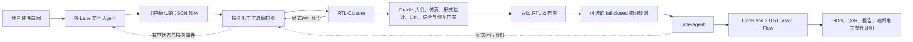

# SiliconWeaver

<p align="center">
  <strong>从硬件意图到已验证 RTL 与开放 PDK GDS 的 Agentic、证据驱动流程。</strong>
</p>

<p align="center">
  <a href="README.md">English</a> · <a href="README.zh-CN.md">简体中文</a>
</p>

<p align="center">
  <a href="https://github.com/vpromise/SiliconWeaver/actions/workflows/ci.yml"></a>
  <a href="LICENSE"></a>
  
  
</p>

SiliconWeaver 是一个开源芯片 Agent，把经用户确认的硬件规格连接到已验证 RTL
生成、有限修复以及受管理的 LibreLane 物理实现。系统以显式契约、持久化运行身份、
不可变证据和 fail-closed 发布门禁为核心设计原则。

```text
自然语言意图 -> 已确认规格 -> 已验证 RTL
            -> 受管理的物理流程 -> GDS + QoR + 完整性证明
```

SiliconWeaver 当前属于研究与工程预览版本。它产生的开源工具证据具有工程价值，
但不等同于商业晶圆厂 signoff，也不能单独证明设计已经具备流片条件。

## 为什么做 SiliconWeaver？

很多 AI 硬件演示在模型生成“看起来像 RTL”的代码后就结束了。SiliconWeaver
把生成视为流程起点，而不是完成标志：

- **意图必须显式化。** 接口、时序、复位、架构约束、需求、假设和验证策略均绑定
  到用户确认的规格。
- **预期行为受到保护。** 生成的 RTL 不能通过修改冻结的 oracle、期望输出或已有
  测试 epoch 来“让自己通过”。
- **修复由证据驱动。** 仿真和形式反例会被规范化为有界反馈；每个候选都必须重新
  回归，并在退化时回滚。
- **物理流程受管理。** 长时间 LibreLane 任务在后台执行，同时保存持久身份、可恢复
  状态、QoR、产物和完整性证明。
- **物理规划必须显式启用并绑定证据。** 可选的工具驱动物理规划会在最终 Lane
  运行前探测已封闭的几何候选集合；公开默认值仍为 `off`，随包提供的 bootstrap
  策略也不能作为可发布的校准证据。
- **读写操作严格分离。** `status`、`report` 等命令是纯读取；`start`、`stop`、
  `retry`、`reconcile` 等状态变更必须显式发起。

## 系统架构



仓库包含两个独立版本管理的 Python 发行包：

| 组件 | 当前版本 | 职责 |
|---|---:|---|
| [`pi-lane/`](pi-lane/) | 0.6.0 | Pi profile、交互启动、持久编排、证据绑定物理规划、LibreLane 运行管理、QoR/产物完整性和 monitor UI |
| [`rtl-closure/`](rtl-closure/) | 0.7.0 | 规格验证、Oracle 共识、RTL 生成、四态验证、有界修复、发布、物理规划选择和 Lane 交接 |

两个组件共享一个运行环境，但命令、状态根目录、运行身份、发布版本和产物彼此独立。

## 验证边界

SiliconWeaver 不会把任意一个成功退出的命令等同于“芯片已经完成”：

| 里程碑 | 最小证据 | **不能**据此声称 |
|---|---|---|
| 规格已接受 | Schema 与 intent-closure 校验通过 | RTL 已存在 |
| RTL 已生成 | 已得到候选 Verilog 模块 | RTL 正确或可综合 |
| RTL 已验证 | 配置要求的仿真、Lint、形式、策略、随机和综合门禁通过 | 物理实现已完成 |
| RTL 已发布 | 不可变发布 manifest 与哈希通过复核 | 已生成 GDS |
| 已生成 GDS | 存在规范 GDS 产物 | QoR、DRC、LVS 和全部必需门禁已通过 |
| 物理交付通过 | 必需的开放 PDK QoR 与完整性门禁通过 | 商业 signoff 或流片保证 |

详细实现可阅读 [Pi-Lane 英文架构文档](pi-lane/docs/ARCHITECTURE.md)和
[中文端到端流程参考](rtl-closure/docs/PIPELINE_FLOW_CN.md)。

## 环境要求

- 带 Docker 的 Linux `x86_64` 或 `aarch64` 环境；
- Python 3.12，推荐使用 [uv](https://docs.astral.sh/uv/)；
- Node.js 24 与 npm，用于锁定版本的 Pi Agent 和 monitor；
- 一个兼容 OpenAI API 的 RTL 生成模型服务；
- 满足 LibreLane 和所选开放 PDK 的存储与计算资源。

当前配套版本如下：

| 层 | 版本 |
|---|---:|
| Pi-Lane | 0.6.0 |
| RTL-Closure | 0.7.0 |
| Pi coding agent | 0.84.2 |
| LibreLane | 3.0.5 |
| Python | 3.12 |
| Node.js | 24 |

## 快速开始

克隆仓库，并把两个组件安装到同一个 Python 环境：

```bash
git clone https://github.com/vpromise/SiliconWeaver.git
cd SiliconWeaver/pi-lane

uv venv .venv --python 3.12
uv pip install --python .venv/bin/python --editable "../rtl-closure[test]"
uv pip install --python .venv/bin/python --editable ".[test]"
npm ci --ignore-scripts --no-audit --no-fund

source .venv/bin/activate
export PI_LANE_PI_EXECUTABLE="$PWD/node_modules/.bin/pi"
```

在配置模型或下载 EDA 资源前，可以先运行不会改变状态的检查：

```bash
pi-lane --version
rtl-closure --version
rtl-closure validate --spec "$PWD/specs/simple_counter.json"
lane-agent doctor --pdk sky130A --json
```

通过以下环境变量配置模型后端。API key 应由 shell 密钥管理或受保护环境注入，
绝不能写进规格、fixture、日志或 Git commit。

```text
RTL_CLOSURE_PROVIDER
RTL_CLOSURE_MODEL
RTL_CLOSURE_BASE_URL
RTL_CLOSURE_API_KEY
```

然后启动交互 Agent：

```bash
pi-lane
```

下面的环境准备命令可能下载体积较大的镜像或开放 PDK，因此与快速检查分开：

```bash
lane-agent image-install
lane-agent pdk-install --pdk sky130A
```

长时间物理流程必须通过受管理的后台控制器启动，不要额外套一层轮询脚本。后续所有
状态、事件、日志和产物查询都应使用命令返回的 workflow ID 与 child run ID。

## 仓库结构

```text
SiliconWeaver/
├── pi-lane/                 # 交互 Agent 与物理流程控制面
│   ├── src/pi_lane/         # Python 包和公开 CLI
│   ├── extensions/          # 只读 Pi monitor
│   ├── prompts/             # 受约束的物理设计 Agent prompt
│   ├── specs/               # 规范 smoke 规格
│   ├── examples/            # 更多合成示例
│   └── docs/                # 架构、开发、发布与中文文档
├── rtl-closure/             # 已验证 RTL 生成与修复引擎
│   ├── src/rtl_closure/     # 规格、Oracle、pipeline 与验证代码
│   ├── examples/            # 可独立使用的公开规格
│   ├── docker/              # 固定验证镜像的构建源
│   └── docs/                # 详细中文流程参考
└── .github/                 # Monorepo CI、依赖更新和 Issue 模板
```

## 开发与测试

以下快速检查不会发起模型请求或物理设计流程：

```bash
cd pi-lane
ruff check src tests
PYTEST_DISABLE_PLUGIN_AUTOLOAD=1 python -m pytest
npm run check

cd ../rtl-closure
ruff check src tests
PYTEST_DISABLE_PLUGIN_AUTOLOAD=1 python -m pytest
```

提交 Pull Request 前请阅读 [`CONTRIBUTING.md`](CONTRIBUTING.md)。所有改动必须只使用
合成或可再分发 fixture，保持必需门禁强度，并确保凭据、私有 RTL、商业 PDK 材料和
NDA 日志永远不会进入仓库。

## 开源范围与非目标

本仓库明确排除 benchmark 数据集、隐藏评测、比较基线、分数聚合、评测凭据和商业
PDK 材料，也不会导入或调用 ORFS 集成。详见
[`pi-lane/OSS_SCOPE.md`](pi-lane/OSS_SCOPE.md)和
[`rtl-closure/OSS_SCOPE.md`](rtl-closure/OSS_SCOPE.md)。

当前非目标包括：

- 商业晶圆厂 signoff 或流片保证；
- 自动使用私有 PDK 或需要许可证的 EDA 工具；
- 模型质量排名或 benchmark 榜单；
- 把有界形式轨迹表述为任意输入下的通用行为证明；
- 静默迁移不兼容的持久状态或协议 schema。

## 安全问题

请勿在公开 Issue 中提交密钥、私有 endpoint、私有设计或漏洞细节。按照
[`SECURITY.md`](SECURITY.md)使用 GitHub 私有漏洞报告渠道。

## 许可证

SiliconWeaver 使用 [Apache License 2.0](LICENSE)。第三方依赖和容器输入保留各自的
许可证与 NOTICE 义务；详见 [`THIRD_PARTY.md`](THIRD_PARTY.md)及两个组件的 NOTICE。
