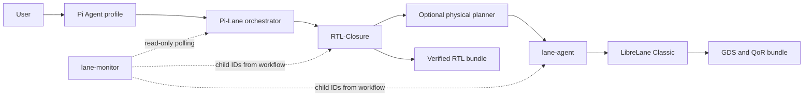

# Pi-Lane Agent Architecture

Pi-Lane separates interaction, durable orchestration, RTL closure, and physical
implementation so that each component owns one state machine and one artifact
boundary.

## Component Ownership

| Component | Owns | Does not own |
|---|---|---|
| Pi profile | intent conversation and explicit confirmation | RTL or Flow state |
| `pi-lanectl` | workflow identity, durable operations, leases, projections | child artifacts |
| RTL-Closure | frozen spec, oracle quorum, RTL generation and verification | physical implementation |
| `lane-agent` | immutable physical input, optional planning probes, LibreLane run, QoR and GDS integrity | RTL generation |
| `lane-monitor` | bounded read-only presentation and cursors | workflow mutation |

The orchestrator never discovers a child from global "latest" state. It binds
every child through an explicit run ID and stable idempotency key, then validates
that identity in later reports. Each component retains its own state root and
can be diagnosed directly with that bound ID.

## Workflow

1. Pi turns the conversation into a complete RTL-Closure JSON specification.
2. The user confirms the closed intent; `rtl-closure intent-hash` binds it.
3. `pi-lanectl start` durably records the request before dispatching it.
4. RTL-Closure freezes behavioral evidence, generates candidates, repairs
   failures, and publishes only after every required release gate passes.
5. If the confirmed specification opts in, RTL-Closure starts an evidence-bound
   physical plan and waits for its final idempotent Lane handoff.
6. Otherwise RTL-Closure hands the immutable published design directly to
   `lane-agent`.
7. `lane-agent` runs the pinned LibreLane Classic flow with an open PDK.
8. Reconciliation validates terminal identities and artifacts before Pi-Lane
   reports completion.

The durable event journals are authoritative for state transitions. Monitor
widgets and visualization timelines are projections, not alternate sources of
truth.

## Trust Boundaries

- Model credentials remain in process environment or private Pi configuration;
  they are not copied into specs, events, generated designs, or containers.
- Generated RTL and verification code run in no-network containers with pinned
  image identities.
- Physical input files are captured into an immutable snapshot before the Flow.
- Physical planning defaults to `off`; a bootstrap policy is non-publishable
  until complete Human calibration evidence is supplied.
- Only reviewed open PDK identifiers are accepted.
- A passing run is open-source tool evidence, not commercial foundry signoff.

## External Consumers

Benchmarking and experiment control are intentionally not architectural layers
inside Pi-Lane. External tools may submit a confirmed spec and read documented
JSON status, event, report, QoR, and attestation outputs. They must not write
Pi-Lane's SQLite database, child state trees, or sealed artifact directories.
