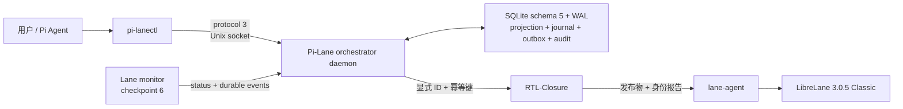
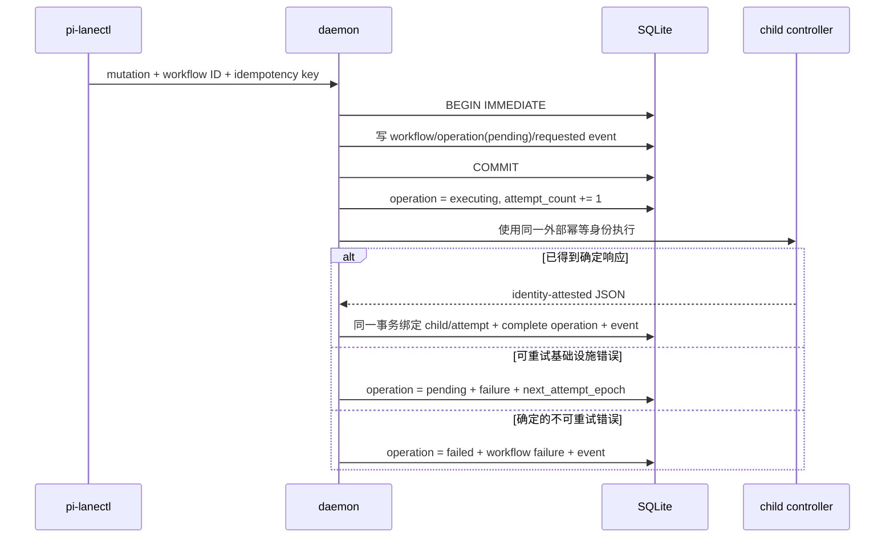

# Pi-Lane 全局编排器 v3

> 适用版本：Pi-Lane 0.5.1。Unix socket wire protocol 固定为 3，SQLite
> database schema 固定为 5，Lane monitor checkpoint 固定为 6。响应外壳的
> `schema_version: 1` 是消息结构版本，不是 wire protocol 或数据库版本。

## 1. 目标和权威边界

全局编排器负责把一个经过确认的自然语言芯片请求依次绑定到 RTL-Closure 和
`lane-agent`，并在 daemon、worker 或 Pi 会话重启后恢复确定的执行状态。它不复制两个
子控制器的完整证据，也不通过“最新目录”猜测 child 身份。



| 层 | 主键 | 权威内容 | 不拥有的内容 |
|---|---|---|---|
| 全局 workflow | `workflow_id` | 跨控制器状态、attempt、operation、事件、失败归属和 child ID | RTL、波形、formal transcript、GDS 正文 |
| RTL 生成验证 | `rtl_closure_run_id` | 契约、Oracle、候选、反例、验证修复、发布证据 | LibreLane Step 的实际执行证据 |
| 物理实现 | `lane_run_id` | 进程、Step、QoR、artifact、GDS 和可视化 | 自然语言契约和 RTL 修复决策 |

因此：

- `pi-lanectl` 是端到端 workflow 的控制入口。
- `rtl-closure` 和 `lane-agent` 保持独立入口、状态目录和发布版本。
- workflow 只能使用自己持久化的 child ID；禁止从全局 current pointer 或目录时间推断。
- 全局 snapshot 是有界投影，完整证据以 child artifact 为准。
- 仅允许已审核的开源 PDK；任何商业或 NDA PDK 都必须拒绝。

## 2. Current-Only 格式

Pi-Lane 0.5.1 只接受下列当前格式：

| 边界 | 格式 |
|---|---|
| 客户端与 daemon | orchestrator protocol 3 |
| daemon 持久状态 | database schema 5 |
| monitor 会话状态 | checkpoint schema 6 |
| Lane managed run | run schema 6 |
| Lane controller journal | event schema 3 |
| Lane 可视化索引 | visualization manifest schema 3 |

daemon 打开已有数据库时，先读取 `metadata.schema_version`，再精确核对关键表列。版本、
列集合或表类型不匹配即以 `UNSUPPORTED_DATABASE_SCHEMA` 或
`INVALID_DATABASE_SCHEMA` 失败关闭；不会转换或部分复用。monitor 同样拒绝非 protocol 3
响应和非 checkpoint 6 会话记录。物理 child 的 run、event、visualization 记录由
`lane-agent` 按当前 schema 精确校验。

## 3. 持久化布局

默认目录：

```text
~/.local/state/pi-lane/orchestrator/
  orchestrator.sqlite3
  orchestrator.sqlite3-wal
  orchestrator.sqlite3-shm
  orchestrator.sock
  orchestrator.lock
  orchestrator.log
```

目录必须是当前用户所有、非符号链接且权限为 `0700`；数据库、socket、lock 和 log 为
`0600`。SQLite 固定启用：

```text
PRAGMA journal_mode=WAL
PRAGMA synchronous=FULL
PRAGMA foreign_keys=ON
PRAGMA busy_timeout=30000
```

WAL 允许 monitor 读取时 daemon 继续提交 mutation；`synchronous=FULL` 降低主机异常退出
时已确认事务丢失的概率。它不提供异机复制或多机高可用。

### 3.1 八张业务表

| 表 | 用途 | 关键约束 |
|---|---|---|
| `workflows` | workflow 当前投影和 child 绑定 | `workflow_id` 主键；`idempotency_key` 唯一；revision 单调增加 |
| `attempts` | RTL 与 Lane 尝试谱系 | `(workflow_id, kind, ordinal)` 唯一；backend run 不能重复绑定 |
| `events` | 全局 append-only journal | `(workflow_id, sequence)` 主键；event ID 唯一；SHA-256 连续链 |
| `artifacts` | 有界 artifact 索引 | `(workflow_id, path)` 唯一；正文仍由 child 控制器拥有 |
| `leases` | workflow 单写者租约 | workflow 一行；`lease_token` 全局唯一；绑定进程身份和到期时间 |
| `client_cursors` | durable consumer acknowledgement | `(client_id, workflow_id)` 主键；sequence 只前进 |
| `terminal_integrity_audits` | completed workflow 的周期复核 | workflow 一行；绑定 revision、检查时间、child 状态和快照哈希 |
| `operations` | `start`/`stop`/`retry` durable outbox | operation ID 与 workflow 幂等键唯一；请求、结果、错误和重试状态持久化 |

内部 `metadata` 表只保存数据库 schema 版本，不属于 workflow 业务表。

### 3.2 Workflow 与 Attempt

一个 workflow 固定绑定：

- 规范绝对路径、规范内容 SHA-256、设计名和 PDK；
- 全局稳定 `idempotency_key`；
- 一个 `rtl_closure_run_id`；
- 当前 `active_lane_run_id`；
- revision、status、phase、有界 snapshot 和结构化 failure。

Attempt kind 只有 `rtl_closure` 和 `lane`。RTL attempt 跨越生成、验证、发布和物理 child
的首次建立，只有 RTL child 失败或最终 workflow 收束时才关闭。物理重试只关闭失败的 Lane
attempt 并创建下一 ordinal，不把已通过的 RTL 发布误记为重新生成。

## 4. Durable Operations Outbox

外部进程调用不是 SQLite 事务的一部分。schema 5 使用 `operations` outbox 把
“意图已提交”和“外部副作用已确认”分开：



operation 状态为 `pending`、`executing`、`completed`、`failed` 或 `cancelled`。每次分派
增加 `attempt_count`。可重试错误使用有界指数退避，仍保留同一个 operation ID、请求内容和
外部 idempotency key。确定响应写入 `result_json`，错误写入 `failure_json`。

### 4.1 Crash Recovery

reconcile 总是先处理该 workflow 最早的活动 operation，再读取 child 状态：

1. `pending` 直接按持久化请求分派；
2. `executing` 被视为结果未知，使用相同外部幂等身份查询或重试；
3. child 已建立但 daemon 尚未绑定时，重复 start 返回同一 child，随后原子补齐 attempt 和
   workflow 绑定；
4. stop 与 start 竞争时，先恢复 start 的 child 身份，再对这个确定 child 发 stop，禁止在
   身份未知时把父 workflow 标成已停止；
5. retry 在响应丢失后复用同一 retry operation key，不会重复创建物理 attempt；
6. operation 的终态与 workflow/attempt/event 投影在同一事务提交。

这套恢复针对进程退出、socket 断开、响应丢失和提交边界崩溃。它不把不可重试的规格、身份
或证据错误循环重放。

## 5. Lease Token 与单写者

每次 reconcile 需要先获得该 workflow 的租约。租约记录：

```text
workflow_id
lease_token        # 每次成功获取都随机生成
owner
pid
process_start_time # Linux /proc 进程启动标识
heartbeat_at
expires_at
```

未到期且进程身份仍有效时，其他 worker 不能获取租约。持有者 heartbeat 和 release 都必须
提交精确 `lease_token`；仅 workflow ID、owner 或 PID 相同不足以释放。租约到期后仍会核验
记录的 PID/start-time，避免 PID 重用或延迟 worker 破坏新租约。数据库事务和 lease token
共同保证一个 workflow 同时只有一个有效推进者。

## 6. 启动、推进和物理重试

### 6.1 Start

```bash
pi-lanectl start --spec /absolute/path/spec.json \
  --idempotency-key <stable-key> --json
```

start 在一个事务内创建 workflow、pending operation 和 `workflow.created` /
`start.requested` 证据。外部命令固定包含规范路径、workflow ID 和 operation 的稳定幂等键。
RTL-Closure 返回值必须是可解析 JSON，且 workflow/spec 身份必须一致；绑定后创建
`rtl_closure` attempt。重复同一全局 key 和同一规范返回原 workflow；同 key 不同规范以
身份冲突失败。

RTL-Closure 完成后，daemon 读取其 release report 并校验：

- report schema、run ID、workflow ID 和 start operation 身份；
- spec 路径/哈希、设计名、PDK；
- RTL 状态根目录归属；
- publication 和独立验证门禁；
- Lane child 的 run/workflow/attempt/idempotency 绑定。

只有报告和证据完全一致，才把物理 child 绑定到当前 Lane attempt。

### 6.2 后台 Reconcile

推进顺序固定为：operation recovery -> RTL child reconcile/report -> Lane child reconcile/status
-> workflow 投影/event -> terminal audit。`pi-lanectl` 不暴露手动 reconcile 子命令；
查询 API 不推进 child，只有后台 daemon 提交新的观察结果。

### 6.3 Physical Retry

物理基础设施恢复后可只重试已发布设计：

```bash
pi-lanectl retry --run-id <workflow-id> --scope lane --json
```

retry 必须复核冻结规范哈希、RTL-Closure publication、Lane 输入 bundle 和前一 child 已终止。
新的 operation ordinal 产生新的稳定 retry key 和 Lane attempt ordinal；同一 operation 的
重复执行仍返回同一 child。它不重新生成 RTL，不修改冻结验证套件，也不绕过 delivery gate。

## 7. 状态、失败和终态审计

主要 workflow status：

| status | 含义 |
|---|---|
| `created` / `queued` / `running` | operation 或 child 正在建立/执行 |
| `waiting_user` | 需要用户确认意图或批准有副作用动作 |
| `blocked_infrastructure` | 可重试基础设施问题，证据和 retry scope 已记录 |
| `completed` | RTL 发布与物理 delivery 全部通过 |
| `failed` | 设计、架构、验证、物理或证据门禁确定失败 |
| `incomplete` | 流程结束但 required 证据或完整交付条件不足 |
| `stopped` | 指定活动 child 已确认停止，且没有其他终态抢先成立 |

结构化 failure 至少包含 `category`、`code`、`message`、`retryable`、`owner` 和
`scope`。常见 owner 为 `rtl_closure`、`lane`、`pi-lane-orchestrator` 或
`infrastructure`。配置、容量、deadline、身份和证据完整性错误不能交给模型假装修 RTL。

completed workflow 由 `terminal_integrity_audits` 定期重新核验。daemon 为每次审计生成新的
`integrity_audit_id`，RTL-Closure reconcile 必须把它转发给 Lane，最终报告也必须带回同一个
ID。Lane schema 6 用 `delivery_attestation` 封存 final metrics、canonical GDS、QoR、mapped
equivalence 和运行身份；终态 event 再绑定 attestation hash。只有本次
`release_integrity.status=verified` 的 completed child 才能通过审计。

artifact 哈希重读或 terminal journal 的暂时性 OSError 返回 `unknown`，保持原 completed
投影并在后续重试；确认污染、替换、缺失、事件断链或身份漂移返回 `degraded`，Lane 先受控地
`completed -> incomplete`，全局 workflow 再只允许 `completed -> failed`，同时写
`workflow.integrity_degraded`。终态不能变回 running，也不能用旧 audit ID 冒充本次复核。

## 8. Durable Events 与 Cursor

每个全局事件包含：

```text
workflow_id, sequence, event_id, timestamp, source, attempt_id,
type, severity, state_revision, phase, payload, failure,
previous_sha256, sha256
```

sequence 从 1 单调增加。`sha256` 绑定规范化事件正文和 `previous_sha256`；读取时从第一条
记录重算完整链，并核对 workflow 投影与 journal 尾部。修改、删除、插入或断链都会
fail-closed。

```bash
pi-lanectl events --run-id <workflow-id> --after-sequence 0 \
  --wait-seconds 25 --client-id <stable-client-id> --acknowledge --json
```

响应给出 `next_after_sequence` 和 current snapshot。`--acknowledge` 只在本次响应通过完整
校验后推进 `client_cursors`，且必须同时提供 workflow ID 和 client ID。cursor 不允许倒退。

monitor checkpoint schema 6 保存 workflow claim、显式 pin、client ID 和每个来源的 durable
cursor。第一次附着只确认当前 event tail，之后仅显示 claim 完成后产生的新事件。并发 poll
以 claim token 归属结果，较慢的响应不能覆盖较新的 workflow 绑定。

## 9. Unix Socket Protocol 3

请求外壳包含：

```json
{
  "protocol_version": 3,
  "request_id": "...",
  "operation": "status",
  "payload": {}
}
```

响应外壳包含：

```json
{
  "schema_version": 1,
  "protocol_version": 3,
  "request_id": "...",
  "ok": true,
  "result": {}
}
```

daemon 只接受 protocol 3。缺失或不匹配的 protocol、request ID、operation 或 JSON 类型直接
拒绝。launcher 将 monitor 控制命令绑定到拥有当前 `pi-lane` 的 Python，避免 PATH 上其他
安装被意外选中。

`daemon ensure` 只复用通过 build、PID、ready、socket owner/mode 和 protocol 3 校验的当前
服务。拒绝连接且 inode 在复核期间未变化的 socket 才能判为 stale 并移除；活跃陌生服务、
普通文件、符号链接和竞态 endpoint 均返回 `DAEMON_SOCKET_IN_USE`，不会 unlink 或强杀。

## 10. 模型配置注入

RTL-Closure 使用独立变量：

```text
RTL_CLOSURE_PROVIDER
RTL_CLOSURE_MODEL
RTL_CLOSURE_BASE_URL
RTL_CLOSURE_API_KEY
```

`pi-lane` launcher 是唯一 Pi 配置适配层。它从 owner-only、非 symlink、大小有界的
`models.json`、`settings.json` 和 `auth.json` 读取所选 provider，并只向 orchestrator
subprocess 注入缺失的 model/base URL/API key。显式环境值优先。Pi 交互进程、规范、状态、
事件、日志、生成目录和容器都不接收凭据。直接运行 `rtl-closure` 时必须自行提供这些变量，
RTL-Closure 不读取 Pi 文件。

## 11. RTL 独立验证闭环

编排器只接受已达到 RTL-Closure release 状态且身份完整的报告。release 前闭环包括：

1. 冻结用户确认的行为、接口、时序、架构约束、需求和假设；
2. 多候选 Python Oracle quorum、最终计划重放和 executable-line coverage 证据；
3. 多个 RTL 候选的 Cocotb 定向/随机仿真、X/reset 探测和内部状态快照；
4. 失败归一化为时序反例、依赖切片和确定性 adaptive suite epoch；
5. 定位、候选修复、完整回归、严格改进判定和失败回滚；
6. 独立于修复模型的 release randomized passes；
7. required Verilator lint、bounded formal、universal property、架构审计和 generic
   synthesis equivalence；
8. 最终 Oracle quorum replay、artifact 重哈希和原子 publication。

模型不能修改 Cocotb driver、expected outputs、Oracle、冻结契约或已有 suite epoch。明确的
行为/formal 反例进入修复反馈；required infrastructure/evidence unknown 在有界重试后停止，
不触发确定性无效的 RTL regeneration。独立验证生成的反例必须重新进入相同闭环并由完整
suite 回归确认，不能在 release 阶段形成旁路。

## 12. LibreLane 交付边界

物理流程固定为 LibreLane 3.0.5 `Classic`。Lane run schema 6 绑定不可变输入 snapshot、
镜像 digest、开放 PDK 内容、Step registry、resume chain、QoR、GDS 和 delivery gate。
Step/状态汇报来自 Lane event schema 3；可视化 manifest schema 3 记录 render 尝试、PNG、
错误和 latest image。`PI_LANE_*` run tag 与环境字段是当前 Pi-Lane/Lane 物理交接协议的一
部分，必须保留。

完整 delivery 至少要求：

- 从 Classic 首 Step 开始的完整且连续执行链；
- 精确 Classic 终点和 canonical GDSII 结构校验；
- timing、routing DRC、Magic/KLayout DRC、LVS、XOR 和 physical sanity/QoR gate；
- 配置为 required 时通过 PDK-mapped `Yosys.EQY`；
- schema 6 input bundle、delivery attestation 和 terminal evidence 重新认证。

partial `--to` 可得到成功的进程状态，但不能成为完整 RTL-to-GDS delivery。开放 PDK 的检查
不构成商业 foundry signoff，也不保证流片结果。

## 13. 操作速查

```bash
pi-lanectl daemon ensure --json
pi-lanectl start --spec /absolute/path/spec.json \
  --idempotency-key <stable-key> --json
pi-lanectl status --run-id <workflow-id> --compact --json
pi-lanectl events --run-id <workflow-id> --after-sequence 0 \
  --wait-seconds 25 --client-id <stable-client-id> --acknowledge --json
pi-lanectl list --active --json
```

按 workflow 中的精确 ID 下钻：

```bash
rtl-closure report --run-id <rtl-closure-run-id> --json
rtl-closure logs --run-id <rtl-closure-run-id> --lines 80
lane-agent status --run-id <lane-run-id> --json
lane-agent logs --run-id <lane-run-id> --lines 80
lane-agent artifacts --run-id <lane-run-id>
```

`status`、`report`、`list` 和 event read 是纯读。`start`、`stop`、`retry`、`reconcile` 和
visualization retry 会改变持久状态。停止 run、修改设计输入、覆盖物理参数或清理产物前必须
先说明并取得用户授权。

当前限制：单机 Unix socket + SQLite，无多机 HA 或外部 push transport；全局 artifact 表
不是完整 evidence catalog；generic synthesis equivalence 和 mapped EQY 都不是 post-layout
LEC；开放 PDK 检查不等于 foundry signoff。

实现入口：[`orchestrator.py`](../src/pi_lane/orchestrator.py)、
[`orchestrator_server.py`](../src/pi_lane/orchestrator_server.py)、
[`orchestrator_cli.py`](../src/pi_lane/orchestrator_cli.py)。
