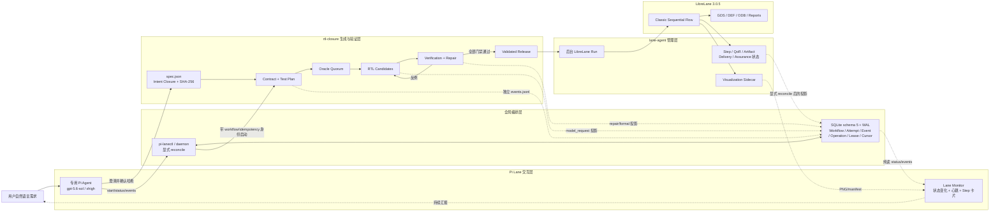
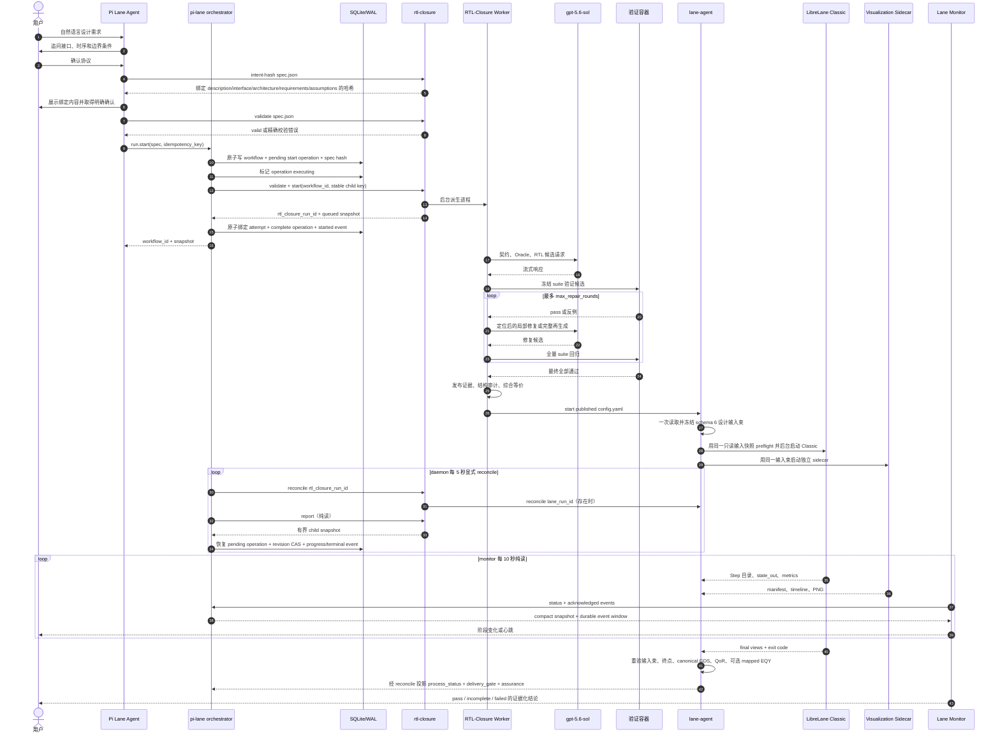
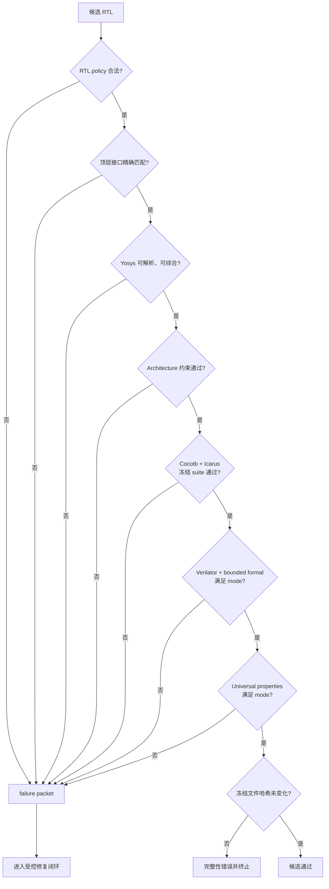
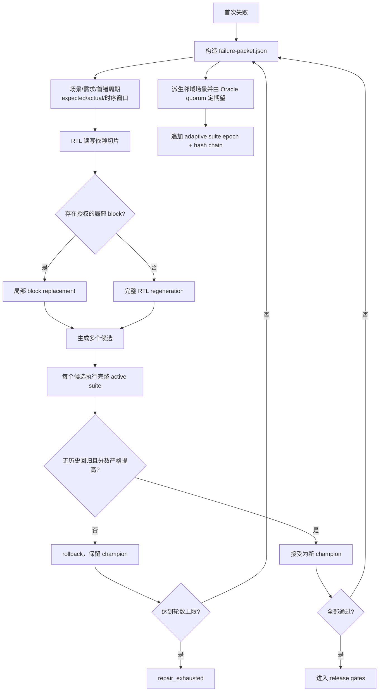
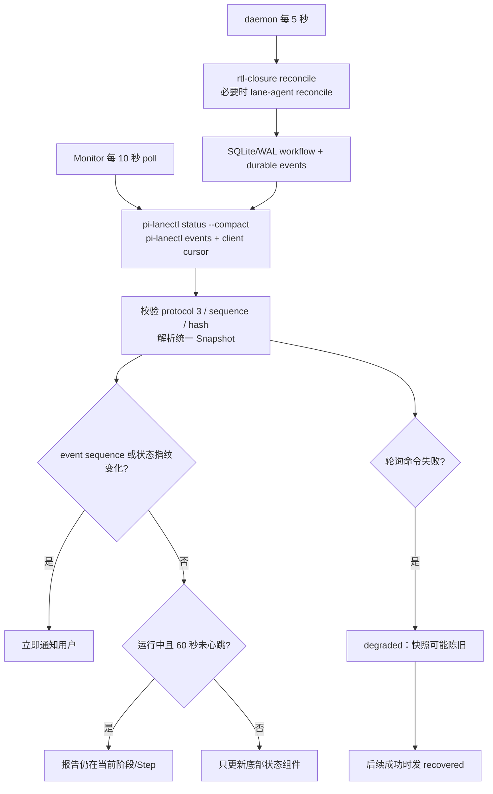
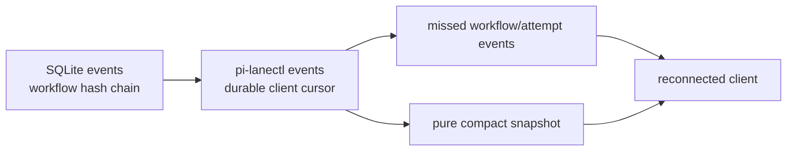
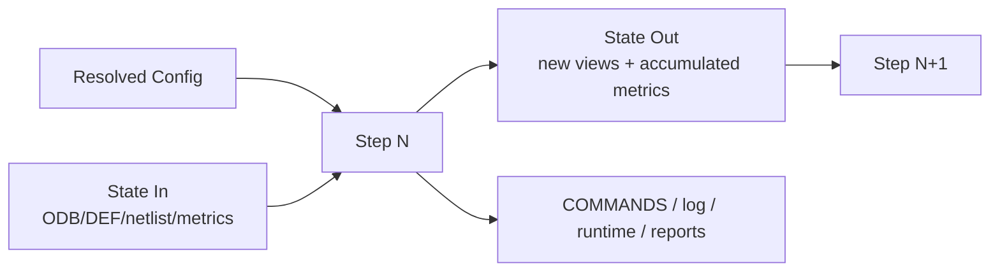
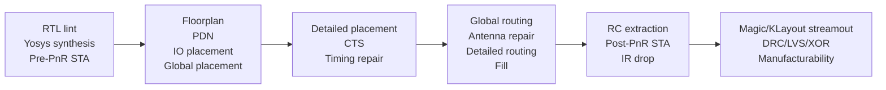
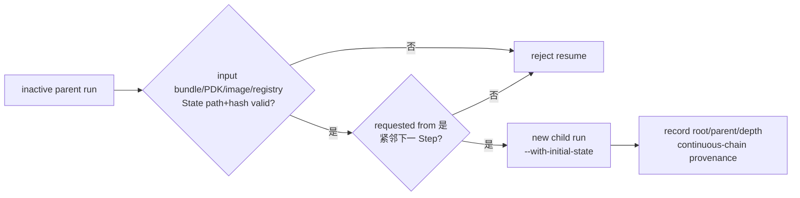
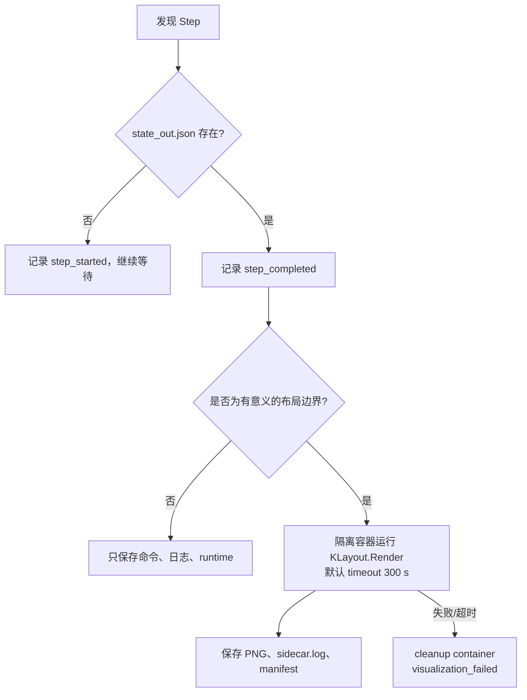

# pi-lane 自然语言到 RTL/GDS 整体流程说明

> 本文描述 Agent-only 版本的实际实现：`pi-lane 0.6.0`、
> `rtl-closure 0.7.0`、LibreLane 镜像
> `ghcr.io/librelane/librelane:3.0.5`。文中的状态名、目录和门禁均来自当前代码，
> 不是未来规划。
>
> SQLite/WAL、Unix socket、workflow/attempt、lease、event 和 client cursor 的详细合约见
> [Pi-Lane 全局编排器 v3 说明](ORCHESTRATOR_V3_CN.md)。

## 1. 一句话理解这套系统

用户输入自然语言后，系统并不是让一个模型直接写 RTL 然后立即跑版图。实际链路是：

```text
自然语言澄清
  -> 结构化 spec.json
  -> 用户确认的 intent closure + 内容哈希
  -> 独立 Oracle 共识和冻结测试闭包
  -> 多候选 RTL 生成
  -> Cocotb、Yosys、Verilator、两层 formal 验证
  -> 反例驱动修复、全量回归和回滚
  -> 固化证据并发布设计
  -> lane-agent 后台启动 LibreLane Classic
  -> 逐 Step 状态、日志、布局预览和 QoR
  -> Classic 终点 + canonical GDS + QoR + assurance 最终交付门禁
```

整个系统由五个边界清晰的组件组成：

| 组件 | 真实职责 | 不负责什么 |
|---|---|---|
| Pi Lane 交互会话 | 理解用户文字、追问歧义、创建规格、调用命令、向用户解释状态 | 不直接充当 RTL 发布门禁或物理实现引擎 |
| `pi-lanectl` / orchestrator daemon | 保存全局 workflow/attempt 图、显式推进 child、归一化失败、提供持久事件和 compact 状态 | 不取代 RTL-Closure 或 Lane 的完整证据目录 |
| `rtl-closure` | 契约、Oracle、RTL 生成、验证、修复、发布、交接 | 不直接执行 LibreLane 内部 Step |
| `lane-agent` | 镜像/PDK 管理、后台启动 LibreLane、显式 reconcile、QoR、artifact 和可视化 | 不生成或修改 RTL；纯读 status 不推进状态 |
| LibreLane Classic | 真正执行 RTL 到 GDS 的顺序物理流程 | 不理解用户的自然语言意图 |

`pi-lane`、`rtl-closure` 和 `lane-agent` 仅通过显式协议与持久化 ID 协作；它们不共享
ORFS 集成的入口、状态、镜像或发布目录。

## 2. 总体架构图



这里有两条独立的数据流：

1. 设计数据流从需求、规格、RTL 一直流向 GDS。
2. 反馈流由 daemon 显式 reconcile 子控制器后写入全局 workflow/event；monitor 只做纯读，
   再由 Pi 向用户报告。完整底层证据仍留在 `rtl-closure`、`lane-agent` 和可视化目录。

当前格式边界固定为：orchestrator protocol 3、database schema 5、monitor checkpoint schema 6、
Lane run schema 6、Lane event schema 3 和 visualization manifest schema 3。各组件遇到其他
格式会失败关闭，不转换持久状态，也不从其他目录推断 run 身份。

database schema 5 的八张 workflow 业务表是 `workflows`、`attempts`、`events`、
`artifacts`、`leases`、`client_cursors`、`terminal_integrity_audits` 和 `operations`。
`operations` 是 `start/stop/retry` 的 durable outbox：先在事务中写入 mutation 意图，再调用
外部 child。daemon 崩溃后 reconcile 会以同一个 operation/idempotency key 恢复未决调用，
避免丢失响应时重复建立 child。每个推进者还必须持有随机 `lease_token`；heartbeat 和释放都
需匹配 token、owner、PID 与进程启动身份，延迟 worker 不能释放新的租约。

## 3. 用户输入之后，Pi 首先做什么

### 3.1 隔离的交互入口

安装后的 `pi-lane`（源码树中由 `bin/pi-lane` 薄包装）启动专用 Pi 会话。它使用独立的
agent 和 session 目录，并带有：

```text
--no-context-files
--no-extensions
--no-skills
--extension <pi-lane>/extensions/lane-monitor.ts
--append-system-prompt <pi-lane>/prompts/LIBRELANE_AGENT.md
```

因此它不会加载全局 Pi 上下文或其他集成的扩展、技能和会话。当前使用
`gpt-5.6-sol`，思考深度为 `xhigh`。

RTL-Closure 只读取 `RTL_CLOSURE_PROVIDER`、`RTL_CLOSURE_MODEL`、
`RTL_CLOSURE_BASE_URL` 和 `RTL_CLOSURE_API_KEY`。`pi-lane` launcher 与 `pi-lanectl`
共用 Pi 配置适配层：它们从 owner-only、非 symlink、大小有界的 agent 配置读取所选
provider，并只向 orchestrator subprocess 注入缺失的 model/base URL/API key；显式环境值
优先。Pi 与 monitor 进程不会接收 API key，凭据也不会进入 spec、run state、事件、日志或
容器。直接执行 `rtl-closure` 时必须自行提供这些变量。

### 3.2 自然语言不是直接执行接口

当前实现中没有一个把任意文本直接解析成电路的固定 REST/CLI parser。自然语言首先由
专用 Pi Agent 解释。Agent 必须把可执行语义落到 `spec.json`，从该文件开始，后面的行为
才是可复现、可校验和可审计的。`intent_closure` 又把用户实际审阅的
`description + interface + architecture + requirements + assumptions` 绑定到一个 canonical SHA-256；
它防止“确认之后规格又被静默改写”，但不能证明用户从未说出的隐含意图。

对于可能改变硬件行为的歧义，Agent 应先追问，而不是擅自补全。至少需要确认：

- 顶层模块名和完整端口表；
- 每个端口的方向、位宽和 signedness；
- 组合逻辑还是时序逻辑；
- 时钟边沿、周期、复位极性、同步或异步；
- `start/valid/ready/busy/done` 等握手含义；
- 延迟、吞吐率、结果有效周期；
- 同周期事件的优先级；
- 溢出、饱和、截断、空包、背压等边界行为；
- 是否要求特定子模块、禁止乘除法运算符或限制寄存器/cell 数；
- 开放 PDK、Classic Flow、利用率、placement density 和 jobs。

如果用户只说“做一个 32 位乘法器”，但没有说明 signedness、64 位输出、握手和延迟，
系统无法构造唯一契约，此时追问是正确行为。

### 3.3 Agent 的标准动作

Agent 在需求明确后按以下顺序工作：

1. 根据当前 schema 创建 JSON 规格，明确列出 assumptions 和尚未解决的问题。
2. 将 `intent_closure.mode` 暂设为 `advisory`，运行
   `rtl-closure intent-hash --spec <absolute-path>` 得到待确认哈希。
3. 把哈希所覆盖的描述、接口、架构约束、原子需求和 assumptions 展示给用户；只有用户确认且
   `unresolved_questions=[]` 后，才把模式设为 `required`、`user_confirmed=true`，并将该
   哈希写入 `confirmed_sha256`。
4. 运行 `rtl-closure validate --spec <absolute-path>`；任何被绑定内容变化都会使哈希
   不匹配，必须重新确认。
5. 校验失败时原样报告错误，不创建 run；校验成功后运行
   `pi-lanectl start --spec <absolute-path> --idempotency-key <stable-key> --json`。
6. `start` 返回后立即汇报其中的 `workflow_id` 和初始 workflow snapshot；不得另启一个
   `rtl-closure start` 造成重复 child。
7. daemon 每 5 秒通过显式 `rtl-closure reconcile` 推进子状态；monitor 和 Agent 使用
   `pi-lanectl status/events` 纯读。用户主动询问时读取新快照，不能复用旧状态。

`required` intent closure 还要求 `verification.requirements` 非空。由模型在确认之后临时
规划出的需求不能冒充已经由用户签认的需求。`off/advisory` 仅用于探索性运行，不能作为
“用户意图已经闭合”的证据。

Agent 不应直接把自己临时写出的 Verilog 发布给 LibreLane，也不应同步阻塞等待整个
物理流程结束。`rtl-closure report` 和 `lane-agent status` 只用于按已持久化 child ID
下钻诊断；它们都是纯读接口，不承担自然语言 workflow 的全局编排。

## 4. `spec.json` 如何承载用户意图

规格只有六个业务顶层字段：`schema_version`、`design`、`flow`、`generation`、
`verification` 和 `intent_closure`。

| 区域 | 内容 | 下游用途 |
|---|---|---|
| `design` | 名称、完整行为描述、PDK、端口、时钟、复位、architecture | 接口、契约、RTL prompt、结构审计、SDC |
| `flow` | `Classic`、执行终点、mapped equivalence、可选物理规划、floorplan、利用率、密度、jobs | 生成 LibreLane `config.yaml` 并选择是否先运行 planner |
| `generation` | API profile、模型、候选数、轮数、随机测试、seed、思考深度 | 模型调用和初始候选预算 |
| `verification` | 原子需求、定向场景、修复预算、formal/universal 配置 | 冻结验证闭包和发布门禁 |
| `intent_closure` | 用户确认、未决问题、assumptions、确认哈希 | 绑定用户实际审阅的意图表面 |

一个简化骨架如下：

```json
{
  "schema_version": 1,
  "intent_closure": {
    "mode": "advisory",
    "user_confirmed": false,
    "unresolved_questions": [],
    "assumptions": [],
    "confirmed_sha256": null
  },
  "design": {
    "name": "example_top",
    "description": "完整、无歧义的行为与时序描述",
    "pdk": "sky130A",
    "ports": [
      {"name": "clk", "direction": "input", "width": 1},
      {"name": "rst_n", "direction": "input", "width": 1},
      {"name": "data_o", "direction": "output", "width": 8}
    ],
    "clock": {"port": "clk", "period_ns": 10.0},
    "reset": {"port": "rst_n", "active_low": true, "asynchronous": false}
  },
  "flow": {
    "name": "Classic",
    "to": null,
    "mapped_equivalence_mode": "off",
    "physical_planning_mode": "off",
    "floorplan_sizing": "relative",
    "core_utilization": 40,
    "place_density_pct": 60,
    "jobs": 4
  },
  "generation": {
    "profile": "api",
    "model": "gpt-5.6-sol",
    "reasoning_effort": "xhigh"
  },
  "verification": {
    "requirements": [],
    "directed_tests": [],
    "oracle_line_coverage_mode": "advisory",
    "oracle_diversity_mode": "advisory",
    "oracle_min_distinct_sources": 2,
    "formal_mode": "advisory",
    "universal_mode": "off",
    "universal_properties": []
  }
}
```

上面的 `advisory` 骨架只是创建和计算哈希时的中间形态。正式运行建议在用户确认后使用
`intent_closure.mode: required`。若要求 Oracle 的 provider/model 多样性，则还要给运行时
配置至少两个真实不同的来源；把同一模型调用多次不会满足这一条件。

`floorplan_sizing` 只接受 `relative` 或 `absolute`。默认使用 `relative`，由综合面积和
利用率决定尺寸，且不能携带 `die_area` / `core_area`。只有用户明确要求固定 outline 时才
使用 `absolute`，并同时提供 `die_area` 和 `core_area`。对小设计机械套用
`300 x 300` 的 die 会产生低利用率和大量 filler，可能被物理合理性门禁拒绝。

`physical_planning_mode` 默认且推荐保持 `off`，因此旧规格不会静默增加物理工作。
`auto_safe` 会在最终 Lane 运行前，由 `lane-agent plan-start` 对封闭候选集合执行 PDN、
IO、详细放置和 mid-PnR 稳健性探测；`reference_locked` 还要求内容哈希绑定的绝对路径
geometry lock。随包提供的 bootstrap policy 标记为 `publishable: false`，只能验证机制，
不能充当标定后的 QoR、signoff 或流片证据。

`design.architecture` 当前可机器检查的字段包括：

- `required_modules`；
- `forbidden_operators`，只支持 `multiply/divide/modulo`；
- `min_sequential_bits`；
- `max_sequential_bits`；
- `max_synth_cells`。

其中 `min_sequential_bits` / `max_sequential_bits` 统计的是 generic synthesis
后的时序单元位数，不等同于 RTL 源码中数组、指针和计数器位宽的简单相加。Yosys 在
memory lowering、读地址寄存和优化过程中可能增加或复制寄存器。因此，除非用户明确要求
并已用当前固定验证镜像标定综合后上限，否则 Agent 不应从 RTL 逻辑状态机械生成精确的
`max_sequential_bits`；应省略该上限，或给出带余量且经用户确认的范围。
规格校验会在启动生成前拒绝相等的上下限，避免把工具相关的精确数字送入自动修复循环。

自然语言中提到“必须由 serializer、deserializer 和 control unit 构成”并不会自动成为
硬门禁。要强制检查，必须把对应模块写进 `required_modules`。

## 5. 一次完整运行的时序



## 6. rtl-closure：从规格到可信 RTL

### 6.1 持久状态

全局 orchestrator 调用 `rtl-closure start` 后会立即创建后台 child run：

```text
~/.local/state/rtl-closure/<run-id>/
  spec.json
  state.json
  events.jsonl
  pipeline.log
  contract.json
  testplan.json
  reference_model.py
  expected-trace.json
  frozen-manifest.json
  attempts/
  adaptive/
  ...
```

这是所有 RTL-Closure run 的唯一现行状态根。Pi-Lane 和 monitor 只通过 workflow 中持久化
的 `rtl_closure_run_id` 访问它，不从其他状态目录认领或推断 run。

`state.json` 是当前快照，使用原子替换；`events.jsonl` 是追加式事件流，每条事件带递增
`sequence`。因此同一个 phase 中 candidate、formal 或模型请求发生变化，也能产生新的
进度通知。

### 6.2 契约、测试计划和 Oracle

第一层目标不是 RTL，而是建立独立于 RTL 的预期行为：

1. `contracting` 将行为拆成原子 requirement，并规划只含输入动作的 directed scenario。
2. 规划器不允许返回 expected output 或可执行测试代码。
3. `oracle_generating` 独立生成多个 Python `TopModule` 候选。
4. 每个 Oracle origin 都记录 `provider`、`model` 和两者生成的 `source_id`；未声明来源也
   会被明确标记，不能伪装成 provider-independent。
5. 每个 Oracle 在隔离环境中执行同一 plan；至少两个 origin 必须对行为形成严格多数。
   origin 是独立 completion，不等于独立供应商或独立模型。
6. `oracle_diversity_mode` 为 `off/advisory/required`。多样性按 winning quorum 中不同的、
   已声明 provider/model source 计数；同一来源的多个 completion 只计一个。`required`
   不满足 `oracle_min_distinct_sources` 时会在 RTL 生成前失败，单一来源配置可在模型调用前
   直接拒绝；`advisory` 只记录风险。
7. reviewer 可以改进代码，但只有行为仍等于共识时才能被采用，而且不增加投票数。
8. `coverage_refining` 根据 Python Oracle 的可执行行覆盖补充新的输入场景。
9. 所有 Oracle origin 在最终 plan 上重新执行并再次形成 quorum。
10. contract、plan、Oracle、expected trace、provenance 和哈希清单随后冻结为只读。

`oracle_line_coverage_mode` 也分为 `off/advisory/required`：`off` 不做覆盖引导，
`advisory` 记录目标未达到的 warning，`required` 在目标未达到、预算耗尽或 refinement 出错
时于 RTL 生成前失败。这里的指标明确命名为 Python Oracle executable-line proxy；它只是
参考模型源码行覆盖率，不等于 RTL branch、toggle、FSM、assertion 或功能覆盖率。场景上的
`requirement_ids` 也只是关联信息，不能自动证明需求已覆盖。

因此 Oracle 的改进是“来源相关性可见且可门禁”，不是声称当前单一 API 后端已经变成多
供应商系统。真正要求 provider-independent quorum 时，仍需在运行环境中接入不同的真实
provider/model backend。

### 6.3 初始 RTL 候选

`generating` 阶段使用多个 Verilog 候选和多轮交叉验证。冻结的 Python Oracle 作为参考，
随机输入比较 RTL 输出与 Oracle 输出。最好候选即使没有达到 100% 匹配，只要非空，仍可
进入后面的严格修复闭环。

因此以下三句话含义不同：

- “模型返回了 RTL”：只有文本候选。
- “初始 RTL-Closure matched”：只表示初始交叉验证达到目标。
- “verification.passed=true”：才表示最终冻结 suite 和配置要求的门禁通过。

### 6.4 每个 RTL 候选的固定门禁



RTL policy 会拒绝 `` `include``、`initial`、声明初始化、`#delay`、`force/release`、
DPI、文件 I/O 和系统任务等不适合作为目标 ASIC RTL 的结构。接口门禁精确比较模块名、
端口顺序、名称、方向、位宽和 signed 属性。

Cocotb 验证会运行：

- 用户确认的定向场景；
- 两个冻结随机 seed；
- reset prime、dirty-state probes、复位保持和释放；
- 每个 scenario、cycle、phase 和 output 的逐点比较；
- X/Z、reset mismatch 和普通 value mismatch 的分类；
- 可用时记录 FST/VCD 路径。

Verilator 使用 `--lint-only --timing --Wall --Wno-fatal`。其中 `--Wno-fatal` 只让控制器能够
收集完整 warning，不代表全部放行。`LATCH`、`MULTIDRIVEN`、`PINMISSING`、`SELRANGE`、
`UNDRIVEN`、`UNOPTFLAT`、`WIDTH`、`WIDTHCONCAT`、`WIDTHEXPAND`、`WIDTHTRUNC` 会使
`quality_gate` 失败；style/unused warning 仍记录但当前不阻断。发布器还会核对最终 RTL hash、
lint status 和空的 blocking warning 列表。timeout/工具不可用是验证基础设施
`unknown/error`，不是 RTL 行为反例。

### 6.5 两层 formal 必须分开理解

| 层 | 配置 | 证明范围 | 不能声称什么 |
|---|---|---|---|
| Bounded trace formal | `formal_mode`、`formal_depth` | 全部受支持且 eligible 的 canonical unique 冻结 checkpoint 的 Yosys SAT replay | 不能称为任意输入、无限时间的通用证明；unsupported 场景不算已执行 |
| Universal formal | `universal_mode`、`universal_properties` | 安全 DSL 属性在符号输入下的 temporal induction | 只证明写入 DSL 的属性，不证明全部自然语言需求 |

两层均支持 `off/advisory/required`，但行为不同：

- 明确反例在 advisory 和 required 中都会拒绝候选。
- provider `unknown/error` 会先重试一次。
- required 模式在重试后仍不确定时会阻断流程。
- universal required 要求每条属性都证明通过，且证据数量和哈希完整。

Bounded formal 没有 `256` 全局性质上限；该内部值既不是选择上限，也不是当前进程 batch
size。控制器先用“输出信号、期望值、实际送入 Yosys 的输入前缀”
计算 canonical obligation hash，语义相同的 checkpoint 合并为一个性质，但保留所有 alias、
scenario、requirement 和 cycle provenance。**全部受支持且 eligible 的唯一性质**进入不可变
manifest，初始每个 Yosys 进程最多执行 32 条。只有发生 rc 137、SIGKILL/OOM 等资源压力的
batch 才拆成 16，再拆到最小 8；拆分只改变调度，绝不删除或截断 obligation。

`formal_timeout_seconds` 是单个 Yosys 进程 timeout，默认 120 秒；
`formal_total_timeout_seconds` 是覆盖所有 batch、重调度和证据处理的全局 deadline，默认
3600 秒。resetless、`reset_before=false` 和没有输出 checkpoint 的场景会显式列为
unsupported/excluded。required 模式只有在没有 excluded，且 `selection_complete`、
`execution_complete`、`evidence_complete` 全部为真时才能通过。不可变
`formal-manifest.json` 和 `formal-checkpoint.json` 绑定 RTL、suite、property map、depth 与
batch 身份；只有身份和原始证据完全匹配的已完成 batch 才可复用。
发布阶段还会从 active suite 重建每批 Yosys script，并核对 DUT、原始 transcript、
returncode 和每条 obligation 的显式 SAT SUCCESS；只有摘要字段的 `pass` 不构成执行证据。

如果全局 deadline、工具启动、配置或证据完整性导致 `formal_incomplete/unknown/error`，
报告会带结构化 `code/category/repairable=false/context`。修复控制器在生成 repair prompt 或
调用模型之前抛出 `NonRepairableVerificationError`，不会再把容量、deadline 或证据问题
错误地交给 RTL regeneration。真正带 SAT counterexample 的行为失败仍属于可修复路径。

Universal DSL 只支持顶层 data/status port 的 `current/previous` 样本、常量、布尔、比较、
位运算和定宽加减。clock/reset 由 harness 控制，不能写进属性；不支持 arbitrary HDL、
liveness、内部寄存器、memory index 或乘除模。

Universal 报告会把完整 `verification.requirements` 宇宙绑定到性质行，分别列出
`covered_requirement_ids`、`uncovered_requirement_ids`、`fully_proven_requirement_ids`、
失败和不确定的 requirement ID。这里的 covered 仅表示“至少一条性质引用该 ID”，报告固定
声明 `semantic_completeness_claimed=false`；它不能把 traceability 误解为自然语言需求已被
完整形式化。
Universal 发布证据同样绑定配置的 verify image tag（当前不绑定 Docker content digest）、
实际执行的 `dut.sv`、确定性 harness/script 和原始 Yosys 日志，发布器会重新分类日志
verdict。

### 6.6 反例驱动修复闭环



`failure-packet.json` 包含 failure class、requirement、首个失败 cycle、输入、expected、
actual、相邻时序窗口、internal-state delta、依赖 slice、formal counterexample 和指纹。

候选只有在以下两个条件同时满足时才可接受：

1. 保留 champion 已通过的全部 `passed_check_ids`，没有历史回归。
2. 在同一个 `suite_sha256` 上按字典序分数严格提高。

否则执行 rollback，旧 champion 不会被坏候选覆盖。该机制采用 AutoVeriFix 风格的
“反例、定位、候选修复、全量回归、回滚”，并采用 Veri-Sure 风格的独立 Oracle、冻结
expected trace、多 seed 复验和证据哈希；当前实现没有直接导入这两个外部仓库。

### 6.7 发布前的第二层门禁

修复闭环通过后仍不能立即送入 LibreLane，还要完成：

1. 重新校验 intent closure/hash，并再次检查 RTL policy 和精确接口。
2. 使用两个独立 seed 做发布随机复验，两次 `match_rate` 都必须为 1.0。
3. 最终 Yosys hierarchy/check。
4. 最终 architecture audit。
5. RTL 与 generic Yosys synthesized netlist 的 equivalence。
6. 若 `flow.mapped_equivalence_mode=required`，在 `sky130A` Classic 配置中生成
   `RUN_EQY: true`，并把后续 LibreLane `Yosys.EQY` 作为完整交付门禁。
7. 复核 contract、Oracle、suite、universal/formal 和所有 release artifact 哈希。
8. 在 staging 中复验后原子发布。

`mapped_equivalence_mode` 只接受 `off/required`。第 5 项是发布前 schema v3 generic
synthesis equivalence：比较 RTL 与 generic Yosys synthesized netlist，并要求顶层端口集合、
方向和位宽匹配。**只有顶层输出 bit 是 release obligation**；同名内部匹配点仅用于支持
induction relation，综合后的内部状态可以合法重编码，不能把内部匹配写成发布义务。带 reset
的时序设计先在 rising edge 上证明 reset base：前 2 个 sample 断言 reset，随后默认 8 个
post-reset sample，再执行 temporal induction。报告用
`scope=post_reset_observable_outputs_rtl_vs_generic_synthesized_netlist`、
`points=top_level_output_bits_only` 和 `reachable_state_base_proven` 固定该范围。它不能被扩写
为“所有内部可达状态均已证明”，resetless 设计也没有 reset-base 可达性声明。

第 6 项是额外的
RTL-vs-synthesized-PDK-mapped-netlist 等价检查：`lane-agent` 只接受恰好一个已完成的
`Yosys.EQY` Step。child delivery identity 会独立绑定固定 Classic registry；RTL-Closure 父
控制器还会通过 `publication-manifest.json` 绑定已发布 design、完整 Lane 输入 manifest /
`lane_input_bundle_sha256` 和预期 child run 目录，并要求 Lane 返回完全相同的
`input_manifest` / `input_bundle_sha256`。单独的 config hash 不足以建立 child 输入身份。
EQY schema v2 自身绑定 lane run ID、canonical run/Step 目录、精确 Step ID，以及
`config.json`、`state_in.json`、`state_out.json`、
`scratch/PASS` 和全部非重复直属 Step 日志的原始字节 SHA-256 与大小；状态、PASS 文件
必须与恰好一个含 `DONE (PASS, rc=0)` 的 verdict 日志一致，失败 scratch marker 也会使
门禁失败。当前 mapped EQY 只支持
`sky130A`；在其他 PDK 上请求 required 会在启动前拒绝。
即使 mapped EQY 通过，它也**不是 post-layout LEC**，不覆盖布线寄生、版图提取网表或
商业 signoff 等价检查。

发布目录形如：

```text
~/.local/state/rtl-closure/published-designs/rtl_closure_<name>_<time>_<hash>/
  src/<top>.sv
  config.yaml
  constraints.sdc
  pin_order.cfg
  spec.json
  reference_model.py
  rtl_closure-provenance.json
  verification/
    contract.json
    testplan.json
    expected-trace.json
    verification-result.json
    repair-history.json
    counterexamples.json
    formal-report.json
    universal-properties.json
    architecture-audit.json
    synthesis-equivalence.json
    ...
```

## 7. 生成和修复阶段如何持续汇报

### 7.1 主要 phase

| 顺序 | 典型 phase | 含义 |
|---:|---|---|
| 1 | `queued` | run 已创建，后台 worker 尚未进入生成 |
| 2 | `model_initializing` | 检查验证镜像并建立模型后端 |
| 3 | `contracting` / `contract_frozen` | 规划并固化需求与测试计划草稿 |
| 4 | `oracle_generating` | 生成独立 Python Oracle 候选并形成共识 |
| 5 | `coverage_refining` | 补充输入场景，提高 Oracle 可执行行覆盖 |
| 6 | `oracle_quorum_revalidating` / `oracle_frozen` | 最终 plan 重投票并冻结闭包 |
| 7 | `generating` / `initial_candidate_ready` | 生成初始 RTL 候选 |
| 8 | `directed_verification` | 验证 round 0 |
| 9 | `formal_running/retrying/completed` | Verilator 和 bounded formal |
| 10 | `universal_formal_running/retrying/completed` | Universal property 证明 |
| 11 | `repair_refining_tests` / `repair_suite_extended` | 从反例扩充 active suite |
| 12 | `repair_diagnosing` 或 `repair_regenerating` | 局部修复或完整再生成 |
| 13 | `repair_evaluating` / `repair_candidate_completed` | 验证单个候选 |
| 14 | `repair_accepted` 或 `repair_rollback` | 接受改进候选或回滚 |
| 15 | `regression` / `repair_exhausted` | 固化最终结果或修复耗尽 |
| 16 | `release_validating` | 发布前完整性校验 |
| 17 | `independent_verification` | 两个独立 seed 的发布复验 |
| 18 | `release_yosys_check` | 最终综合检查 |
| 19 | `release_architecture_audit` | 结构约束检查 |
| 20 | `release_synthesis_equivalence` | RTL 对 generic synthesis 等价 |
| 21 | `publishing` | 原子发布设计和证据 |
| 22 | `starting_lane` / `lane_running` | 交接给物理实现层 |

### 7.2 长模型请求的状态

模型请求使用流式 Chat Completions。公开状态只记录传输元数据，不记录 prompt、RTL、响应
正文或 reasoning：

```text
request_started
request_waiting
stream_connected
streaming
request_completed
request_retrying
request_failed
```

默认 timeout 为 900 秒、重试 2 次、并发候选 2 个。独立 30 秒 heartbeat 可以区分
“仍在等待首个流事件”和“已经连接并持续接收”。单个候选失败不会丢掉同批其他成功
候选，只有整批失败才终止该次模型动作。

## 8. Monitor 如何做到“流程不停就一直汇报”



Monitor 的关键语义是：

- 自然语言 workflow 优先固定观察一个显式 `workflow_id`；child ID 只能来自该 workflow，
  不能分别猜“最新 RTL-Closure”和“最新 Lane”。
- 默认每 10 秒轮询一次，范围可配置为 3 到 60 秒。
- phase、candidate、repair、formal、coverage、模型请求、Step、QoR 和错误都参与指纹。
- 状态发生变化时立即报告，不要求 phase 名必须改变。
- 运行中没有变化时，默认每 60 秒报告一次 heartbeat。
- heartbeat 表示“仍在同一阶段”，不是把上一个完成事件重新报告一次。
- 第一次附着到正在执行的 run 先确认当前事件尾部，只显示附着后产生的新事件。
- 如果事件窗口已经越过 cursor，会明确报告 sequence gap。
- CLI 查询失败时显示 `degraded`，此时快照可能陈旧；恢复后显示 `recovered`。
- `degraded` 是观测失败，不是设计流程失败。
- `status/report` 是纯读；`events --acknowledge` 只提交 client 消费 cursor。推进由 daemon 的
  显式 reconcile 完成，monitor 不写 backend 状态。
- 没有全局 workflow 时，自动观察保持 `idle`；直接 child 调试必须使用显式
  `/lane-monitor follow rtl_closure|lane <run-id>`，不能猜测或自动拼接两个来源。
- 自动绑定的 workflow 进入终态后继续观察其持久事件，以接收后续
  `workflow.integrity_degraded`；后续新活动 workflow 会在下一次轮询自动抢占，不需要手工
  执行 `off/on`。
- 自动绑定处于 `waiting_user` 或 `blocked_infrastructure` 时，每轮都会重新检查活动 workflow；
  `running`、`queued`、`created` 任务优先于等待处理任务，防止旧失败遮挡新流程。显式
  `/lane-monitor follow workflow ...` 固定的任务不会被自动抢占。
- 在规格尚未完成、`pi-lanectl start` 尚未执行的窗口，monitor 使用 Pi 的 agent/tool 生命周期
  显示 `agent | processing request` 或当前工具名；它不会把该阶段伪装成已创建的 managed run。
- 只有显式 `/lane-monitor follow ...` 才会成为不可抢占的 pin。自动绑定不会作为 pin 保存，
  但会以单个有界 `recentTerminalWorkflow` 独立保存最近终态观察目标，使完整性监控跨会话恢复。
- Pi 会话关闭后后台任务继续运行，但不会继续向已关闭的终端主动通知。

交互控制命令：

```text
/lane-monitor status
/lane-monitor latest
/lane-monitor follow <workflow|rtl_closure|lane|pdk|image> <run-id>
/lane-monitor auto [source|all]
/lane-monitor off
/lane-monitor on
```

### 8.1 断线后的持久回放

主动通知仍依赖一个存活的 Pi Lane monitor，但 workflow 事件不只存在于会话内存中。
全局 SQLite `events` 表按 workflow 保存连续 sequence、attempt、state revision、failure、
`previous_sha256` 和事件 SHA-256。monitor 使用稳定 `client_id` 持久确认消费位置；确认值只
能单调增加。monitor checkpoint schema 6 保存 cursor、workflow claim、用户显式 pin，以及
一个有界的最近终态 workflow。重新连接先恢复该终态观察，再允许新活动 workflow 抢占：

```bash
pi-lanectl events --run-id <workflow-id> --after-sequence 0 \
  --limit 256 --wait-seconds 25 --client-id <stable-client-id> \
  --acknowledge --json
```

响应含 `next_after_sequence`、`journal_sequence`、`cursor_sha256`、`has_more`、
`acknowledged_sequence` 和 compact `snapshot`。单次 limit 必须为 1 到 1000，long poll 最多
30 秒。响应必须使用 protocol-3 envelope；其他 protocol 会直接拒绝。request ID、sequence、
协议版本或哈希连续性校验失败时，monitor fail closed，并报告来源特定的观测错误。



### 8.2 Lane 子层事件

Lane run 的权威物理事件位于独立 schema v3 `controller-events.jsonl`，不是可视化
`timeline.jsonl`。`lane-agent events` 首次从序号 0 读取；后续必须原样回传上一响应的
`next_after_sequence`、`generation` 和 `cursor_sha256`，从而检测 journal 替换、截断或历史
前缀改写。控制器 journal 上限为 64 MiB，路径必须是受控的普通非 symlink 文件。

非 schema-3 controller journal 不作为状态来源。可视化 sidecar 失败不会阻断或替代物理
Step/终态事件。`rtl-closure/events.jsonl` 继续独立保存生成、
验证和修复细节；全局数据库只保存有界投影与关联 ID。

这项能力是 pull replay，不是离线消息推送。Pi 会话关闭后，后台 run、journal 和快照仍会
继续，但没有存活的终端可接收实时文字；若要无人值守主动告警，仍需另接 webhook、消息
队列或其他外部通知 transport。

## 9. lane-agent 如何启动和观察 LibreLane

### 9.1 目标 PDK readiness

运行前应使用带目标的 doctor，而不是把“Docker 和镜像存在”误当成目标工艺已就绪：

```bash
lane-agent doctor --pdk sky130A --json
```

未传 `--pdk` 时 `ready=false` 且 CLI 非零退出。报告同时给出 `target_pdk`、每个开放 PDK 的
安装状态、实际 `pdk_revisions`、固定的 `expected_pdk_revisions`、镜像 ID 和 readiness
errors。只有核心 runtime 检查通过，指定目标 PDK 匹配 pinned revision，且重算的聚合
tree SHA-256、file count 和 total bytes 与持久 manifest 一致，才返回 `ready=true`。树哈希
重算会遍历每个相对路径、文件大小和内容字节；manifest 本身只保存聚合结果，不保存逐文件
哈希清单。符号链接、内容漂移或不安全 bootstrap 会失败关闭。这避免 doctor 的成功结论
与随后真正使用的 PDK 脱节。

### 9.2 交接配置

发布后的 `config.yaml` 主要包含：

```text
meta.version / meta.flow
PDK
DESIGN_NAME
VERILOG_FILES
CLOCK_PORT / CLOCK_PERIOD
PNR_SDC_FILE / SIGNOFF_SDC_FILE
FP_SIZING
FP_CORE_UTIL
PL_TARGET_DENSITY_PCT
IO_PIN_ORDER_CFG
RUN_EQY（仅在 required mapped equivalence 时为 true）
```

随后 `rtl-closure` 调用：

```bash
lane-agent start \
  --config <published-design>/config.yaml \
  --pdk sky130A \
  --flow Classic \
  --jobs 4 \
  --json
```

`lane-agent start` 会先检查 JSON/YAML、开放 PDK、镜像、PDK root、jobs、Step ID 语法和
重复活动 run。后台启动采用持久化两阶段交接：先提交 `status=launching`、请求身份和容器
身份，再启动只等待 `launch_handoff` 的 session leader；只有 PID 与 `/proc` start-time 已
写入状态后，控制器才原子释放 handoff，让 wrapper 真正执行 Docker。控制器若在任一窗口
崩溃，wrapper 会在有界等待后以 125 退出，不会留下未登记的物理流程。镜像和 PDK 安装器
使用同一握手及全局启动锁。命令返回只表示 run 已可靠创建，不表示 LibreLane 已完成。

在进入容器 preflight 前，当前 schema 6 控制器会一次读取并冻结配置引用的设计输入。
快照至少包含 `config.yaml`、`VERILOG_FILES` / `VHDL_FILES`、`SDC_FILE` /
`PNR_SDC_FILE` / `SIGNOFF_SDC_FILE` / `BASE_SDC_FILE`、通过 `dir::` 引用的
`IO_PIN_ORDER_CFG` 及其他文件。若 `RUN_EQY=true`，还包含 `EQY_SCRIPT` 和同目录下必需的
`<DESIGN_NAME>-gate.tcl`。文件必须是设计目录内、`runs/` 外的普通文件；符号链接和越界
路径会失败关闭。

每个非配置引用文件上限是 64 MiB，配置解析器另有 16 MiB 上限，整个输入快照上限是
256 MiB。控制器把每个相对路径、字节数和内容 SHA-256 写入
`input-manifest.json`，再对规范化行计算唯一的 `input_bundle_sha256`。快照文件存放在
`~/.local/state/lane-agent/<run-id>/input-snapshot/`，后续执行不再从发布目录重新读取这些
设计输入。

### 9.3 容器隔离

preflight、主物理流程和可视化 sidecar 使用同一个已物化输入快照和输入束身份，而不是
分别读取可能变化的发布目录。权限边界如下：

```text
--network none
--read-only
--cap-drop ALL
--security-opt no-new-privileges
--user <host uid>:<host gid>
design input snapshot -> original logical design path: read-only
PDK root: read-only
original design/runs -> original logical design/runs: read-write (main flow only)
main run directory: read-only (visualizer)
visualization output directory: read-write (visualizer only)
```

因此 RTL、SDC、pin 配置和 EQY 设计输入在运行中不能被容器或发布目录的后续修改替换；
主流程唯一的设计侧可写挂载是原始发布目录中的 `runs/`。可视化容器只读主 run，并用单独
的可写子挂载保存 PNG、命令、日志、配置和 timeline。

启动前先把固定的 LibreLane tag 解析为本地不可变 `sha256:` image ID；preflight、主流程
和所有 render 命令实际使用该 ID，tag 只保留为可读 provenance。完整流程退出后，delivery
gate 会再次 inspect 该 image ID，并重新遍历 PDK 的全部相对路径、大小和内容，要求当前
revision/tree hash 与启动记录完全一致。这个昂贵复核只在启动、显式 doctor、resume/
visualization 启动和首次 terminal delivery 时执行；终态保存 attestation，普通 monitor
轮询不会重复扫描完整 PDK。

只有独立 PDK 安装流程允许网络访问。当前允许的 PDK 是 `sky130A`、`gf180mcuD` 和
`ihp-sg13g2`。

### 9.4 纯读 status 与显式 reconcile

`lane-agent status --json` 会重新扫描真实进程、目录和产物来构造当前视图，但它是纯读接口：
不会写回 `state.json`，不会递增 revision，也不会追加事件。真正提交子状态的是
`lane-agent reconcile --run-id <id> --json`；自然语言 workflow 由全局 daemon 定期调用它。
两者共享的发现过程会：

1. 根据 stop 标志、主 PID 和原子 `exit_code` 判断 process status。
2. 扫描 `<ordinal>-<Step>/` 目录。
3. 只有存在 `state_out.json` 才把 Step 视为 completed。
4. 找出 active Step、last completed Step、started/completed 数量和 failed Step。
5. 从 final 或最新 state 读取 metrics。
6. 合并 QoR、错误、artifact 和 visualization manifest。
7. 生成当前候选快照。

只有显式 reconcile 才在 run lock 下用 revision CAS 原子更新 managed `state.json`，并向
schema v3 `controller-events.jsonl` 追加状态、Step、QoR 或终态事件。`list`、`artifacts` 和
`events` 同样保持纯读，查询失败不能反向改变被查询的 run。

顶层显示用的 `synthesis/floorplan/placement/cts/routing/signoff` 来自随代码固定、带版本号
`librelane-3.0.5-classic-v1` 的 80-Step 静态 registry，不再依靠关键词猜测。每个精确 Step
ID 都有唯一 phase；不在 registry 中的 ID 显式显示 `unknown`。粗 phase 仍只适合概览，
恢复、终点和失败定位都以完整 Step ID、ordinal 与磁盘证据为准。

## 10. LibreLane Classic 内部流程

### 10.1 SequentialFlow 的状态传递

Classic 是严格有序的 `SequentialFlow`。每个 Step 接收同一个解析后的 Config 和上一步的
不可变 State，运行后只返回“视图更新 + metrics 更新”，框架再合并成新的 State。



一个实际执行的 Step 通常留下：

```text
<ordinal>-<step-slug>/
  state_in.json
  config.json
  COMMANDS
  <tool-or-step>.log
  <step>.process_stats.json
  reports/
  state_out.json
  runtime.txt
```

`state_out.json` 是完成标志。仅出现目录、`COMMANDS` 或 log，不能说明 Step 已完成。

### 10.2 Classic 的六个实现分组



| 分组 | 代表性 Step | 主要输入输出和反馈 |
|---|---|---|
| RTL/综合 | `Verilator.Lint`、`Yosys.Synthesis`、`OpenROAD.STAPrePNR` | gate netlist、综合面积、unmapped/check、pre-PnR timing |
| Floorplan/PDN/IO | `OpenROAD.Floorplan`、`GeneratePDN`、`IOPlacement`、`GlobalPlacement` | 首份 ODB/DEF、die/core、供电网、pin 位置、拥塞 |
| Placement/CTS | `DetailedPlacement`、`CTS`、`ResizerTimingPostCTS` | 合法化布局、时钟树、setup/hold 修复和中途 STA |
| Routing | `GlobalRouting`、`RepairAntennas`、`DetailedRouting`、`FillInsertion` | routing guides、天线报告、真实 wires/vias、DRC、填充后 ODB |
| Extraction/STA | `RCX`、`STAPostPNR`、`IRDropReport` | SPEF、最终时序、SDF/Liberty、IR drop |
| Streamout/signoff | `Magic.StreamOut`、`KLayout.StreamOut`、`KLayout.Render`、DRC、LVS、XOR | GDS/PNG、物理检查、LVS/XOR、最终 manufacturability report |

Classic 3.0.5 的声明序列包含 80 个 Step。顶层 gate 默认关闭的若干 Step 不创建目录，
所以默认完整成功 run 通常看到约 76 个根 Step 目录；内部 no-op Step 仍可能留下完整目录。
精确的 80 Step 逐项说明见配套 RTL-Closure 仓库的
`docs/PIPELINE_FLOW_CN.md`；发布使用时应按版本配对表选择对应 tag。

### 10.3 跳过、局部执行和错误语义

- `lane-agent steps` 输出固定 registry 的全部 80 个精确 Step ID、ordinal 和静态 phase。
- `--from X` 和 `--to X` 都包含指定 Step；ID 必须来自该 registry，range 倒置会被拒绝。
- 普通 `lane-agent start --from ...` 现在直接拒绝，因为没有可信 initial State；只运行到中间
  Step 可以使用精确的 `--to`，但其 `flow_scope=partial`，不能成为完整交付。
- 从 checkpoint 继续必须使用 `lane-agent resume --run-id <parent>`。控制器只允许从
  `last_completed_step` 的**紧邻下一 Step**开始，并把父 Step 的 `state_out.json` 作为
  LibreLane `--with-initial-state`；不能越过中间 Step。
- 对 schema 6 source，resume 会递归重验每个 ancestor attestation，逐文件重验 source 的
  `input-manifest.json` 和只读快照，并要求 manifest 与 state 中的完整
  `input_bundle_sha256` 一致。随后它重新捕获当前发布目录中的 config、RTL、SDC、pin 和
  required EQY 输入；只有新 bundle 与 source 完全相同才创建新 run，不能用单独的 config
  SHA-256 掩盖其他设计输入变化。
- resume 同时绑定/复核设计目录、PDK pinned revision 与全树 content manifest、镜像
  digest、Classic registry version、父 Step/ordinal/state 路径和 State SHA-256。父 State
  必须位于设计 mount 内，是非空且不超过 64 MiB 的 `state_out.json`，并且与唯一
  completed Step 记录一致；其字节会再复制一次到新 controller 目录，并只读挂载到原逻辑
  State 路径。
- 每次 resume 创建新 run，保存 `parent_run_id/root_run_id/chain_depth`。只有从首 Step 开始
  且每段都经过上述验证的连续链，最终到达终点时才可恢复 `flow_scope=full`。
- 当前不暴露原生 `only/skip`；validated resume 只支持 pinned Classic，不是任意 Flow 的
  通用 checkpoint 恢复器。
- gate 为 false 的 Step 不创建目录；内部条件 no-op 的 Step 仍可能完成并写 `state_out`。
- immediate error 会立即终止。
- deferred checker error 会让后续 signoff 尽量继续，最后再把 run 判为 failed。
- LibreLane 会在汇总 deferred error 前保存 final snapshot。

最后一条很重要：`final/` 或 GDS 已存在，并不能单独证明 run 成功。



## 11. Notebook 风格可视化

每个 managed Lane run 都同时启动独立 sidecar。它每秒只读扫描 Step，不修改、暂停或插入
主 Classic Flow。



只有以下情况生成 PNG：

1. LibreLane 已有 `KLayout.Render` 输出，可以直接复用。
2. `KLayout.StreamOut` 完成且有 DEF。
3. `OpenROAD.*` Step 输出了相对输入已变化的 DEF。

因此“显示所有代码执行过程”在当前实现中的准确含义是：

- 每个已发现 Step 都记录目录、`COMMANDS`、log、runtime 和 state 路径。
- Step 卡片展开后显示 `COMMANDS` 前 40 行和最新 log 末 30 行。
- 只有布局状态发生有意义变化的边界生成 PNG。
- 它不是逐行实时直播完整日志，也不会给每个 checker 强行生成重复图片。

产物位于：

```text
<published-design>/runs/PI_LANE_<run-id>/visualizations/
  manifest.json
  timeline.jsonl
  <ordinal>-<step>/
    *.png
    sidecar.log
    ...KLayout.Render artifacts...
```

`timeline.jsonl` 的事件包括 `step_started`、`step_completed`、
`visualization_started`、`visualization_completed` 和 `visualization_failed`。
可视化失败会报告为 warning/error 字段，但不会把成功的 Classic Flow 改判为失败。

每次新 render 的默认硬 timeout 是 300 秒，内部参数允许 10 到 3600 秒。无论成功、工具
失败还是 Python timeout，sidecar 都在 `finally` 中执行有界的 `docker stop` 和
`docker rm -f`，并清除 current-container 标记，因此一个挂起的 KLayout 不能让可视化
永远停在 running。

对于已经结束为 `completed_with_errors` 的 sidecar，可以执行：

```bash
lane-agent visualize --run-id <lane-run-id> --retry-failed
```

重试前会严格校验持久 manifest 的 run/design/config/PDK/image 身份，只选择 failed、missing
或 pending 的 preview，保留已经成功的 PNG 和既有 timeline。每次尝试写入 attempt、上次错误、
新结果以及 `retry_started/retry_completed/retry_failed` 事件，最后重新计算 manifest 的
errors 和状态。运行中的 sidecar 不允许并发 retry；没有
`completed_with_errors` 的 run 也不会误触发该模式。

## 12. QoR 和“完成”的严格定义

### 12.1 Metrics 来源

指标优先读取 `final/metrics.json`。final 尚未产生时，读取最新 completed Step 的
`state_out.json.metrics` 并标记为 `partial`。两者都没有时为 `unavailable`。

Signoff gate 当前检查七项真实 key：

| 检查 | metric key | pass 条件 |
|---|---|---|
| setup timing | `timing__setup_vio__count` | 0 |
| hold timing | `timing__hold_vio__count` | 0 |
| route DRC | `route__drc_errors` | 0 |
| Magic DRC | `magic__drc_error__count` | 0 |
| KLayout DRC | `klayout__drc_error__count` | 0 |
| LVS | `design__lvs_error__count` | 0 |
| XOR | `design__xor_difference__count` | 0 |

`physical_sanity` 另行检查：

- 标准单元利用率至少 10%；
- filler/core 比例不高于 90%；
- core、instance、standard-cell、filler、tap 和 utilization 在 5% 容差内一致。

只有 final metrics 中七项全部存在、类型是 finite 非负整数且值为 0，并且 physical sanity
全部通过，最终 `qor.gate` 才为 `pass`。布尔、字符串、NaN/Infinity、负数和小数都不能
冒充计数；缺失或非法值必须为 `unknown`，不能补成 0。

managed status 现在把工具进程和交付结论分开保存：`process_status` 只回答 LibreLane 进程
是否 running/completed/failed/stopped，`status` 还应用完整交付门禁。exit code 0 但
`qor.gate=unknown` 的 full-flow run 会成为 `status=incomplete`，不再冒充 completed；
`qor.gate=fail` 则成为 failed。

### 12.2 四层完成口径

| 口径 | 必要条件 |
|---|---|
| RTL 已生成 | 有非空候选 RTL |
| RTL 已验证并发布 | `verification.passed=true`，release evidence/hash 全部通过 |
| 物理执行完成 | child `process_status=completed` 且 `exit_code=0` |
| 完整交付通过 | schema 6 `input_bundle_attested=true`、`flow_scope=full`、终点到达、canonical GDSII 结构校验通过、`qor.gate=pass`，且 required mapped EQY 通过 |

Classic 完整交付的预期终点固定为 `Misc.ReportManufacturability`。`flow_scope=full` 只可能
来自“从第一 Step 开始且 `to` 为空/等于终点”的 run，或一条从首 Step 起、连续且每段都
validated 的 resume 链。直接用中间 `--to` 结束时即使 exit 0，也只能得到
`flow_scope=partial` 和 `delivery_gate=not_applicable`。

canonical GDS 不是“final 目录中出现任意文件”：控制器只接受 `final/gds/` 下无符号链接、
后缀精确为 `.gds` 的普通产物，并解析完整偶数字节 record framing，检查 HEADER、BGNLIB、
LIBNAME、UNITS、至少一个带 STRNAME 的完整 BGNSTR/ENDSTR，以及唯一末尾 ENDLIB。该检查
只证明基本 GDSII 结构可解析，不替代 DRC/LVS 或 foundry signoff。对于 full flow，delivery
gate 同时检查：

1. 进程成功退出；
2. schema 6 `input-manifest.json` 的每个路径、大小和 SHA-256 与只读快照一致，重算值同时
   匹配 manifest 和 state 中的 `input_bundle_sha256`；
3. 最后 completed Step 是固定终点；
4. 至少一个 canonical GDS 存在；
5. `qor.gate=pass`；
6. 若请求 `mapped_equivalence_mode=required`，`Yosys.EQY` 证据 gate 也为 pass。

结果语义为：完整满足是 `delivery_gate=pass`；QoR 明确 fail、进程失败或无效 assurance 是
`fail`；输入快照/manifest/bundle 缺失或被改动也会 fail closed。缺终点、GDS、QoR final
字段或 required EQY 证据是 `incomplete`；运行中、停止或部分范围是 `not_applicable`。
这些字段连同 `expected_final_step`、`endpoint_reached`、`canonical_gds`、
`input_bundle_attested` 和 reasons 会进入 `lane-agent status`，也会传回
`rtl-closure report`。父 pipeline 只有 child 完整交付 pass 才能宣称端到端 completed。

只有 schema 6 run 且完整输入快照重新认证通过时，才能得到
`input_bundle_attested=true`。缺少 manifest、bundle digest 或任一文件绑定会 fail-closed，
必须启动新 run 生成并绑定完整输入快照。

schema 6 在第一次得到完整 `completed/pass` 时，还会生成 `delivery_attestation`。它逐文件
绑定 final metrics 与不超过 32 个 canonical GDS 的相对路径、大小和内容 SHA-256，同时绑定
run ID、输入 bundle、镜像、PDK、最后 Step、QoR 和 mapped equivalence 的规范化哈希。该
attestation 的 SHA-256 会再次写入唯一终态 event，因此单独改写 `state.json` 不能建立新的
可信基线。

处于 completed 的封存 run 每次显式 terminal reconcile 都使用新的 `integrity_audit_id`
重读当前证据，并输出
`release_integrity.status`：内容替换、缺失、终态 event 断链或当前 delivery 不再 pass 是
`degraded`，Lane 受控地从 `completed` 降为 `incomplete`，且不会生成第二个终态 event；暂时
无法完成 artifact 哈希重读或读取 terminal journal 的 OSError 是 `unknown`，保留已封存的
`completed` 结论，等待下一次审计重试。
Pi-Lane 只接受与本次请求 audit ID 相同且为 `verified` 的 completed child 报告，避免复用旧
审计结果。

如果 GDS 存在但 deferred checker 最终失败，必须报告“有产物但流程失败”。如果物理进程
exit 0 但证据不完整，则报告 incomplete，而不是把缺失信息补成成功。

### 12.3 开放 PDK assurance 边界

每个 managed status 都显式附带：

```text
open_pdk: true
foundry_signoff: false
tapeout_guarantee: false
```

并列出固定限制：开放 rule deck 不含所有 foundry 私有制造规则；自动检查通过不保证工艺
接受、可制造性、良率或硅后功能。delivery pass、DRC/LVS/XOR clean 和 mapped EQY 都不能
改变上述三个 assurance 值。它们描述“当前开放工具和证据通过”，不是商业 foundry signoff
或流片保证。

## 13. 状态和产物目录

```text
~/.local/state/pi-lane/
  agent/                      # 独立模型、认证和设置
  sessions/                   # 独立 Pi 会话
  orchestrator/
    orchestrator.sqlite3      # schema 5: workflow/attempt/event/operation/lease/cursor/audit
    orchestrator.sqlite3-wal
    orchestrator.sock
    orchestrator.log

~/.local/state/rtl-closure/<rtl-closure-run-id>/
  state.json
  events.jsonl
  pipeline.log
  attempts/
  adaptive/
  verification evidence...

~/.local/state/lane-agent/<lane-run-id>/
  state.json                  # schema 6，含输入 manifest、delivery attestation 和 release audit
  input-manifest.json         # path/size/SHA-256 行及 bundle_sha256
  input-snapshot/             # preflight/main/visualizer 共用的只读设计输入
  resume-input.state          # 仅 resume run；父 checkpoint 的只读字节副本
  controller-events.jsonl     # schema v3 权威物理事件
  build.log
  exit_code
  visualizer.log
  visualizer_exit_code

~/.local/state/rtl-closure/published-designs/<published-design>/
  src/<top>.sv
  config.yaml
  constraints.sdc
  verification/
  runs/PI_LANE_<lane-run-id>/
    resolved.json
    flow.log
    warning.log
    error.log
    <ordinal>-<Step>/
    final/
    visualizations/           # manifest schema 3、timeline 和 PNG
```

需要分析失败时，优先按层查证据：

1. 先从全局 workflow/event 取得准确的 `rtl_closure_run_id`、`lane_run_id`、attempt 和失败域。
2. 对话和规格问题查 `spec.json`。
3. RTL/验证问题查 `attempts/`、`failure-packet.json`、`verification-result.json`。
4. 修复决策查 `repair-history.json` 和 `counterexamples.json`。
5. 物理 Step 问题查对应 Step 的 log、`state_in/out.json` 和 `COMMANDS`。
6. 最终门禁查 `final/metrics.json` 和纯读的 `lane-agent status --json`。

## 14. 常见失败如何反馈

| 故障层 | 可观察证据 | 系统应如何表述 |
|---|---|---|
| Workflow preflight | global event、spec hash、idempotency key | spec 非法/变化进入 `waiting_user`；相同 key 不得启动重复 child |
| Orchestrator/backend observation | `failure.domain=orchestration/infrastructure`、degraded event | 瞬时观察失败保持 workflow 原状态并退避，不归咎于 RTL；child 尚未建立时可为 `blocked_infrastructure`；backend 已确认终止则收敛为 `failed` |
| Intent closure | binding/confirmed SHA、未决问题、确认状态 | 规格未获确认或确认后已变化，不能进入 required 闭包 |
| Spec 校验 | CLI 非零和 stderr | 规格无效，尚未创建 run |
| 模型请求 | `model_request` event、HTTP/Ray、retry | 当前候选/attempt、是否流已连接、是否会重试 |
| Oracle | origin/quorum/diversity artifact | 无行为多数，或 required provider/model 多样性不足；不能建立所声明级别的 expected behavior |
| Oracle coverage | executable-line proxy report | required 目标未达到时在 RTL 前停止；绝不能称为 RTL 功能覆盖失败 |
| Cocotb | scenario/cycle/expected/actual/waveform | 真实行为反例，可进入 RTL 修复 |
| Bounded formal fail | property/CEX/artifact | 冻结轨迹反例，不是通用证明结论 |
| Bounded formal incomplete | structured non-repairable error、batch/deadline | 配置、deadline、基础设施或证据问题；停止 repair，不调用 RTL 修复模型 |
| Universal fail | property ID、requirement、symbolic CEX | 通用安全属性反例，可进入 RTL 修复 |
| Required provider unknown/error | provider detail 和 attempt | 验证基础设施不确定，不能宣称 DUT 通过 |
| Repair exhausted | last failure、history、counterexamples | 预算内没有得到通过版本，RTL 不发布 |
| Release hash/evidence | missing/changed artifact | 完整性门禁失败，设计不发布 |
| 镜像/PDK | image/pdk install state | 安装和设计 run 是不同任务，不能混报 |
| Lane input bundle | `input-manifest.json`、`input_bundle_sha256`、`input_bundle_attested` | config/RTL/SDC/pin/EQY 任一输入缺失或变化都是执行身份失败，不应归咎于 RTL 行为 |
| LibreLane Step | failed Step、error.log、Step log | 精确报告物理阶段和工具错误 |
| QoR | gate reason、真实 metric | exit 0 仍可因 QoR 失败 |
| Delivery | scope、终点、canonical GDS、QoR、mapped EQY | 区分 partial、incomplete 和 fail，不用进程 exit 替代交付结论 |
| Visualization | manifest errors | 预览失败，主实现结果单独判断 |
| Monitor poll | `degraded/recovered` | 当前快照可能陈旧，不等于流程失败 |

全局 `failure` 使用 `code/domain/message/retryable/repairable_by_rtl/user_action_required/`
`caused_by_event_id/evidence`。只有明确的 compile/interface/policy/architecture/value/CEX 等
`generated_rtl` 失败才能进入 RTL repair；formal capacity/deadline/evidence、物理工具和编排
故障都不能消耗 RTL 修复轮数。当前全局显式 retry 只有 Lane scope，且必须创建新 attempt
保留 supersedes 关系；formal/model checkpoint retry 仍未实现。

停止 run、修改设计、覆盖物理参数或删除产物都需要用户明确授权，monitor 不会自动执行。

## 15. 18 项边界处置矩阵

下表按本轮实施后的真实状态分类。“已修复”只表示当前代码声明的范围内已有强制机制；
“已缓解/固有边界”表示风险已被显式记录或门禁，但不能仅靠本地控制器彻底消除。紧急性
中的 P0 是会造成无限无效修复、错误成功结论或重大 assurance 误报的问题，P1 是近期工程
可靠性问题，P2 是非紧急的能力扩展。

| # | 原边界 | 本轮处置与当前结果 | 剩余风险 / 长期工作 | 状态 | 紧急性 |
|---:|---|---|---|---|---|
| 1 | 未表达的自然语言意图不可证明 | 新增 required `intent_closure`：明确确认、零未决问题、非空原子需求，并用 SHA-256 绑定 description/interface/architecture/requirements/assumptions；修改后必须重新确认 | **无法靠当前本地代码完全消除**：系统仍不能推断用户没有说出的意图，也不能证明用户理解了确认内容；长期可引入领域模板、需求审查和人工签核 | 已缓解 / 固有边界 | P1，高 |
| 2 | 多个 Oracle completion 不等于独立模型来源 | 每个 origin 保存 provider/model/source provenance；diversity 按不同声明来源计数，`required` 不足时在 RTL 前失败，同一来源重复调用只计一个 | **无法靠当前本地代码完全消除**：默认单一 API 后端仍具相关失效；真正独立 quorum 需要接入和运维多个外部 provider/model | 已缓解 / 外部依赖 | P1，高 |
| 3 | Oracle line coverage 只是 warning，且不是 RTL 功能覆盖 | 新增 `off/advisory/required`；required 未达 target、预算耗尽或 refinement 出错时于 RTL 前失败，并固定声明它是 Python executable-line proxy | 该指标仍不是 RTL 功能、branch、toggle、FSM 或 assertion coverage；长期应补充 Cocotb coverage model 和 RTL coverage 工具 | 门禁问题已修复，度量边界仍在 | P2，中 |
| 4 | bounded formal 的 256 选择上限 | 先按真实 Yosys 语义 canonical 去重并保留 alias/provenance；性质数量不设 256 截断，初始 batch 为 32，资源压力时仅拆分受影响 batch 为 16/8；所有受支持且 eligible 的唯一 obligation 都调度执行 | unsupported 场景仍会显式 excluded 并使 required selection 不完整；性质数量也会影响运行时间和内存 | 已修复 | P0，紧急，已完成 |
| 5 | 超过 256 必然 `formal_incomplete` | 受支持且 eligible 的唯一 obligation 全部分批执行，selection 不再因数量截断；required 检查全部 batch 和 excluded 完整性 | unsupported、全局 deadline 或基础设施失败仍可合法得到 incomplete，但不再由“数量 > 256”机械触发 | 已修复 | P0，紧急，已完成 |
| 6 | `formal_incomplete` 被误送进 RTL repair | 配置、capacity、deadline、infrastructure、evidence 错误使用结构化 `repairable=false`；repair 在构造 prompt/调用模型前 fail-fast | 未来新增 provider 时必须继续维护错误分类，避免未分类错误退化为行为修复 | 已修复 | P0，紧急，已完成 |
| 7 | Universal DSL 只覆盖部分安全性质 | 报告固定输出 proof scope/capabilities/limitations，并列出 covered、uncovered、fully-proven、failed、inconclusive requirement IDs；不宣称 semantic completeness | **无法靠当前本地代码完全消除**：仍不支持 liveness/eventuality、内部状态、memory index 和任意 HDL；长期需扩展受控 DSL 或接入更强 property/spec 工具 | 已缓解 / 固有边界 | P2，长期 |
| 8 | generic synthesis equivalence 不是 post-layout LEC | generic evidence 升为 schema v3，只把顶层输出 bit 作为 release obligation，内部匹配仅支持 induction relation；带 reset 时先证明 2 个 reset sample + 默认 8 个 post-reset sample 的 reachable base，再做 temporal induction。另有可选 required mapped EQY schema v2，绑定 run/Step、config/state/PASS 和直属日志字节哈希，范围明确为 RTL vs synthesized PDK-mapped netlist | **无法靠当前本地代码完全消除**：两者仍都不是 post-layout/extracted-netlist LEC，目前 mapped EQY 只支持 sky130A；长期需版图后网表导出与专业 LEC 流程 | 已缓解 / 固有边界 | P2，长期 |
| 9 | doctor 成功不代表目标 PDK 可用 | `lane-agent doctor --pdk` 必须指定目标；除 pinned revision 外，还持久化聚合 tree SHA-256/file count/total bytes，并通过逐个相对路径、大小和内容重算复核，拒绝符号链接、内容漂移和不安全 bootstrap；未指定或目标未就绪时非零退出，`start` 和首次 terminal delivery 都会再次复核 | manifest 不保存逐文件哈希清单；外部正常升级 PDK 后需要由受控安装流程重新建立聚合 manifest，不能静默沿用旧证明 | 已修复 | P1，高，已完成 |
| 10 | 没有通用中途 resume/retry | 新增 Classic validated resume：从父 run 最新 completed State 的紧邻下一 Step 创建 child；递归验证完整祖先链，并绑定每一代 checkpoint、父 attestation、完整 `input_bundle_sha256`、PDK revision/content manifest、image digest、registry 和 State hash；新 run 重新捕获发布输入且必须与 source bundle 完全一致 | 仅支持 pinned Classic；**任意 Flow、跨版本/跨 PDK/跨镜像恢复仍是长期工作**。`rtl-closure retry-lane` 仍用于从头新启物理 run | 在支持范围内已修复 | P1，高 |
| 11 | `from/to` 可能使用假 ID，`from` 不加载旧 State | 固定 3.0.5 Classic 80-Step registry；精确校验、顺序校验；普通 `start --from` 被拒绝，只有 validated resume 可带 initial State | LibreLane 升级时必须审查并发布新的 registry version；未知 ID 明确为 unknown/拒绝 | 已修复 | P1，高，已完成 |
| 12 | 中间 `to`、缺终点或缺 GDS 也可能被当作完整完成 | 新增 `process_status` 与 `flow_scope/delivery_gate` 分离；schema 6 full 必须通过完整 input-bundle attestation，从首 Step/连续 resume 链到 `Misc.ReportManufacturability`，且 canonical `.gds` 通过路径、record framing 和关键 GDSII 结构校验 | partial run 仍可正常 `process_status=completed`，调用方必须读取 delivery 字段；基本结构校验不替代 DRC/LVS/signoff | 已修复 | P0，紧急，已完成 |
| 13 | QoR unknown + exit 0 可能被宣称成功 | full flow 的 `qor.gate=unknown` 现在得到 `status=incomplete`；明确 fail 得到 failed；只有 QoR pass 才能交付 pass | 新 LibreLane metric key 变化会产生 incomplete，需要维护真实 key 映射，不能用默认 0 掩盖 | 已修复 | P0，紧急，已完成 |
| 14 | coarse phase 由关键词猜测 | 使用版本化静态 Classic Step-to-phase registry；未知 ID 显式 `unknown` | registry 随 LibreLane 版本升级需要人工复核；粗 phase 本身仍不替代精确 Step | 已修复 | P2，非紧急，已完成 |
| 15 | 单次 KLayout render 无 timeout | 默认 300 秒硬 timeout（内部允许 10-3600 秒），所有结果都执行有界 stop/rm cleanup，并记录精确超时错误 | 极端 Docker daemon 故障可能使 cleanup 失败，但 cleanup 自身有界且不阻塞主 Flow | 已修复 | P1，近期，已完成 |
| 16 | `completed_with_errors` 无法重试失败 PNG | `visualize --retry-failed` 严格校验 manifest 身份，仅重试 failed/missing/pending，保留成功图和 timeline，逐 attempt 记录结果 | 当前需人工触发；长期可加入有限次数和退避策略，但不得影响主 Flow | 已修复 | P2，非紧急，已完成 |
| 17 | Pi 会话关闭后没有主动通知 | 新增独立于可视化的 Lane schema v3 controller journal，以及 SQLite/WAL 全局 workflow journal；daemon 在 Pi 会话退出后继续显式 reconcile，monitor 以 client ID、sequence、哈希 cursor 和 ACK 断点回放，workflow 持久绑定 RTL-Closure/Lane child ID | **无法靠当前本地代码完全消除**：没有连接中的 monitor 就没有实时文字接收端；真正离线 push 需要外部 webhook/MQ/告警 transport | 已缓解 / 固有传输边界 | P1，高 |
| 18 | 开放 PDK 检查可能被误当作 foundry signoff | 每个状态固定输出 `open_pdk=true`、`foundry_signoff=false`、`tapeout_guarantee=false` 和限制说明；任何自动门禁都不得提升这一 assurance | **无法靠当前本地代码完全消除**：foundry 私有规则、工艺接受、良率与硅后功能需要商业 signoff 和人工 tapeout 流程 | 已明确 / 固有边界 | P0，声明安全，持续强制 |

本轮已关闭所有会造成确定性无效 repair 或错误完整交付结论的 P0 实现缺陷，即第 4、5、
6、12、13 项；第 18 项作为不可消除的 assurance 边界持续强制显示。第 9、11、14、15、16
项已直接修复，第 10 项在 pinned Classic 范围内完成。第 1、2、7、8、17、18 项不能被
诚实地写成“彻底解决”，它们分别需要更强需求工程、多来源外部模型、更强 formal 语言、
post-layout LEC、外部通知 transport 或 foundry signoff。第 3 项的门禁语义已经修复，但
proxy coverage 的能力范围没有改变。

## 16. 操作速查

启动专用交互会话：

```bash
pi-lane
```

环境、镜像和 PDK：

```bash
lane-agent doctor --pdk sky130A --json
lane-agent image-install
lane-agent image-status
lane-agent pdk-install --pdk sky130A
lane-agent pdk-status
lane-agent steps
```

自然语言流程在 Agent 生成规格后使用：

```bash
rtl-closure intent-hash --spec /absolute/path/spec.json
rtl-closure validate --spec /absolute/path/spec.json
pi-lanectl daemon ensure --json
pi-lanectl start --spec /absolute/path/spec.json \
  --idempotency-key <stable-key> --json
```

持续查询全局状态和事件（都不推进 workflow；event ACK 只提交 client cursor）：

```bash
pi-lanectl status --run-id <workflow-id> --compact --json
pi-lanectl events --run-id <workflow-id> --after-sequence 0 \
  --wait-seconds 25 --client-id <stable-client-id> --acknowledge --json
pi-lanectl list --active --json
```

按 workflow 持久化的 child ID 下钻诊断：

```bash
rtl-closure report --run-id <rtl-closure-run-id> --json
rtl-closure logs --run-id <rtl-closure-run-id> --lines 80
rtl-closure logs --run-id <rtl-closure-run-id> --lane --lines 80

lane-agent status --run-id <lane-run-id> --json
lane-agent logs --run-id <lane-run-id> --lines 80
lane-agent artifacts --run-id <lane-run-id>
lane-agent events --run-id <lane-run-id> --after-sequence 0 --limit 256
```

`report/status/list/artifacts/events` 不推进 workflow 状态。自然语言 workflow 由 daemon 自动执行
reconcile；只在直接 backend 调试、明确需要提交新观察结果时手工运行：

```bash
rtl-closure reconcile --run-id <rtl-closure-run-id> --json
lane-agent reconcile --run-id <lane-run-id> --json
```

当前全局显式 retry 只实现 Lane scope，并保留旧 attempt：

```bash
pi-lanectl retry --run-id <workflow-id> --scope lane --json
```

`formal` / `model` scope 在 backend 尚无可验证 checkpoint 时会返回
`RETRY_REQUIRES_BACKEND_CHECKPOINT`，不能当作已经恢复。

从已完成 checkpoint 的紧邻下一 Step 创建 validated Classic child run：

```bash
lane-agent resume --run-id <parent-lane-run-id> --json
# 可选终点必须是 lane-agent steps 列出的真实 ID
lane-agent resume --run-id <parent-lane-run-id> \
  --to Misc.ReportManufacturability --json
```

回填可视化，或只重试一个 `completed_with_errors` run 中失败/缺失的 preview：

```bash
lane-agent visualize --run-id <lane-run-id>
lane-agent visualize --run-id <lane-run-id> --retry-failed
```

`pi-lanectl status/events` 是自然语言全流程的首选聚合入口；`rtl-closure report` 和
`lane-agent status` 是按 child ID 诊断的纯读源快照。不能用缓存的 report 回答“现在进行到
哪里”，也不能通过一次 status 查询暗中推进状态。

## 17. 实现索引

| 主题 | 文件 |
|---|---|
| 隔离 Pi 启动器 | [`bin/pi-lane`](../bin/pi-lane) |
| Agent 行为约束 | [`prompts/LIBRELANE_AGENT.md`](../prompts/LIBRELANE_AGENT.md) |
| 全局编排详细合约 | [`docs/ORCHESTRATOR_V3_CN.md`](ORCHESTRATOR_V3_CN.md) |
| Workflow SQLite store / 协议 | [`src/pi_lane/orchestrator.py`](../src/pi_lane/orchestrator.py) |
| Unix socket daemon | [`src/pi_lane/orchestrator_server.py`](../src/pi_lane/orchestrator_server.py) |
| `pi-lanectl` 客户端 | [`src/pi_lane/orchestrator_cli.py`](../src/pi_lane/orchestrator_cli.py) |
| Monitor 轮询和 UI | [`extensions/lane-monitor.ts`](../extensions/lane-monitor.ts) |
| Monitor 状态解释 | [`extensions/lane-monitor-core.ts`](../extensions/lane-monitor-core.ts) |
| lane-agent CLI | [`src/pi_lane/cli.py`](../src/pi_lane/cli.py) |
| LibreLane 后台控制与 QoR | [`src/pi_lane/controller.py`](../src/pi_lane/controller.py) |
| Classic 80-Step registry | [`src/pi_lane/classic.py`](../src/pi_lane/classic.py) |
| Validated resume 计划 | [`src/pi_lane/resume.py`](../src/pi_lane/resume.py) |
| Mapped EQY 与开放 PDK assurance | [`src/pi_lane/assurance.py`](../src/pi_lane/assurance.py) |
| 可视化 sidecar | [`src/pi_lane/visualizer.py`](../src/pi_lane/visualizer.py) |
| RTL-Closure 主 pipeline | 配套 RTL-Closure 仓库的 `src/rtl_closure/pipeline.py` |
| Intent closure 与规格渲染 | 配套 RTL-Closure 仓库的 `src/rtl_closure/spec.py` |
| 契约与测试计划 | 配套 RTL-Closure 仓库的 `src/rtl_closure/contract.py` |
| Oracle 共识 | 配套 RTL-Closure 仓库的 `src/rtl_closure/oracle.py` |
| Oracle coverage refinement | 配套 RTL-Closure 仓库的 `src/rtl_closure/coverage_refinement.py` |
| Cocotb 验证 | 配套 RTL-Closure 仓库的 `src/rtl_closure/verification.py` |
| 反馈包与依赖定位 | 配套 RTL-Closure 仓库的 `src/rtl_closure/feedback.py` |
| 修复和回滚 | 配套 RTL-Closure 仓库的 `src/rtl_closure/repair.py` |
| Bounded formal | 配套 RTL-Closure 仓库的 `src/rtl_closure/formal.py` |
| Universal formal | 配套 RTL-Closure 仓库的 `src/rtl_closure/universal.py` |
| Pre-RTL typed gate errors | 配套 RTL-Closure 仓库的 `src/rtl_closure/errors.py` |
| 更深的 80 Step 参考 | 配套 RTL-Closure 仓库的 `docs/PIPELINE_FLOW_CN.md` |

本文应随 spec schema、Classic Step 列表、metric key、发布证据或状态协议的变化同步更新。
