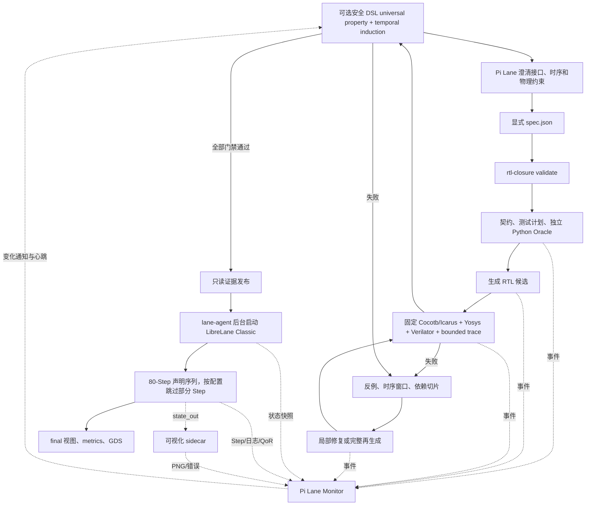

# RTL-Closure / Pi-Lane 自然语言 RTL 到 GDS 全流程说明

> 适用实现：`rtl-closure 0.7.0`、`pi-lane 0.6.0` / `lane-agent`、
> 运行镜像 `ghcr.io/librelane/librelane:3.0.5`。本文依据本仓库源码、配套
> Pi-Lane 0.6.0 公共接口以及固定 LibreLane 3.0.5 镜像的实现整理，不是概念性规划。

## 1. 文档目标与结论口径

这套系统把一段自然语言硬件需求转化为经过验证的 RTL，再送入 LibreLane 完成
RTL 到 GDS 的物理实现。它由三个完全隔离的层组成：

1. **Pi Lane 交互层**：理解自然语言、追问不明确的接口与时序、生成显式 JSON 规格，
   并持续向用户报告进度。
2. **rtl-closure 生成与验证层**：生成 RTL，构建独立参考模型与不可变验证闭包，
   执行反例驱动修复、回归、形式检查和发布门禁。
3. **lane-agent + LibreLane 物理实现层**：在隔离容器中执行 Classic Flow，采集每个
   Step 的状态、日志、QoR 和 GDS，并由独立 sidecar 保存布局可视化。

必须使用以下严格口径，不能把几个不同的“完成”混为一谈：

| 表述 | 可以成立的最小条件 | 不能据此声称 |
|---|---|---|
| 规格已创建 | JSON 已写入且 `rtl-closure validate` 成功 | RTL 已生成 |
| RTL 已生成 | 模型返回了候选 Verilog | RTL 正确或可综合 |
| RTL 已验证 | `verification.passed=true`，并通过配置要求的门禁 | 已发布或已有 GDS |
| 设计已发布 | 发布证据完整、哈希一致，文件进入独立设计目录 | LibreLane 已完成 |
| GDS 已生成 | `final/gds/` 中存在 GDS 视图 | DRC/LVS/QoR 一定通过 |
| 物理流程成功 | LibreLane 退出码为 0 | 所有缺失指标都隐含通过 |
| 签核门禁通过 | `qor.gate=pass`，且所需检查字段均存在并为 0 | 商业 signoff 或流片保证 |

`rtl-closure`、`pi-lane` 与 ORFS 控制器、状态、镜像和指标互不依赖。
当前物理层只接受经审查的开放 PDK：`sky130A`、
`gf180mcuD` 和 `ihp-sg13g2`。

当前格式边界固定为 orchestrator protocol 3、database schema 5、monitor checkpoint
schema 6、Lane run schema 6、Lane event schema 3 和 visualization manifest schema 3。
任何其他持久格式或 wire protocol 都会失败关闭，不转换状态，也不从其他目录推断 run。

## 2. 总体数据流和反馈流



反馈有两条独立来源：

- `rtl-closure` 每次生成、验证或修复状态变化都会原子更新 `state.json`，并把带
  `sequence` 的事件追加到 `events.jsonl`。
- `lane-agent` 每次查询都重新扫描 LibreLane 的真实 Step 目录、`state_out.json`、
  退出码、日志和指标，生成当前物理流程快照。它不依赖模型猜测“跑到哪一步”。

Pi monitor 默认每 10 秒串行读取这些来源。状态指纹变化立即报告；如果流程仍在运行
但没有变化，默认每 60 秒发送一次 heartbeat。因此“持续汇报”不是重复宣称完成，
而是由**阶段变化通知**和**无变化心跳**共同构成。

## 3. 自然语言怎样变成可执行输入

### 3.1 自然语言入口的真实边界

`rtl-closure` CLI 本身不直接接收一整段自由文本。自然语言由隔离的 Pi Lane agent
处理，agent 必须先明确以下信息，再生成 JSON 规格：

- 模块名、每个端口的方向和位宽；
- 无符号/有符号语义；
- 组合逻辑还是时序逻辑；
- 时钟边沿、复位极性、同步/异步复位；
- `start`、`valid`、`ready`、`busy`、`done` 等握手；
- 固定或可变延迟、吞吐率、结果何时有效；
- 同周期事件优先级以及溢出、饱和、截断等边界行为；
- PDK、Classic Flow、时钟周期、利用率、密度、die/core area 和并发数。

如果这些信息会改变硬件行为，agent 应追问，不能自行把模糊描述当成已确认协议。

### 3.2 `spec.json` 的五个部分

| 区域 | 关键内容 | 后续用途 |
|---|---|---|
| `intent_closure` | mode、用户确认、未决问题、assumptions、确认哈希 | 防止用户确认后意图表面被静默改写 |
| `design` | `name`、完整行为描述、`pdk`、端口、clock、reset、可选 `architecture` | 生成模块接口、行为契约、结构门禁和 SDC |
| `flow` | `name=Classic`、可选 `to`、mapped equivalence、可选物理规划、floorplan sizing、利用率、密度、可选 die/core area、jobs | 渲染 LibreLane `config.yaml` 并选择是否先运行 planner |
| `generation` | profile、可选 model、候选数、轮数、随机测试数、seed、thinking | 选择生成后端和预算 |
| `verification` | 原子需求、定向场景、修复/覆盖预算、bounded formal 和 universal property 配置 | 建立不可变验证闭包和发布门禁 |

示例规格显式选择 `gpt-5.6-sol`；`reasoning_effort` 缺省为 `xhigh`，0.7 只使用隔离的 API profile。
RTL-Closure 独立读取 `RTL_CLOSURE_PROVIDER`、`RTL_CLOSURE_MODEL`、
`RTL_CLOSURE_BASE_URL` 和 `RTL_CLOSURE_API_KEY`，不读取 Pi 状态。通过 Pi-Lane 启动时，
launcher 只向 orchestrator subprocess 注入缺失值；显式环境值优先。规格中不允许写 API
key、token 或其他凭据，凭据也不会进入 run state、事件、日志或容器。

`generation.model` 是可选的运行钉住项：规格中存在时优先于
`RTL_CLOSURE_MODEL`；不存在时使用环境变量。schema 不再偷偷填充模型默认值；两处都缺失会
得到 typed、不可重试的模型配置错误。

正式运行建议使用 `intent_closure.mode=required`。这要求用户明确确认、
`unresolved_questions=[]`、非空显式 requirements，并把
`rtl-closure intent-hash --spec ...` 输出的 SHA-256 写入
`confirmed_sha256`。哈希绑定 description、完整 interface、规范化 architecture、requirements 和 assumptions；
任一绑定内容变化都必须重新取得确认。它能证明“运行内容等于确认内容”，但不能推断用户
从未表达的隐含意图。

API 后端使用流式 Chat Completions。长推理请求拿到首个 SSE 事件后持续读取增量内容，
不会等待完整正文才让反向代理看到响应；每 30 秒还会写一次不含 prompt、RTL 和 reasoning
正文的存活心跳。默认同时运行 2 个候选，并可通过进程环境覆盖传输参数：

```bash
RTL_CLOSURE_MODEL_TIMEOUT_SECONDS=900  # 连续无数据超时，范围 30..3600
RTL_CLOSURE_MODEL_MAX_RETRIES=2        # 首次之外的重试次数，范围 0..8
RTL_CLOSURE_MODEL_CONCURRENCY=2        # 同时候选数，范围 1..8
```

只有连接错误、客户端 timeout、HTTP 408/409/425/429 和 5xx 会重试；若网关给出
`retry_after`/`Retry-After` 则遵守该退避（最多 300 秒），最后一次失败后不再额外等待。
单个候选失败会保留为空候选并继续评估同批成功结果；只有整批全部失败才终止该模型调用。

`design.architecture` 只接受当前可机器检查的五类约束：

- `required_modules`：必须从 top 可达且至少实例化一次的合法 Verilog 模块名；
- `forbidden_operators`：只允许枚举 `multiply`、`divide`、`modulo`；
- `min_sequential_bits` / `max_sequential_bits`：generic synthesis 后的时序位数上下限。该指标
  不是 RTL 状态变量位宽的简单相加；memory lowering 和综合优化可能增加或复制地址寄存器，
  因而规格校验拒绝相等的上下限，必须提供带余量的范围；
- `max_synth_cells`：generic synthesis 后的最大 cell 数。

未提供 `architecture` 时，审计结果为 `not_requested`，仍会生成并发布证据；提供后任一
约束失败都会阻断发布。这里检查的是可达层次、Yosys 运算符 cell 和 generic netlist
统计，不能证明某个子模块承担了自然语言声称的全部微架构职责。

`flow.floorplan_sizing` 只接受 `relative` 或 `absolute`，默认是 `relative`。只有显式
`absolute` 才允许并要求同时给出 `die_area` 和 `core_area`；`relative` 禁止携带这两个
面积字段。不要给小设计无条件套用固定 300 x 300 的 die。

`flow.physical_planning_mode` 默认是 `off`。`auto_safe` 会在最终 Lane 运行前启动
Pi-Lane 0.6 的证据绑定 planner；`reference_locked` 还要求一个绝对、普通文件形式且
SHA-256 内容绑定的 geometry lock。可选 policy 同样按绝对路径和内容哈希绑定。规划失败
属于物理/基础设施失败，不得触发新一轮 RTL 修复；随包 bootstrap policy 的
`publishable` 为 `false`，不能据此声称已经标定 QoR 或完成 signoff。

形式验证有两套独立配置，不能混为一个“formal”：

- `formal_mode` / `formal_depth` / `formal_timeout_seconds` /
  `formal_total_timeout_seconds` 控制冻结输入轨迹的 bounded checkpoint 检查；前者是
  单个 Yosys 进程时限，后者默认 3600 秒并限制完整 obligation manifest；它不是
  universal proof。
- `universal_mode` / `universal_properties` / `universal_induction_depth` /
  `universal_timeout_seconds` 是整组显式安全性质共享的符号证明 deadline；持久化运行会按 RTL、性质、harness 和镜像身份复用已完成的确定性证明，只重跑未决项。默认 `universal_mode=off`、性质为空；
  induction depth 范围 2..64，整组 deadline 在规格中为 10..900 秒。

`off` 要求 universal properties 为空并固定产出 `not_requested` 证据；`advisory` 会执行
所给性质，明确反例仍阻断候选，但 retry 后的 `unknown/error` 只作为不确定证据保留；
`required` 至少需要一条性质，且每条都必须得到 temporal-induction `pass`。required 下的
`unknown/error/not_requested`、缺失性质、property count/hash 不一致或任何不完整证据都会
阻断，不得降级为 advisory。

### 3.3 启动命令和同步/异步语义

```bash
rtl-closure doctor
rtl-closure validate --spec /absolute/path/spec.json
rtl-closure start --spec /absolute/path/spec.json
rtl-closure reconcile --run-id <run-id> --json
rtl-closure report --json
rtl-closure stop --run-id <run-id> --json
```

- `doctor` 检查 Docker、模型配置、`lane-agent`、验证镜像、Cocotb、Verilator、
  Yosys formal 等依赖。
- `validate` 只做规格结构和约束校验；失败时不会创建 run。
- `start` 建立 run 目录并派生后台 worker，返回只表示“后台任务已创建”。
- `status --json` 和 `report --json` 是纯读快照；常驻编排器调用 `reconcile --json`
  推进 child 状态并写入终态事件。查询失败 run 仍返回退出码 0，非零只表示查询或协议失败。
- `stop --json` 是带确认的控制协议，不是只发送信号。退出码 0 只说明控制调用和响应协议
  成功；调用方仍必须检查返回的 `status`、`phase`、`failure_code` 和活动 Lane attempt 状态，
  不能把“拿到 JSON”直接解释为 `stopped`。

启动后必须立即查询一次 `rtl-closure report --json`。任何后续进度问题都应重新
查询，不能复用旧快照。

## 4. rtl-closure：从规格到可信 RTL

### 4.1 后台 run 与持久状态

每次运行创建：

```text
~/.local/state/rtl-closure/<run-id>/
  spec.json                 # 规范化输入
  state.json                # 当前状态快照，原子替换
  events.jsonl              # 追加式事件日志，带 sequence
  pipeline.log              # 后台 worker stdout/stderr
  attempts/                 # 初始候选和每个修复候选的完整证据
  adaptive/                 # 反例衍生的追加式测试 epoch
  ...                       # 契约、oracle、回归、formal、发布证据
```

初始 `status=running, phase=queued`。worker 使用新的进程会话后台运行。需要对外记录
的 `_update` 会更新 `state.json`、增加 `event_sequence` 并追加一条事件；PID 注册、
child 状态刷新等 `record_event=false` 的内部更新只刷新快照，避免制造重复事件。顶层
终态为 `completed`、`incomplete`、`failed` 或 `stopped`。

每条事件固定保存 `sequence`、`timestamp`、`status`、`phase`，并带当时的
`model_request`、`repair`、`coverage`、`verification` 和 `error` 摘要。候选在同一
phase 中变化或模型请求发出、连通、心跳、完成、重试、失败时也会产生新 sequence，
因此 monitor 不必等 phase 名变化才报告真实进度。`model_request` 只记录请求序号、候选、
attempt、活动请求数、耗时、chunk 数以及可选 HTTP/Ray 信息，不记录模型输入输出正文。

新写入的 schema v3 事件包含 `previous_event_sha256` 和 `event_sha256`。读取 state 时会从
第一条记录开始重算每条 event identity、连续 sequence、自身摘要和前驱链接，并要求
`state.event_sequence` 精确指向已验证的尾事件，已持久化的 `state.last_event_sha256` 也必须
与尾摘要一致；不能只验证最后一条记录。schema v3 尾事件的 `status`、`phase`、
`failure_class`、`failure_gate`、`failure_code` 还必须与 `state.json` 的关键状态投影一致，
因此只篡改 state 结论、但保留完整事件链也会 fail-closed。`event-pending.json` 作为 WAL
只恢复可由同一 durable state 唯一推导的提交；
身份、revision、state hash 或前驱不一致时拒绝猜测性恢复。

### 4.2 生成与验证阶段详表

| 顺序 | 对外 phase / 动作 | 实际执行 | 主要产物 | 成功条件与反馈 |
|---:|---|---|---|---|
| 1 | `queued` | 保存规范化规格，注册后台 worker PID | `spec.json`、`state.json`、`pipeline.log` | start 返回 run ID；此时没有 RTL |
| 2 | `model_initializing` | 将验证镜像和通用无网络 sandbox 镜像 tag 分别解析为 immutable image ID，绑定本次运行，再安装隔离 cross-verify hook 和加载流式模型后端 | 两个镜像身份、公开模型标识、streaming/timeout/retry/concurrency | 任一镜像/模型不可用则 `failed`，保留原始错误；运行中不再解析可变 tag |
| 3 | `contracting` | 把自然语言行为拆成原子 requirement；生成只含输入动作的 directed scenarios | 内存中的 contract/test plan | 端口、采样相位、reset、scenario 结构必须合法 |
| 4 | `contract_frozen` | 写入只读初始契约和测试计划草稿 | `contract.json`、`testplan-draft.json` | 报告 requirement/scenario 元数据和路径 |
| 5 | `oracle_generating` | 生成至少两个带 provider/model/source provenance 的 Python oracle 候选；候选执行相同场景，只有候选间多数一致才能选中 | `oracle-candidates/`、`oracle-origins.json` | reviewer 只审计，不算独立票；required diversity 按去重来源计数，同一来源重复 completion 只计一次 |
| 6 | `coverage_refining` | 统计 oracle 可执行行覆盖；模型只能补充**输入场景声明**，控制器验证唯一性、端口和值域、cycle budget 后再运行 oracle | `coverage-refinement/` | 每轮报告覆盖率、目标、轮次、剩余预算、增加场景数 |
| 7 | `coverage_refinement_completed/warning/error` | 按 `off/advisory/required` 结束覆盖细化 | `coverage-refinement.json` | required 未达目标/预算耗尽/出错时在 RTL 前失败；advisory 保留 warning/error 后可使用已验证 base suite |
| 8 | `oracle_quorum_revalidating` | 所有 oracle origin 在覆盖细化后的最终 plan 上重新执行并形成最终 quorum | `oracle-final-quorum/`、`oracle-quorum.json` | 最终 plan 上必须再次一致并复核来源 diversity，不能沿用旧投票 |
| 9 | `oracle_frozen` | 写入选定 oracle、最终 test plan、expected trace 和四者哈希清单，并设为只读 | `reference_model.py`、`testplan.json`、`expected-trace.json`、`frozen-manifest.json` | 后续每次验证前后都重算哈希；修复模型无权修改这些文件 |
| 10 | `generating` | 用 RTL-Closure Verilog agent 流式生成多个 RTL 候选和多轮交叉尝试；Python 角色被固定 oracle 替代 | `question.txt`、`interface.sv`、`rtl_closure-result.json`，state/event 中的 `model_request` 心跳 | 记录 candidate/attempt/active、matched、best match rate、turn；部分候选失败不丢弃成功候选，即使未全匹配也只作为初始候选进入受控修复 |
| 11 | `initial_candidate_ready` | 规范化顶层模块名并确认候选非空 | 初始 RTL（尚未发布） | “候选已就绪”不代表验证通过 |
| 12 | `directed_verification` | 对候选执行策略、接口、综合、仿真和配置要求的额外验证，见 4.3 | `attempts/000/` | 报告 round=0、latest attempt、失败类别或通过结果 |
| 13 | `repair_refining_tests` / `repair_suite_extended` | 从新反例确定性地产生邻域场景；独立 oracle quorum 生成期望；只追加新 epoch | `adaptive/epoch-NN/`、`adaptive-corpus.json` | 每个 epoch 绑定父 suite 哈希、plan/trace 哈希、oracle/quorum 证据和 epoch 哈希 |
| 14 | `repair_diagnosing` | 把 failure packet、历史反例、覆盖缺口、依赖切片和被拒原因交给模型，要求结构化局部编辑建议 | prompt/response 与 attempt 记录 | 模型只提出候选，不直接覆盖 champion |
| 15 | `repair_regenerating` | 未授权局部编辑或连续停滞达到阈值时，生成完整 RTL 候选 | 候选集合 | 完整再生成仍需经过同一不可变 suite，不是绕过验证 |
| 16 | `repair_evaluating` | 每个候选在当前完整 suite 上独立执行 4.3 的门禁 | `attempts/<round>-candidate-<n>/` | 持续报告 round、candidate/count、strategy、latest attempt |
| 17 | `repair_candidate_completed` | 计算候选分数，并检查所有 champion 已通过 check 是否仍通过 | `verification-result.json`、失败时 `failure-packet.json` | 只有“无历史回归且分数严格提高”才 eligible |
| 18 | `repair_accepted` | 用 eligible 候选替换 champion；若完全通过则结束修复 | `repair-history.json`、`counterexamples.json` | 报告 accepted、score、bounded formal/universal/lint 状态和反例数 |
| 19 | `repair_rollback` | 本轮没有严格改进时保留原 champion，不写坏版本 | 同上 | 报告 stagnation 及下一步 `retry` 或 `regenerate` |
| 20 | `formal_running/retrying/completed` | 仅当仿真先通过时，运行 Verilator lint 与分批 Yosys bounded-trace formal；每批 pass 要求 return code 0 且每条 obligation 都有显式 SAT SUCCESS；unknown/error 各重试一次 | attempt 下 `formal-evidence/`，最终 `formal-report.json`、`formal-properties.json`、`formal-execution-evidence.json`、`verilator-lint.json` | 只有可解析且目标信号取值确实反例的 CEX 才进入修复；required 模式的连续 unknown/error 或 selection/batch/聚合证据不完整都会失败，且基础设施错误不交给 RTL 模型伪修复 |
| 21 | `universal_formal_running/retrying/completed` | bounded/lint 后，对每条安全 DSL 性质分别构造 symbolic-input harness 并运行 Yosys SAT temporal induction；unknown/error 重试一次 | attempt 下 `universal-evidence/universal-properties.json` 及每条性质的 harness/script/log/CEX | 任意 fail 作为 `universal_counterexample` 进入修复；required 模式必须全部证明，inconclusive/incomplete 阻断 |
| 22 | `regression` 或 `repair_exhausted` | 校验 adaptive 哈希链，重放最终 active suite 的 oracle quorum，并固化最终 RTL/结果 | `<design>.sv`、`verification-result.json`、`final-suite-quorum.json` | `verification.passed=true` 才进入发布；耗尽则写 `last-failure.json` 后失败 |
| 23 | `release_validating` | 再查 RTL 策略与精确接口 | 无新设计状态 | 任一错误阻断发布 |
| 24 | `independent_verification` | 用两个独立 seed 各跑一次发布随机验证；行为反例进入同一候选修复/回归/回滚闭环 | schema 3 `independent-verification.json`、`independent-repair/` | 两次完整 trace 都必须重算一致；每次开始/通过都会单独反馈，非 RTL 错误立即停止 |
| 25 | `release_yosys_check` | 对最终 RTL 再执行 Yosys read/hierarchy/check | `yosys-check.log` | 综合检查非零即阻断 |
| 26 | `release_architecture_audit` | 在 pre-synth hierarchy 和 generic synthesized netlist 上检查显式结构约束 | `architecture-audit.json` | 有约束时必须全部 pass；无约束时固定记录 `not_requested` |
| 27 | `release_synthesis_equivalence` | 独立解析两份 RTL，一侧只 lower，另一侧执行 `synth -flatten`，用 Yosys equivalence + 8 深度时序归纳比较 | `synthesis-equivalence.json`、`synthesis-equivalence.log` | `equiv_status -assert` 必须成功；这是 generic synthesis equivalence，不是 PDK/signoff LEC |
| 28 | `publishing` | 检查 fixed evidence（包括 universal status、RTL/property hash 和 property count），在 staging 中复验后原子发布，只读化证据 | `~/.local/state/rtl-closure/published-designs/rtl_closure_<name>_<time>_<hash>/` | 防止发布前后 TOCTOU、性质遗漏或证据被替换 |
| 29 | `completed` 或 `starting_lane` | `--generate-only` 到此完成；否则调用 `lane-agent start` | `lane_run_id` | lane start 成功只代表物理后台任务已创建 |
| 30 | `lane_running` / `lane_<active-Step-ID>` / 子终态 | 常驻编排器调用 `rtl-closure reconcile` 合并 lane-agent 当前状态；`report` 只读聚合快照 | 聚合 report | 物理失败不改写已经完成的 RTL 验证证据，但全流程状态会报告失败 |

契约规划时，模型只允许返回声明式 requirement 和**输入动作**，不允许给 expected
output 或测试代码。用户显式提供的部分保持不变；模型 JSON 仍要通过同一 spec validator。
如果规划失败，控制器使用确定性的 requirement 和 boundary/one-hot 场景 fallback。
最终 plan 还加入两个冻结随机序列，seed 为基础 seed 加 1009 和 2027，每个长度由
`random_regression_cycles` 决定。它们属于 active suite；发布阶段同样使用两个偏移 seed
做 `independent_verify_tests`，但那是独立的第二层 release cross-verification，不能用
其中一层替代另一层。

Oracle 候选分别通过策略检查并在无网络、只读、资源受限的容器中运行整个 plan。
有效候选中必须至少两个 origin 产生同一 behavior hash，且该组票数严格超过全部有效
候选的一半。每个 origin 保存 provider/model/source provenance；来源 diversity 对相同
provider/model 去重，`oracle_diversity_mode=required` 不足时在 RTL 前失败，重复调用同一
来源不能冒充 provider-independent quorum。额外 reviewer 只有在行为仍等于共识时才能
改进所选代码，并且不计入票数。覆盖细化后所有 origin 必须在最终 plan 上重新投票；
selected oracle、重放 trace、来源审计和之前冻结的行为哈希必须一致。

初始 RTL 生成使用 best-of-N Verilog 候选；RTL-Closure 的 Python 角色被 `StaticBackend`
固定为冻结 oracle。每轮用随机 cross-verification 比较 RTL 与 oracle，只在 match rate
严格提高时更新 best candidate，并把 compile/mismatch 反馈给下一轮；达到 1.0 或耗尽
`max_turns` 时结束。这里的 `matched=true` 仍不是发布条件；非空但未完全匹配的 best RTL
会进入下面的正式冻结 suite 修复环。

### 4.3 单个 RTL 候选的固定验证次序

每一个初始或修复候选都按以下顺序执行，前一关失败就记录失败并停止该候选的后续关：

1. 规范化 top module，拒绝违反 RTL policy 的内容。
2. 精确比较模块名、端口名、方向和位宽。
3. 用 Yosys 做语法、层次和可综合性检查。
4. 如果规格声明 architecture，先检查可达模块、禁用运算符、时序位数和 generic cell 数。
5. 在配置的 `rtl-closure/verify:0.4.0` tag 容器中用 Cocotb + Icarus 执行冻结 suite。
6. 执行 reset/dirty-state probes，避免候选只在“碰巧为零”的初始状态通过。
7. 比较每个场景、cycle、phase 和 output，保存 actual trace、内部状态快照、覆盖摘要；
   模拟器若产生 FST/VCD，记录其路径。
8. 只有仿真通过后才运行 Verilator lint 和 Yosys internal SAT bounded-trace properties。
9. 前层未以 required infrastructure error 终止时，合并 bounded/lint 结果后运行独立的
   安全 DSL universal properties；每条性质使用 symbolic inputs 和 temporal induction，
   明确反例会回到同一修复闭环。
10. 再次校验冻结文件哈希，防止验证期间 contract、plan、oracle 或 expected trace 被修改。

运行开始时同时解析专用验证镜像和通用 sandbox 镜像，校验 Docker `sha256:<image-id>`，
把配置 tag、image ID 和可用 repo digest 写入 state/release gate。Cocotb、formal、universal
使用冻结的验证 image ID；Oracle、随机复验、Yosys、架构审计和综合等价使用冻结的
sandbox image ID。运行中不再解析可变 tag；重建或重定向同名 tag 只影响新 run。

RTL policy 明确拒绝 `` `include``、`initial`、声明初始化、`#delay`、`force/release`、
DPI、文件 I/O 和系统任务等不适合作为目标 ASIC RTL 的结构。接口门禁要求端口顺序、
名称、方向、宽度和 signed 属性全部精确匹配。

对每个要求 reset 的 scenario，Cocotb driver 的 reset/dirty sequence 由控制器固定：先做
asserted prime edge 和 deasserted prime edge；把非 reset 输入置最大值并运行两个 dirty
probe edge；重新 assert reset（异步 reset 还会在时钟边沿之间采样）；连续保持 3 个
asserted edge；再 deassert，最后才执行正式 scenario cycles。每个采样点逐输出比较，
X/Z 归类为 `unknown_value`，reset phase 错误为 `reset_mismatch`，其他为
`value_mismatch`，并保存 check ID、phase、inputs、expected、actual 和内部信号。

形式属性来自冻结 trace checkpoint，而不是让修复模型自由编写。控制器按“目标输出、期望
值、实际送入 Yosys 的输入前缀”计算 canonical obligation；语义相同的 checkpoint 只执行
一次，同时保留全部 scenario、requirement、cycle 和 alias provenance。所有受支持且
eligible 的 unique obligation 都会执行。初始单批为 32；rc137/OOM 时只把受影响范围拆为
16、再拆为最小 8，绝不删减 required property。`formal_timeout_seconds` 限制单个进程，
`formal_total_timeout_seconds` 限制完整 manifest。每个通过或有真实反例的 batch 都写入
checkpoint，相同 RTL/suite/property/image 哈希重试时可复用，身份不一致则拒绝复用。
`pass` 只表示全部冻结输入前缀的 checkpoint
通过，`universal_proof=false`，不能把有界检查描述为无限状态空间的完整证明。在
`required` 模式下，selection、任一 batch 或最终聚合证据不完整都会以
`formal_incomplete` 阻断。配置、capacity、deadline、infrastructure 和 evidence-integrity
错误带结构化 `repairable=false`，在 repair prompt 和模型调用之前 fail-fast，不会再触发
确定性无效的 RTL regeneration。Yosys formal 会清除 RTL declaration initializer 的 init
属性，执行 `async2sync/flatten/memory_map`，按冻结输入前缀逐 cycle 设置输入，再对目标输出
做 bounded `sat -prove`；失败时保存 WaveJSON counterexample。resetless、
`reset_before=false` 或没有输出 checkpoint 等当前无法可靠建模的场景会显式列为
unsupported/excluded；它们不会被静默当作已执行，并会使 required selection 不完整。

Verilator 虽以 `--Wno-fatal` 收集完整 warning，但控制器另有生成 RTL 质量门禁：
`LATCH`、`MULTIDRIVEN`、`PINMISSING`、`SELRANGE`、`UNDRIVEN`、`UNOPTFLAT`、
`WIDTH`、`WIDTHCONCAT`、`WIDTHEXPAND` 和 `WIDTHTRUNC` 都会使候选失败。style/unused
warning 仍进入 `warning_counts`，但当前不阻断。发布器要求 lint status 与
`quality_gate.status` 都为 pass、blocking code 为空且证据绑定最终 RTL hash。

行为覆盖也分层表达。scenario 的 `requirement_ids` 只是规划关联，不能自动算作 condition
hit；报告分别记录 associated cycles、实际 I/O observation 和显式机器判定的
`requirement_hits` / `coverage_hits`。没有显式 predicate hit 时，即使场景标签关联且 I/O
被观察，requirement 也只会是 `associated_only` 或 `observed`，不会伪报 `passing`。
`oracle_line_coverage` 仅统计 Python `TopModule` 可执行源码行，不代表 RTL
branch/condition/toggle/FSM 或功能覆盖。

### 4.4 安全 DSL 与通用性质证明

universal 层不接收 SystemVerilog assertion 字符串或模型生成的任意 HDL，只接收严格
JSON 数据。每条性质固定为：

```json
{
  "id": "PROP_DONE_IMPLIES_IDLE",
  "kind": "always_implication",
  "requirement_ids": ["REQ_DONE_PULSE"],
  "antecedent": {"port": "done", "at": "current"},
  "consequent": {
    "op": "eq",
    "left": {"port": "busy", "at": "current"},
    "right": {"const": 0, "width": 1}
  }
}
```

安全 DSL 的真实边界如下：

- 最多 64 条性质；每条最多 256 个 expression node、深度最多 32；`id` 必须唯一。
- `kind` 只能是 `always_implication`，antecedent 和 consequent 都必须是一位布尔表达式。
- port expression 为 `{"port":"name","at":"current"}` 或把 `at` 设为 `previous`；只能引用声明过的
  top-level 数据/状态输入或输出。clock 和 reset 由 harness 控制，规格校验明确禁止引用；
  internal register、memory element 和层次信号也不可引用。
- constant 为非负整数并显式给 `width`。二元运算两侧位宽必须一致。
- 支持一位 `not`，2..32 项的一位 `and/or`，以及 `eq/ne`、无符号比较
  `ult/ule/ugt/uge`、
  `bit_and/bit_or/bit_xor`、`add/sub`。DSL 不支持任意 HDL、liveness/eventuality、
  memory index 或乘除模运算。
- 每条性质必须绑定至少一个已声明 `requirement_ids`；未知 requirement 在 spec validate
  阶段被拒绝。反例因此可以回到对应 requirement，而不是成为无来源的 formal 日志。

`current` 是当前上升沿前的 port sample，`previous` 是前一个 post-reset 上升沿 sample。
harness 对除 clock/reset 外的所有输入在每个采样周期使用任意但 defined 的符号值，并在
一拍 warmup 后断言 implication。有 reset 时先从任意 defined DUT state 施加两个 asserted
reset edge，再开始 post-reset 证明；无 reset 时初始 DUT state 保持任意 defined。

每条性质独立生成私有 wrapper、`assert` 和 Yosys script，执行
`sat -set-init-def -set-def-formal -seq <depth> -tempinduct -prove-asserts -verify`。只有日志给出
temporal induction success 才记为 `status=pass, universal_proof=true`，此时性质对 DSL
scope 中所有符号输入轨迹和无限时间范围成立，而不是有限向量 replay。每条的 harness、
script、log 及失败时 WaveJSON counterexample 都保存在 attempt 的 `universal-evidence/`；
汇总证据为 `universal-properties.json`，绑定 RTL hash、规范化 properties hash、数量、
requirement IDs、scope 和每条 verdict。它还固定声明 capabilities/limitations，并分别列出
covered、uncovered、fully-proven、failed 和 inconclusive requirement IDs。这里的 covered
仅表示至少一条性质引用该 requirement；这种 traceability 不能证明自然语言需求已经被完整
形式化。因此报告固定设置 `semantic_completeness_claimed=false`、
`complete_behavioral_proof=false` 和 `complete_requirement_proof=false`。

三种模式的门禁严格独立于 `formal_mode`：

| `universal_mode` | 规格约束 | `pass` | `fail` | retry 后 `unknown/error` 或不完整证据 |
|---|---|---|---|---|
| `off` | properties 必须为空 | 不运行，记录 `not_requested` | 不适用 | 发布仍要求同 RTL/空 property hash 的证据 |
| `advisory` | properties 可为空 | 记录通用证明 | **始终拒绝候选并进入修复** | 保留证据，允许其他门禁继续，但不能称为证明通过 |
| `required` | 至少一条 property | 必须每条均 pass | **始终拒绝候选并进入修复** | 重试后阻断为验证基础设施/完整性错误，不交给模型伪修 RTL |

### 4.5 反馈包、候选选择和回滚

失败会被标准化为 `failure-packet.json`，主要包含：

- `failure_class`、scenario、requirement、首个失败 cycle/ordinal；
- 失败 signal 的 expected、actual、inputs；
- 失败点前后固定窗口的时序 trace；
- internal-state delta 和同周期 mismatch cluster；
- 从 RTL 读写关系得到的 suspect block dependency slice；
- bounded formal 或 universal counterexample，以及 lint 摘要；
- suite hash、slice hash 和反例 fingerprint。

候选分数按以下字典序比较：

1. 完全通过的候选优先；
2. 对行为错误，首个失败位置越晚越好；
3. mismatch 越少越好；
4. 编译、接口、策略、综合、仿真基础设施和 required formal/universal unknown/error 属于最低档。

更重要的是，候选必须保留 champion 的全部 `passed_check_ids`，且候选和 champion 的
`suite_sha256` 必须相同。否则无论模型如何解释，都回滚。这个机制实现了
AutoVeriFix 风格的“反例 -> 定位 -> 候选修复 -> 全量回归 -> 接受/回滚”；
独立 oracle quorum、不可变 expected trace、多 seed 发布复验和证据哈希则实现了
Veri-Sure 风格的验证可信度约束。当前实现是对两者思想的原生构建，**没有导入或依赖
AutoVeriFix/Veri-Sure 外部仓库**。示例运行钉住 `gpt-5.6-sol`、`xhigh`；未钉住模型时按
上述唯一优先级从 `RTL_CLOSURE_MODEL` 解析。

独立随机验证不是 repair loop 之外的一次性终点。passing champion 进入 release candidate
阶段后执行两个独立 seed；任一行为 mismatch 都会被标准化为带 seed、test index、expected、
actual 和精确输入向量的独立反例，并进入“定位 -> 完整 RTL 候选 -> 全量 frozen/adaptive
回归 -> 相同双 seed 复验 -> 接受/回滚”闭环。独立随机 transcript 不会被伪装成新的
adaptive suite epoch；已有 frozen/adaptive suite 保持不变，并在每个候选上完整重跑。只有新
champion 再次通过全部门禁和两个独立 seed，`independent-verification.json` 才能成为
release evidence。容器超时和证据完整性错误按不可修复基础设施/验证证据错误停止；普通
SystemVerilog 编译或仿真错误仍可作为 RTL 修复反馈，但候选必须重新通过全部既有门禁。

`independent-verification.json` schema 3 把控制器可信字段与 verifier 原始输出分层：每个
run row 只允许 `run`、`seed`、`num_tests`、`passed`、`verification` 五个顶层字段，完整
verifier transcript 只能位于 `verification` 内，不能覆盖控制器记录。发布时重新从冻结
spec 推导两个 seed、测试数和最大修复轮数，校验 round/candidate 唯一性及完整反例集合，
按端口声明重放 stimuli 的键、位宽、取值范围和顺序，要求两侧 trace 的每个输出都是完整、
具体且位宽内的整数，再从 trace 逐项重算 mismatch 和 match rate。
送入修复模型的独立反例按 seed 与首失败指纹去重，只保留确定性的最早失败切片；单值
上限 4 KiB、整个切片上限 32 KiB。未截断的原始证据仍完整保存在报告中。

### 4.6 发布目录和证据

成功发布目录的核心结构为：

```text
~/.local/state/rtl-closure/published-designs/<design-slug>/
  src/
    <top>.sv
  config.yaml
  constraints.sdc
  pin_order.cfg
  spec.json
  reference_model.py
  rtl_closure-provenance.json
  verification/
    contract.json
    testplan.json
    expected-trace.json
    frozen-manifest.json
    oracle-origins.json
    oracle-quorum.json
    final-suite-quorum.json
    coverage-refinement.json
    adaptive-corpus.json
    verification-result.json
    repair-history.json
    counterexamples.json
    independent-verification.json
    yosys-check.log
    architecture-audit.json
    universal-properties.json      # 所有模式都要求；off 为 not_requested
    universal-execution-evidence.json # 确定性 harness/script 与原始 Yosys transcript
    synthesis-equivalence.json
    synthesis-equivalence.log
    formal-report.json             # formal_mode != off 时要求
    formal-properties.json         # formal_mode != off 时要求
    formal-execution-evidence.json # executed、DUT hash、script/log、returncode、SUCCESS 计数
    verilator-lint.json            # 启用 lint 时要求
```

发布时不是简单复制 RTL。控制器要求固定证据集合完整，`architecture-audit.json` 的
状态、RTL hash 和约束 hash 必须匹配；`universal-properties.json` 必须绑定同一 RTL、
规范化 property hash 和 property count，并符合 off/advisory/required 的 verdict 规则；
发布器还会从 spec 重建每条 universal harness/script，并用原始日志重新计算 verdict。
bounded formal 同样从 active suite 重建完整 obligation map 和每批 Yosys script，核对
DUT、原始 transcript、returncode、逐 obligation SUCCESS 计数、状态和完整性，不能用仅含
`status: pass` 的摘要代替执行证据；
`synthesis-equivalence.json` 必须是 schema v3、同一 RTL 的
`post_reset_observable_outputs_rtl_vs_generic_synthesized_netlist`（有 reset）或
`observable_outputs_rtl_vs_generic_synthesized_netlist`（无 reset）pass。发布 obligation
严格等于全部顶层输出 bit；同名内部匹配点只能辅助 induction relation，不能因综合合法重编码
内部状态而误判发布失败。有 reset 时还必须存在两拍 reset 加默认 8 拍 post-reset 的 base
proof。所有文件哈希与 release gate 一致；然后在
staging 中重新验证 oracle epoch chain 和 final suite quorum，最后才替换到正式目录。
`publication-manifest.json` schema 2 对 `reference_model.py`、核心配置/RTL 和
`verification/` 下每一个文件（包括 adaptive epoch）记录大小与 SHA-256；读取发布物时会
重新枚举验证目录，遗漏、替换、删除、增加或 symlink 均 fail-closed。独立的 Lane input
manifest 只绑定物理流程实际消费的配置、RTL、约束、pin order 和 required EQY 脚本。

universal proof 在每个通过基础仿真的候选上运行，最终 passing champion 的汇总被固化到
run 根目录。进入 release 后依次做独立随机复验、最终 Yosys、architecture audit 和
generic synthesis equivalence，再在 fixed-evidence 校验中复验该 universal 汇总的
RTL/property hash、数量、status 和 `universal_proof`：required 只接受
`pass + universal_proof=true`；advisory 接受明确标注的 pass 或 inconclusive，但不接受
任何 property fail；off 只接受 `not_requested`。全部成立后才原子发布。

## 5. lane-agent：启动、跟踪和解释 LibreLane

### 5.1 交接配置

发布后的 `config.yaml` 由规格确定性生成，主要包含：

```text
meta.version / meta.flow
PDK
DESIGN_NAME
VERILOG_FILES
CLOCK_PORT / CLOCK_PERIOD
PNR_SDC_FILE / SIGNOFF_SDC_FILE
FP_SIZING=relative（默认）或 absolute
FP_CORE_UTIL
PL_TARGET_DENSITY_PCT
IO_PIN_ORDER_CFG
RUN_EQY（`mapped_equivalence_mode=required` 时为 true）
STD_CELL_LIBRARY（可选）
```

默认不写 `DIE_AREA` / `CORE_AREA`，让 LibreLane 依据综合面积与 `FP_CORE_UTIL` 定尺寸。
只有显式或兼容判定为 absolute 的规格才写这两个面积。发布时还会生成稳定的
`pin_order.cfg`：clock/reset 放南侧，其他输入在西/南两侧按负载平衡，输出在东/北两侧
平衡；多位端口用 bus regex 保持成组。`config.yaml` 通过
`IO_PIN_ORDER_CFG: dir::pin_order.cfg` 引用它，避免总线位在芯片边界被任意拆散。

`constraints.sdc` 创建主时钟，并给非时钟输入和输出设置为周期 20% 的 delay。随后
`rtl-closure` 执行：

```bash
lane-agent start \
  --config <published-design/config.yaml> \
  --pdk <open-pdk> \
  --flow Classic \
  --json \
  [--to <LibreLane-Step-ID>] \
  [--jobs <n>]
```

只有命令退出码为 0、stdout 是 JSON object 且其中包含 `run_id`，交接才成功。
`rtl-closure` 不导入 LibreLane，也不在生成 worker 内执行物理实现；交接完成后，
LibreLane 由独立的 `lane-agent` 进程和状态目录管理。

### 5.2 启动前校验

直接启动物理流程时可使用：

```bash
lane-agent doctor --pdk sky130A --json
lane-agent image-install
lane-agent image-status
lane-agent pdk-install --pdk sky130A
lane-agent pdk-status
lane-agent start --config /absolute/path/config.yaml --pdk sky130A --jobs 4 --json
lane-agent status --json
```

`start` 在创建后台任务前检查：

- 配置必须是 JSON/YAML，`DESIGN_NAME` 必须是合法标识符；
- PDK 只能是 `sky130A`、`gf180mcuD`、`ihp-sg13g2`；
- flow 缺省为 `Classic`；validated range/resume 只支持固定的 Classic；
- jobs 范围为 1..256，`from/to` 必须是版本化 80-Step registry 中的精确 ID，range 倒置
  会在启动前拒绝；普通 `start --from` 因没有可信 initial State 而拒绝；
- `--set KEY=JSON_VALUE` 的 key 和 JSON value 都合法；identity、PDK、RTL/SDC、flow，
  以及 `RUN_*`/`ERROR_ON_*` 等门禁字段禁止覆盖；
- 固定 LibreLane 镜像实际存在，并保存其 image digest；
- 目标 PDK 已安装在隔离根 `~/.ciel-pi-lane`，enabled path 与 LibreLane 3.0.5 固定 Ciel
  revision 精确匹配，且重算的聚合 tree SHA-256/file count/total bytes 与持久 manifest
  一致；tree digest 遍历每个相对路径、大小和内容，manifest 不保存逐文件哈希清单；
- 同一配置 SHA-256 和 PDK 的 active run 默认不能并发。

镜像安装、PDK 安装和设计运行是三种不同 run。镜像安装成功不能推导 PDK 已安装，
PDK 安装成功也不能推导设计流程已经开始。

### 5.3 主流程容器和后台语义

实际命令等价于：

```text
docker run --rm --init --name pi-lane-<run-id>
  --network none --read-only --cap-drop ALL
  --security-opt no-new-privileges --user <uid>:<gid>
  --tmpfs /tmp:rw,nosuid,nodev,size=2g
  -e HOME=/tmp -e PDK_ROOT=<isolated-pdk-root>
  -v <design-dir>:<design-dir>:rw
  -v <pdk-root>:<pdk-root>:ro
  -w <design-dir>
  ghcr.io/librelane/librelane:3.0.5
  python3 -m librelane --manual-pdk --pdk-root <root> --pdk <pdk>
  --flow Classic --run-tag PI_LANE_<run-id> --hide-progress-bar
  [--jobs N] [--with-initial-state STATE] [--from STEP] [--to STEP]
  [--override-config KEY=JSON] <config>
```

该命令由 `subprocess.Popen(..., start_new_session=True)` 后台启动，stdin 为 `/dev/null`，
stdout/stderr 合并追加到 `build.log`。wrapper 在主命令结束时原子写入 `exit_code`。
所以 `lane-agent start` 返回后，最可靠的第一句话是“run 已启动”，而不是“流程完成”。

控制器状态目录与 LibreLane 产物目录分开：

```text
~/.local/state/lane-agent/<run-id>/
  state.json
  build.log
  exit_code
  visualizer.log
  visualizer_exit_code

<published-design>/runs/PI_LANE_<run-id>/
  resolved.json
  flow.log / warning.log / error.log
  <ordinal>-<Step-ID>/...
  final/...
  visualizations/...
```

### 5.4 `lane-agent status --json` 如何得出当前状态

每次查询都会刷新而不是只读旧 `state.json`：

1. 根据 stop 标志、主 PID 和原子 `exit_code` 判定 `running/completed/failed/stopped`。
2. 扫描 `runs/PI_LANE_<id>/<ordinal>-<step>/`。存在 `state_out.json` 才算该 Step 完成。
3. Step ID 优先读取 `config.json.meta.step`；目录名只作 fallback。该 meta 字段是
   implementation ID，重复的 `STAMidPNR` / `CheckAntennas` 不带内部唯一化后缀，
   因此重复 Step 必须结合 `ordinal` 和 `directory` 区分。
4. 最新未完成 Step 是 `active_step`；Step 间隙仍在 running 时暂时显示最后完成 Step。
5. 收集 `last_completed_step`、started/completed 数量和失败时的 `failed_step`。
6. 合并最新 metrics、QoR、错误、artifact 和可视化 manifest。
7. 原子保存刷新后的状态并返回。

粗粒度 `coarse_phase` 是展示映射，不是 LibreLane 内部额外阶段：

| Step ID 关键词 | 展示 phase |
|---|---|
| Verilator/Yosys/Synthesis/PrePNR | `synthesis` |
| Floorplan/PDN/TapEndcap/IOPlacement | `floorplan` |
| Placement/PostGPL | `placement` |
| CTS | `cts` |
| Routing/Antenna/PostGRT/RCX | `routing` |
| Magic/KLayout/Netgen/LVS/XOR/Manufacturability | `signoff` |
| 其他 | `implementation` |

### 5.5 QoR 的来源和门禁

指标优先读取 `final/metrics.json`；如果 final 尚不存在，则读取最新已完成 Step 的
`state_out.json.metrics`，并标记为 `partial`。两者都没有时是 `unavailable`。

lane-agent 当前明确检查以下实际 key：

| 检查 | metric key | 判定 |
|---|---|---|
| setup timing | `timing__setup_vio__count` | 0 pass，非 0 fail |
| hold timing | `timing__hold_vio__count` | 0 pass，非 0 fail |
| route DRC | `route__drc_errors` | 0 pass，非 0 fail |
| Magic DRC | `magic__drc_error__count` | 0 pass，非 0 fail |
| KLayout DRC | `klayout__drc_error__count` | 0 pass，非 0 fail |
| LVS | `design__lvs_error__count` | 0 pass，非 0 fail |
| Magic/KLayout XOR | `design__xor_difference__count` | 0 pass，非 0 fail |

任一已知检查非 0，`qor.gate=fail`；只有 metrics 来自 `final` 且七项全部存在并为 0，
`qor.gate=pass`；缺字段或只有 partial metrics 时一律 `unknown`。同时报告 setup/hold
WS/TNS、instance area、utilization 和 total power，但只读取真实存在的值。

这比“LibreLane 退出码 0”更严格。Classic 中一些 checker 可以被配置关闭，某些 PDK
也可能没有对应 signoff 脚本，因此缺失不能被解释成通过。

### 5.6 错误、日志和 artifact

`errors` 只从 LibreLane `error.log` 与 controller `build.log` 尾部匹配 `[ERROR`、
`Error:`、`Traceback (`，去重后保留最后 8 条。它是高信号摘要，不是任意日志全文。

```bash
lane-agent status --run-id <id> --json
lane-agent logs --run-id <id> --lines 80
lane-agent artifacts --run-id <id>
```

`logs` 优先返回 active Step（否则最后完成 Step）按 mtime 最新的 `*.log` 尾部；没有
Step log 才回退到 `build.log`。`artifacts` 显式索引：

- `final/metrics.json`；
- `final/gds/*`；
- `final/render/*`；
- 最新 `state_out.json` 和从中解析的最新 ODB；
- 可视化目录、manifest、timeline、PNG 和 latest image。

完整 `final/` 还可能包含 DEF、LEF、网表、SDF、SPEF、Liberty、SPICE、SDC、MAG 等
视图，但当前 `lane-agent artifacts` 不逐项展开所有格式。

## 6. 连续反馈与 notebook 风格可视化

### 6.1 Pi monitor 的报告时机

Pi Lane 启动器只加载私有 monitor，使用独立 agent/session 目录，并显式禁用全局
context、extensions 和 skills。monitor 从常驻编排器读取 compact snapshot 和增量事件；
状态查询不再隐式推进控制器。编排器显式执行：

```text
rtl-closure reconcile --json
    -> lane-agent reconcile --json
    -> lane-agent pdk-status
    -> lane-agent image-status
```

编排器是唯一 reconcile 写入者，monitor 只读，避免两个控制器同时推进同一 child。反馈规则为：

- 首次附着正在运行的任务：报告一份当前快照，不重放全部旧事件；
- `events.jsonl` 出现新 sequence：按序报告；若游标落后到已丢失窗口，先报告 sequence gap；
- status、phase、Step、错误、candidate、coverage、bounded formal、universal、lint 或可视化指纹变化：立即报告；
- 仍在运行且无变化：默认 60 秒 heartbeat；
- 终态：固定报告 completed/incomplete/failed/stopped，并停止 heartbeat；
- CLI 读取失败：monitor 进入 `degraded`，说明快照可能陈旧但继续轮询；恢复时显式
  报告 `recovered`。`degraded` 不是设计流程失败，也不是新进度。

通知级别也有明确区分：主 status failed 或 `errors` 非空为 error；stopped 或仅可视化
错误为 warning；required bounded formal/universal/lint 在重试后仍 unknown/error 为 error；
bounded 或 universal 的明确 fail 作为候选反例报告，advisory 不确定性为 warning；coverage refinement 自身报错为 error，
未达到 coverage target 或只有 warning 时为 warning。

轮询间隔可由 `PI_LANE_MONITOR_INTERVAL_MS` 调整为 3..60 秒；heartbeat 可由
`PI_LANE_HEARTBEAT_INTERVAL_MS` 调整为 10 秒..15 分钟。每次 CLI JSON 查询超时为
8 秒。

交互命令：

```text
/lane-monitor status    # 立即刷新
/lane-monitor latest    # 重放最新布局 PNG
/lane-monitor off       # 停止连续通知
/lane-monitor on        # 恢复连续通知
```

### 6.2 Step 卡片

当新 Step 完成或它的 PNG 稍后生成时，monitor 在 transcript 中增加 Step 卡片。卡片
包含 Step ID、粗粒度 phase、状态、`COMMANDS`、log、runtime 和绝对 artifact 路径。
展开后显示命令前 40 行和日志末 30 行；兼容 Kitty/iTerm2 的终端内嵌 PNG，否则显示
绝对路径。Step 完成和 visualization 到达分别去重，因此慢到达的图不会被漏掉。

### 6.3 可视化 sidecar 的执行规则

每个 lane run 同时启动一个独立 visualizer。它每秒扫描 Step 目录，只读主流程状态，
不会把渲染 Step 插进 Classic Flow。事件写入：

```text
visualizations/timeline.jsonl
  step_started
  step_completed
  visualization_started
  visualization_completed
  visualization_failed
```

预览边界复用 LibreLane notebook 的 `display(step)` 思路：

1. 已有 `KLayout.Render` 输出时，复制其 PNG；
2. `KLayout.StreamOut` 完成且输出 DEF 时渲染；
3. 任意 `OpenROAD.*` Step 若输出 DEF 且相对输入 DEF 有变化，则渲染；
4. 其他 Step 只保存执行记录，不生成没有意义的版图图像。

新渲染从该 Step 的 `state_out.json` 加载状态，调用注册的 `KLayout.Render` Step。
每次渲染在单独的离线、只读、drop-capabilities、`no-new-privileges` 容器中完成；
design 和 PDK 只读，只有本 run 的 `visualizations/` 可写。

```text
<design>/runs/PI_LANE_<run-id>/visualizations/
  manifest.json
  timeline.jsonl
  <ordinal>-<step>/
    *.png
    sidecar.log
    ...KLayout Render 的 config/state/COMMANDS...
```

`manifest.json` 保存 Step 列表、完成数、成功/失败预览数、images 和 latest image。
主流程退出后，仍未完成的记录标为 `incomplete`。如果主流程成功但一张图渲染失败，
visualizer 状态为 `completed_with_errors`，错误会被报告，但**不会把成功的 Classic Flow
改判成物理实现失败**。每次 KLayout render 默认有 300 秒硬 timeout，结束路径都会有界
stop/rm 命名容器。`completed_with_errors` 可用 `--retry-failed` 严格校验 schema-3 manifest
后只重试失败、缺失或 pending
预览，并保留已成功 PNG、timeline 和逐次 attempt 记录。

## 7. LibreLane Classic Flow 内部机制

### 7.1 Classic 不是一个黑盒命令

LibreLane 3.0.5 的 `Classic` 继承 `SequentialFlow`，源码声明了 80 个严格有序的 Step。
“综合、floorplan、placement、CTS、routing、signoff”只是便于人理解的分组，真正的
执行和断点都以 Step ID 为准。

每个 Step 接受：

- 同一个解析后的不可变 `Config`；
- 上一步产生的不可变 `State`，其中包含按 DesignFormat 命名的视图路径及累计 metrics。

Step 的 `run()` 只返回“视图更新 + 指标更新”，框架把它们合并成一个新的不可变
State。OpenROAD Step 通常读上一份 ODB，写新的 ODB/DEF/SDC/netlist；Odb Step 则用
`openroad -python` 操作 OpenDB 并写新文件，而不是原地改坏上一状态。

### 7.2 每个 Step 都如何执行和留下反馈

一个实际执行的 Step 一般产生：

```text
<ordinal>-<step-slug>/
  state_in.json
  config.json
  COMMANDS
  <tool-or-step>.log
  <step>.process_stats.json
  reports / markers / tool-specific outputs
  state_out.json
  runtime.txt
```

框架执行顺序为：

1. 创建 Step 目录并先写 `state_in.json`；
2. 写 `config.json`，其 `meta` 记录 LibreLane version 和 implementation Step ID；
3. 检查该 Step 声明的必需输入 view 是否存在；
4. 运行工具，`COMMANDS` 追加实际 argv，log 保存 stdout/stderr；
5. 解析 `%OL_METRIC_*`、OpenROAD metrics JSON 和工具报告；
6. 把视图/指标增量合并为新 State，并校验 State 中所有路径有效；
7. 只有成功后才写 `state_out.json` 和 `runtime.txt`。

因此 `state_out.json` 是 lane-agent 判断“Step 已完成”的硬标志。仅有 Step 目录或 log
不代表该 Step 成功。

运行根目录另有：

```text
resolved.json       # 最终解析配置
flow.log            # 全流程日志
warning.log
error.log
tmp/
final/<format>/...  # 最终 State 中各格式视图的副本
final/metrics.csv
final/metrics.json
```

### 7.3 gate、`from/to`、跳过和续跑

Classic 先解析 80 个 Step 的唯一 ID。重复项正规化为
`OpenROAD.STAMidPNR-1/-2/-3` 和 `OpenROAD.CheckAntennas-1`。

下面的 `--only`、`--skip` 是原生 LibreLane CLI 语义；当前 `lane-agent start` 只暴露
`--from` 和 `--to`，没有直接暴露 `--only` / `--skip`。

- `--from X`：从 X 开始，**包含 X**。
- `--to X`：执行完 X 后停止，**包含 X**。
- `--only X`：等价于 from/to 都是 X。
- `--skip X`：不执行匹配 Step，State 原样传给下一步；不会自动找旧输出。
- gate 变量为 false：该 Step 跳过，不创建目录，也不增加实际执行 ordinal。
- Step 自身也可能因无 macro、无 custom IO 文件、无 clock、无 diode cell 或 PDK 无
  runset 而内部 no-op 或只给 warning。内部 no-op 仍经过 `Step.start()`，会写
  `config.json`、`state_in.json`、`state_out.json` 和 `runtime.txt`，并计为已完成 Step。

`lane-agent start --from ...` 会直接拒绝。可靠续跑必须使用 `lane-agent resume --run-id`；
它从 inactive 父 run 最新 completed `state_out.json` 的紧邻下一 Step 创建新 child，递归
重验全部 ancestor attestation，并绑定 config hash、PDK revision/content manifest、image
digest、State 路径/hash、registry 和从首 Step 开始的连续 chain provenance。跨版本、跨
PDK、跨镜像、跳 Step 或任意 Flow checkpoint 跨边界恢复均拒绝。
lane-agent 的常规 run tag 每次唯一，因此默认是新 run，不会暗中复用旧 State。

默认启用的主要 gate：lint、tap/endcap、post-GPL repair、CTS、post-CTS timing repair、
antenna repair、DRT、fill、RCX、post-PnR STA、IR drop、Magic/KLayout streamout、
Magic/KLayout DRC、XOR 和 LVS。默认关闭：post-GRT design repair、heuristic diode、
post-GRT timing repair 和 Yosys EQY。

精确 gate 映射如下；未列出的 Step 不受 Classic 顶层 `RUN_*` gate 控制，但仍可能按
自身输入/配置条件跳过：

| 配置变量 | 默认 | 控制的 Step |
|---|---:|---|
| `RUN_LINTER` | true | `Verilator.Lint` 和三个 `Checker.Lint*` |
| `RUN_TAP_ENDCAP_INSERTION` | true | `OpenROAD.TapEndcapInsertion` |
| `RUN_POST_GPL_DESIGN_REPAIR` | true | `OpenROAD.RepairDesignPostGPL` |
| `RUN_POST_GRT_DESIGN_REPAIR` | false | `OpenROAD.RepairDesignPostGRT` |
| `RUN_CTS` | true | `OpenROAD.CTS` |
| `RUN_POST_CTS_RESIZER_TIMING` | true | `OpenROAD.ResizerTimingPostCTS` |
| `RUN_POST_GRT_RESIZER_TIMING` | false | `OpenROAD.ResizerTimingPostGRT` |
| `RUN_HEURISTIC_DIODE_INSERTION` | false | `Odb.HeuristicDiodeInsertion` |
| `RUN_ANTENNA_REPAIR` | true | `OpenROAD.RepairAntennas` |
| `RUN_DRT` | true | `OpenROAD.DetailedRouting`、`Checker.TrDRC` |
| `RUN_FILL_INSERTION` | true | `OpenROAD.FillInsertion` |
| `RUN_SPEF_EXTRACTION` | true | `OpenROAD.RCX` |
| `RUN_MCSTA` | true | `OpenROAD.STAPostPNR` |
| `RUN_IRDROP_REPORT` | true | `OpenROAD.IRDropReport` |
| `RUN_MAGIC_STREAMOUT` | true | `Magic.StreamOut`；也是 XOR 的前置 gate |
| `RUN_KLAYOUT_STREAMOUT` | true | `KLayout.StreamOut`；也是 XOR 的前置 gate |
| `RUN_MAGIC_WRITE_LEF` | true | `Magic.WriteLEF` |
| `RUN_KLAYOUT_XOR` | true | `KLayout.XOR`、`Checker.XOR`，并同时要求两种 streamout |
| `RUN_MAGIC_DRC` | true | `Magic.DRC`、`Checker.MagicDRC` |
| `RUN_KLAYOUT_DRC` | true | `KLayout.DRC`、`Checker.KLayoutDRC` |
| `RUN_LVS` | true | `Netgen.LVS`、`Checker.LVS` |
| `RUN_EQY` | false | `Yosys.EQY` |

### 7.4 异常和 deferred error

- `StepException`：配置、必需输入或框架异常，立即转换为 `FlowException`。
- `StepError`：工具或设计流程失败，立即转换为 `FlowError`。
- `DeferredStepError`：记录后继续跑后续 signoff，最后集中返回 `FlowError`。
- immediate checker 会立即停，例如 lint error、unmapped cell、综合检查错误、critical
  disconnected pin。
- deferred checker 让尽可能多的签核报告先生成，例如 DRC、LVS、XOR、时序违规。

一个非常重要的实现细节是：SequentialFlow **先保存 `final/` snapshot，再汇总并抛出
deferred errors**。而且使用 `--to` 的部分流程同样会保存当前 State 到 `final/`。
所以 `final/` 或 GDS 存在绝不等于 run 成功，必须同时看主退出码、错误、实际执行的
Checker 和 QoR gate。

### 7.5 80 个 Classic Step 逐步说明

以下编号是 `Classic.Steps` 的**声明顺序**，不保证等于某次 run 的目录 ordinal。
只有被 from/to/skip 范围或顶层 gate 跳过的 Step 没有目录，后续实际 ordinal 才会前移；
Step 内部条件 no-op 仍有完整目录和完成状态。

#### A. RTL、综合与 Pre-PnR STA（1-12）

| # | Step ID | 如何执行 | 主要反馈 / 状态效果 |
|---:|---|---|---|
| 1 | `Verilator.Lint` | 对配置 RTL 运行 Verilator lint；受 `RUN_LINTER` 控制，默认开 | lint error/warning、timing construct、inferred latch 指标和 log |
| 2 | `Checker.LintTimingConstructs` | 读取 lint timing-construct metric；同受 `RUN_LINTER` 控制 | 默认遇到 RTL timing construct 立即失败 |
| 3 | `Checker.LintErrors` | 检查 lint error count；默认开 | 非零默认立即失败 |
| 4 | `Checker.LintWarnings` | 检查 lint warning count；默认开 | 默认报告 warning；可配置为硬错误 |
| 5 | `Yosys.JsonHeader` | 读取 RTL 和 powered macro model，抽取层级、端口和电源连接 | 产生 `json_h` 视图，供 PG/header 步骤使用 |
| 6 | `Yosys.Synthesis` | Yosys + ABC 综合和标准单元技术映射 | gate netlist；cell count、area、unmapped、Yosys check metrics |
| 7 | `Checker.YosysUnmappedCells` | 检查综合后 `$...` 未映射单元 | 非零默认立即失败 |
| 8 | `Checker.YosysSynthChecks` | 检查组合环、无驱动线等 Yosys check 结果 | 非零默认立即失败 |
| 9 | `Checker.NetlistAssignStatements` | 扫描 gate netlist 的残余 `assign` | 默认立即失败，避免 PnR 输入不规范 |
| 10 | `OpenROAD.CheckSDCFiles` | 加载 PNR/signoff SDC 并检查选择逻辑 | SDC report；未显式指定时可 warning 并使用 fallback |
| 11 | `OpenROAD.CheckMacroInstances` | 用 netlist/OpenSTA 确认配置中的 macro instance 存在 | 无 macro 时内部 no-op（仍完成 Step）；不一致时报错 |
| 12 | `OpenROAD.STAPrePNR` | 对综合网表、Liberty、macro timing views 做多角 STA | 各 corner SDF/report；setup/hold/slew/cap metrics |

#### B. Floorplan、PDN、IO 与 Global Placement（13-30）

| # | Step ID | 如何执行 | 主要反馈 / 状态效果 |
|---:|---|---|---|
| 13 | `OpenROAD.Floorplan` | gate netlist 建初始数据库，确定 die/core、rows、tracks、blockage | 首份 ODB/DEF/SDC/netlist/powered-netlist；area/utilization 基础数据 |
| 14 | `OpenROAD.DumpRCValues` | 读取 Tech LEF 和数据库 RC 参数 | 原始 RC、数据库 RC、Resizer RC 报告；更新数据库视图 |
| 15 | `Odb.CheckMacroAntennaProperties` | 检查 macro LEF pin antenna 属性 | 主要为 warning/report，不改行为逻辑 |
| 16 | `Odb.SetPowerConnections` | 用 JSON header 在 ODB 中设置 macro global power connections | 新 ODB/DEF；PG 连接问题会报错 |
| 17 | `Odb.ManualMacroPlacement` | 按配置放置 macro | 无 manual macro placement 时内部 no-op（仍完成 Step）；否则输出新 ODB/DEF |
| 18 | `OpenROAD.CutRows` | 根据 macro 与 halo 切标准单元 rows | 新 ODB/DEF；为 tap/placement 清理合法区域 |
| 19 | `OpenROAD.TapEndcapInsertion` | 插入 welltap/endcap；`RUN_TAP_ENDCAP_INSERTION=true` | 新 ODB/DEF；WELLTAP 配置不完整可立即失败 |
| 20 | `Odb.AddPDNObstructions` | 临时加入只供 PDN 生成使用的 obstruction | 未配置时内部 no-op；仍留下完成 Step 目录 |
| 21 | `OpenROAD.GeneratePDN` | 根据 PDN 配置生成 power grid | 新 ODB/DEF；每个 power net 的 disconnected/PSM violation metrics |
| 22 | `Odb.RemovePDNObstructions` | 移除第 20 步临时 obstruction | 清理后的 ODB/DEF |
| 23 | `Odb.AddRoutingObstructions` | 加入供后续 signal routing 使用的 obstruction | 未配置时内部 no-op；否则写新 ODB/DEF |
| 24 | `OpenROAD.GlobalPlacementSkipIO` | 为自动 pin placement 做一次 IO 未固定的预布局 | DEF 改变时可视化；custom IO/template 存在时内部 no-op |
| 25 | `OpenROAD.IOPlacement` | OpenROAD 自动放 IO pins | 新 ODB/DEF；custom pin config/template 存在时内部 no-op |
| 26 | `Odb.CustomIOPlacement` | 按 pin-order 文件放 IO | 无文件时内部 no-op；pin 集不匹配可失败 |
| 27 | `Odb.ApplyDEFTemplate` | 从 DEF template 复制 die/core/pin placement | 无 template 时内部 no-op；否则输出新 ODB/DEF |
| 28 | `OpenROAD.GlobalPlacement` | 正式全局布局标准单元 | 新 ODB/DEF；density、overflow、拥塞、overlap log/metrics |
| 29 | `Odb.WriteVerilogHeader` | 从 ODB + JSON header 写带 power-port guard 的 Verilog header | 产生 `vh` 视图 |
| 30 | `Checker.PowerGridViolations` | 检查第 21 步累积的 PG violation metric | 默认 deferred error，可让后续报告继续生成 |

#### C. Placement、CTS 与 Timing Repair（31-38）

| # | Step ID | 如何执行 | 主要反馈 / 状态效果 |
|---:|---|---|---|
| 31 | `OpenROAD.STAMidPNR` | 对当前 ODB 用估算寄生做中途 STA | timing reports/metrics，不代表最终 signoff STA |
| 32 | `OpenROAD.RepairDesignPostGPL` | 修 fanout、slew、cap、tie fanout 和 port buffering；默认开 | 新 ODB/DEF/netlist；修复前后时序/设计指标 |
| 33 | `Odb.ManualGlobalPlacement` | 应用用户指定 instance 坐标 | 未配置时跳过；否则更新 ODB/DEF |
| 34 | `OpenROAD.DetailedPlacement` | 合法化 cell placement | 新 ODB/DEF；overlap、空间不足、site 不匹配会失败 |
| 35 | `OpenROAD.CTS` | 插 clock buffer、建树并重合法化；`RUN_CTS=true` | 新 ODB/DEF/netlist；无 clock net/port 时可返回原 State |
| 36 | `OpenROAD.STAMidPNR-1` | CTS 后 STA | CTS 后 setup/hold/slew/cap 反馈 |
| 37 | `OpenROAD.ResizerTimingPostCTS` | resizing/buffering 修 setup/hold；默认开 | 新 ODB/DEF/netlist；修复指标 |
| 38 | `OpenROAD.STAMidPNR-2` | post-CTS repair 后再做 STA | 验证第 37 步效果，仍非最终 extracted STA |

#### D. Global/Detailed Routing 与 Antenna（39-55）

| # | Step ID | 如何执行 | 主要反馈 / 状态效果 |
|---:|---|---|---|
| 39 | `OpenROAD.GlobalRouting` | 生成 coarse routing guides、拥塞和更准确 RC 估计 | 新 ODB/DEF；routing guide、congestion/overflow 信息 |
| 40 | `OpenROAD.CheckAntennas` | 在 global-route 状态检查 antenna | antenna report 和 `route__antenna_violation__count` |
| 41 | `OpenROAD.RepairDesignPostGRT` | 基于 global route 修 slew/cap/wire | 实验项，`RUN_POST_GRT_DESIGN_REPAIR=false` 默认跳过 |
| 42 | `Odb.DiodesOnPorts` | 插 port diode，再做 detailed placement/global routing | `DIODE_ON_PORTS=none` 时内部 no-op；否则更新数据库 |
| 43 | `Odb.HeuristicDiodeInsertion` | 用 Manhattan wire estimate 插 diode 并合法化 | `RUN_HEURISTIC_DIODE_INSERTION=false` 默认跳过 |
| 44 | `OpenROAD.RepairAntennas` | 根据 GRT antenna 信息插 diode/修复并复查；默认开 | 无 `DIODE_CELL` 时内部 no-op；否则更新 ODB/DEF 与 antenna metric |
| 45 | `OpenROAD.ResizerTimingPostGRT` | global-route RC 下修 setup/hold | `RUN_POST_GRT_RESIZER_TIMING=false` 默认跳过 |
| 46 | `OpenROAD.STAMidPNR-3` | routing repair 后中途 STA | routing 阶段 timing feedback |
| 47 | `OpenROAD.DetailedRouting` | TritonRoute 生成真实 wires/vias | 新 ODB/DEF；DRC report/marker XML；通常耗时最长 |
| 48 | `Odb.RemoveRoutingObstructions` | 移除第 23 步的 signal routing obstruction | 清理后 ODB/DEF |
| 49 | `OpenROAD.CheckAntennas-1` | detailed routing 后重新检查 antenna | 最终布线状态 antenna report/count |
| 50 | `Checker.TrDRC` | 检查 `route__drc_errors`；与 `RUN_DRT` 同 gate | 非零默认 deferred error |
| 51 | `Odb.ReportDisconnectedPins` | 枚举所有断连 pins | 完整报告；普通/critical disconnected pin metrics |
| 52 | `Checker.DisconnectedPins` | 检查 critical disconnected pins | 非零默认立即失败 |
| 53 | `Odb.ReportWireLength` | 统计每条 wire length | `wire_lengths.csv` 和 longest-wire metric |
| 54 | `Checker.WireLength` | 与 PDK `WIRE_LENGTH_THRESHOLD` 比较 | 超阈值默认 deferred error；未配阈值时内部 no-op |
| 55 | `OpenROAD.FillInsertion` | 插 filler/decap，完成 hardened layout；默认开 | 最终填充后的 ODB/DEF/netlist |

#### E. Extraction、Post-PnR STA 与 IR Drop（56-59）

| # | Step ID | 如何执行 | 主要反馈 / 状态效果 |
|---:|---|---|---|
| 56 | `Odb.CellFrequencyTables` | 按 master/function/library 统计单元 | cell/buffer/function/library frequency tables |
| 57 | `OpenROAD.RCX` | 从 DEF 为各 RC corner 提取 SPEF；`RUN_SPEF_EXTRACTION=true` | `spef` 视图；某 corner 无 ruleset 时 warning/跳过该 corner |
| 58 | `OpenROAD.STAPostPNR` | netlist + SPEF + optional ODB 做多角 signoff STA | SDF、Liberty、report 和最终 setup/hold/slew/cap metrics |
| 59 | `OpenROAD.IRDropReport` | 用 ODB + default-corner SPEF 分析 IR drop | `irdrop.rpt`、worst voltage、average/worst drop；默认开 |

#### F. Stream-out、物理签核与最终汇总（60-80）

| # | Step ID | 如何执行 | 主要反馈 / 状态效果 |
|---:|---|---|---|
| 60 | `Magic.StreamOut` | DEF 转 Magic GDS/MAG；默认开 | `mag_gds`、`mag`；Magic 为 primary 时更新 canonical `gds` |
| 61 | `KLayout.StreamOut` | DEF + LEF + cell/macro GDS 转 KLayout GDS；默认开 | `klayout_gds`；KLayout 为 primary 时更新 canonical `gds` |
| 62 | `KLayout.Render` | 从 DEF 或已有 GDS 生成 PNG | `render` State view；也是 sidecar 可直接复用的预览 |
| 63 | `Magic.WriteLEF` | canonical GDS + DEF 写 design LEF；默认开 | `lef` 视图 |
| 64 | `Odb.CheckDesignAntennaProperties` | 检查生成 design LEF 的 pin antenna 属性 | warning/report，辅助 hard macro 复用质量判断 |
| 65 | `KLayout.XOR` | 比较 Magic GDS 与 KLayout GDS 几何差异 | XOR database/report 和 `design__xor_difference__count`；要求两种 streamout 都启用 |
| 66 | `Checker.XOR` | 检查 XOR difference count | 非零默认 deferred error |
| 67 | `Magic.DRC` | 对 GDS（或配置 DEF）运行 Magic DRC | report、KLayout marker DB、`magic__drc_error__count` |
| 68 | `KLayout.DRC` | 使用 PDK runset 运行 KLayout DRC | marker DB/JSON、`klayout__drc_error__count`；无 runset 可内部 no-op |
| 69 | `Checker.MagicDRC` | 检查 Magic DRC count | 非零默认 deferred error |
| 70 | `Checker.KLayoutDRC` | 检查 KLayout DRC count | 非零默认 deferred error；缺 metric 不能视为 pass |
| 71 | `Magic.SpiceExtraction` | GDS + DEF 抽取 abstract LVS SPICE | `spice` 视图、illegal-overlap count、marker XML |
| 72 | `Checker.IllegalOverlap` | 检查 extraction 的 illegal overlap | 非零默认 deferred error |
| 73 | `Netgen.LVS` | extracted SPICE 对 powered Verilog netlist | shorts/opens/pin/net/device/property mismatch 和 LVS metric |
| 74 | `Checker.LVS` | 检查 `design__lvs_error__count` | 非零默认 deferred error |
| 75 | `Yosys.EQY` | 实验性 RTL/netlist equivalence | `RUN_EQY=false` 默认跳过；不能假定已做等价性检查 |
| 76 | `Checker.SetupViolations` | 按配置 corner pattern 检查 setup violation metrics | 违规默认 deferred error |
| 77 | `Checker.HoldViolations` | 检查 hold violation metrics | 违规默认 deferred error |
| 78 | `Checker.MaxSlewViolations` | 检查 max-slew violation metrics | 违规默认 deferred error |
| 79 | `Checker.MaxCapViolations` | 检查 max-cap violation metrics | 违规默认 deferred error |
| 80 | `Misc.ReportManufacturability` | 汇总 antenna、DRC、LVS 状态 | `manufacturability.rpt`；是汇总报告，不替代原 checker 门禁 |

在未设置 from/to、没有额外 override 的默认 Classic 中，四个默认关闭的顶层 gate
通常使完整成功 run 产生 76 个根 Step 目录；内部 no-op 不会再减少这个数字。改变 gate
或执行范围后数量会变化。观察时应结合 `step_history[].ordinal`、`directory` 和 `id`；
不能只靠 `id` 区分重复的 STA/antenna Step，也不能把 76 写成所有配置永远固定的数量。

## 8. 统一状态报告的字段和解释

### 8.1 `rtl-closure report --json`

这是自然语言全流程的纯读快照入口。child 推进由编排器显式调用
`rtl-closure reconcile --json` 完成，再由 `report` 返回：

| 字段 | 含义 |
|---|---|
| `run_id` | rtl-closure run ID |
| `status` | 全流程当前 `running/completed/incomplete/failed/stopped` |
| `component` | 当前主要组件：`rtl_closure` 或 `librelane` |
| `phase` | 生成/修复 phase，或 child 的 `lane_<Step-ID>` / 终态 |
| `current_step` | 当前 LibreLane Step；未交接时为 rtl_closure phase |
| `last_completed_step` | 最近完成的 LibreLane Step |
| `completed_step_count` / `started_step_count` | 真实 Step 目录统计 |
| `elapsed_seconds` | 从 rtl_closure run 创建起的总耗时 |
| `model_request` | 最近模型传输事件，以及 candidate/attempt/活动请求数/耗时/HTTP/Ray；不含 prompt、RTL 或 reasoning 正文 |
| `contract` / `oracle` / `coverage` | 验证闭包规划与覆盖信息 |
| `rtl_closure` | 初始候选匹配率和生成轮次，不是最终门禁 |
| `repair` | round、candidate、strategy、score、failure、bounded formal/universal/lint 等进度 |
| `verification` | 最终是否通过、check 数、mismatch、suite hash、bounded formal、universal properties |
| `lane_run_id` | 物理实现子 run ID |
| `qor` | child 的 final/partial QoR 和 gate |
| `flow_scope` / `delivery_gate` | full/partial 范围以及完整交付的 pass/incomplete/fail/not_applicable |
| `mapped_equivalence` / `assurance` | mapped EQY 证明范围，以及 open-PDK 非 foundry/non-tapeout 边界 |
| `artifacts` | 本地验证证据与物理产物的合并索引 |
| `errors` | pipeline、lane status、child error 的去重列表 |
| `diagnostic_log_tail` | 仅失败/有错时附加的 pipeline log 尾部 |
| `events` | 最近最多 256 个追加式 rtl_closure 事件 |

对重复的 `OpenROAD.STAMidPNR` / `OpenROAD.CheckAntennas`，顶层 `current_step` 或 phase
文本可能相同；需要定位具体一次时，查看 child `lane-agent status --json` 的
`step_history`，用 `ordinal + directory` 区分。

当 lane status 无法查询、超时或返回非法 JSON 时，phase 为 `lane_status_unknown`。
这表示观测结果未知，不能自动改判为成功或设计失败。child 明确进入 `failed` 时全流程
映射为 failed；完整范围的 child 进入 `incomplete` 时父流程也不能宣称完成。两者都保留
child state、交付原因和日志路径。

### 8.2 每次报告至少应说什么

生成/修复阶段：

```text
run ID / status / component / phase / elapsed
当前 contract-oracle-coverage-generation-repair-release 动作
模型 request event、candidate/attempt、active request、request elapsed（若正在调用模型）
repair round、candidate、failure class、first failure cycle（若存在）
verification/bounded-formal/universal/Verilator 状态
错误原文和关键 artifact 路径（若存在）
```

LibreLane 阶段：

```text
run ID / status / coarse phase / active Step / last completed Step
completed/started Step 数 / elapsed
QoR gate 与各项 pass/fail/unknown
visualization status/count/latest image
错误原文 / latest state / GDS / metrics 路径
```

推荐的非虚构报告模板：

```text
LibreLane 仍在运行
- run: <run-id>
- phase / Step: <coarse-phase> / <active-step>
- last completed: <step-id>
- progress: <completed>/<started> 个已发现 Step 完成
- elapsed: <seconds> s
- QoR: <partial|final|unavailable>, gate=<pass|fail|unknown>
- visualization: <status>, <count> 张，latest=<absolute-path-or-none>
- errors: <none-or-exact-error-lines>
```

心跳应该明确写“仍在同一 Step”，不能把 `last completed` 再说成刚刚完成。阶段变化通知
也只说明观察到状态变化；要声称完成，仍需看到相应 completed/terminal 字段。

## 9. 故障分层、反馈和恢复

| 故障位置 | 系统如何识别 | 给用户的反馈 | 默认处理 / 恢复 |
|---|---|---|---|
| spec 校验 | `validate` 非零、stderr 为 `rtl-closure: error: ...` | 原样报告校验错误；没有 run ID | 修正规格后重新 validate；不能说已启动 |
| 模型/验证镜像 | worker exception | `phase=failed`、pipeline log 和 error | 修复依赖或模型配置后新建 run |
| Cloudflare 524 / 长模型响应 | `model_request.http_status=524`、Ray ID 和 retry event | 当前 candidate/attempt、退避秒数、Ray ID；心跳可区分仍在流式运行与已经失败 | 默认 SSE 绕过“等待完整正文”的 120 秒窗口；仍失败则按 `retry_after` 最多重试 2 次，整批失败后新建 run；上游若连首个 SSE 事件也无法在代理窗口内返回，仍需网关运营方调整 origin/proxy timeout |
| Oracle 无 quorum | 独立候选无至少 2 票严格多数，或最终重放不一致 | 报告 oracle phase 和候选证据目录 | 终止，不能拿单一 oracle 继续 |
| Oracle diversity 不足 | winning origins 的 provider/model source 去重后不足 | 报告 distinct source 数与 provenance | `required` 在 RTL 前失败；同一来源重复 completion 不能冒充独立来源 |
| Oracle coverage 未达标 | coverage status/warning/error | 覆盖率、目标、mode、剩余预算 | `required` 在 RTL 前失败；`advisory` 保留 warning；该值始终只是 Python executable-line proxy |
| Coverage refinement 异常 | `coverage_refinement_error` | 精确 `coverage.error` 和最后有效 plan | `required` 停止；`advisory` 可使用已验证 base suite 继续但保留错误证据 |
| RTL policy/interface/Yosys | candidate 的 failure class | candidate、reason、attempt、log | 进入同一受控 repair loop |
| Cocotb mismatch/X/reset | frozen trace 比较失败 | scenario/requirement/cycle/expected/actual/trace/waveform | 构造反例、依赖切片、adaptive suite，再修复 |
| Bounded formal counterexample | bounded formal `status=fail` | frozen-trace property、CEX、formal artifact | 始终阻断该候选，作为反例继续修复；不能称为 universal |
| Universal counterexample | 任一 universal property `status=fail` | property ID、requirement IDs、symbolic CEX、harness/log | 不论 advisory/required 都以 `universal_counterexample` 阻断候选并继续修复 |
| Formal/universal/lint 基础设施不确定 | 对应 required 模式 retry 后仍 unknown/error，或 required universal 证据不完整 | provider、status、detail、attempt/artifact | 终止为基础设施/完整性错误，不送给模型假装改 RTL |
| 修复耗尽 | `repair_exhausted` | 最后 failure packet、history、counterexamples | run 失败；人工修正规格/预算/设计后新建 run |
| 发布证据/hash 不一致 | publication gate exception | 缺失/变化的 artifact 名称 | 不发布；保留 run 证据审计 |
| lane 镜像/PDK 不可用 | `lane-agent start` 非零或响应丢失 | 脱敏错误摘要、attempt 和 launch identity | 默认记为 `launch_unknown`；同一 retry key 复用原 launch identity，先 reconcile，确认基础设施恢复后只重启已发布设计 |
| LibreLane immediate error | Step 无 `state_out`、主 exit 非零 | failed Step、error.log/build.log、Step log | 根据真实物理错误修改配置/RTL；不要自动覆盖输入 |
| LibreLane deferred error | 后续 signoff 可能完成但最终 exit 非零 | final/GDS 可存在，仍报告 failed 和 checker metric | 根据 DRC/LVS/timing/XOR 报告处理，不能以 GDS 存在判成功 |
| QoR 字段缺失 | `qor.checks.*=unknown` | 明确 unknown 和 metrics 来源 | 查 PDK/Step gate/runset；不能补造 0 |
| visualization 失败 | sidecar manifest error | 精确 visual error 和主流程 status | 主 Classic 继续；可 `lane-agent visualize --retry-failed` 仅重试失败/缺失预览 |
| monitor degraded | CLI poll 失败 | “快照可能陈旧，仍会继续轮询” | 等 recovered；不作为设计失败或新进度 |

停止 run、修改设计输入、覆盖物理参数或清理产物都不是自动恢复动作，需要用户明确授权。
`retry-lane` 只允许在 rtl_closure worker 已结束、旧 child 不活跃且发布配置仍存在时执行；
它不会重新生成 RTL。run 必须具备有效 publication manifest，并在重启前重新校验发布
bundle、RTL、配置和 Lane 输入 bundle；manifest 缺失或不一致会 fail-closed。自动编排必须
传入稳定的 `--idempotency-key`：同一 run 重复相同键只返回记录的
结果，启动状态未知时复用原 Lane launch identity；仅在明确创建新物理 attempt 时换键。

若 child 报告消费了不同的 immutable input bundle，父 run 保持
`release_integrity/lane_input_mismatch` 失败结论，但 `stop` 仍可按已经验证的
run/workflow/attempt/idempotency 身份停止该 child。父失败结论不会被“stopped”覆盖；确认
child 已终止后，`retry-lane` 才可创建一个消费正确 bundle 的新 attempt。
发布 bundle 自身损坏也不能阻止回收一个已经通过基本身份校验的活动 child；停止完成后父
run 仍保持 `release_integrity/publication_invalid`，绝不把资源回收误报成发布成功。

`rtl-closure stop --run-id <id> --json` 对 Lane child 要求响应为可解析 JSON，并校验
run/workflow/attempt/idempotency 身份；发布完整时还校验其 immutable input manifest。
只有 child 明确返回 `status=stopped` 才确认停止；仍为 running 时命令失败，若 completed、
failed 或 incomplete 抢先成为终态，则保留该真实结果并交给正常 reconcile 分类，不能覆盖
成 stopped。尚未创建 Lane child 时，控制器只在 `/proc` identity 和 session process group
均匹配后发送 SIGTERM，且确认进程消失后才写 `stopped`；两秒确认期内仍存活则保持
`running/stopping`。因此 CLI 退出码 0 或 JSON 可解析都不是“已停止”的充分条件。发布或
输入完整性失败场景还会有意保留父级 failed/incomplete；此时应从活动 attempt/child 状态
确认资源已回收，而不是要求父级状态变成 stopped。

## 10. 最终完成门禁

### 10.1 RTL 发布门禁

以下条件必须同时成立：

- 规格和精确接口合法；
- 至少两个独立 oracle origin 在最终 plan 上形成严格多数；
- contract、base plan、oracle、expected trace 的冻结哈希有效；
- active adaptive epoch chain 连续、只追加且每个 epoch quorum 有效；
- 最终候选通过全部 Cocotb/Icarus checks 和历史反例；
- Verilator/bounded formal 满足 `formal_mode` 策略；bounded `fail` 永远阻断，required 的任一 batch/聚合证据不完整阻断；
- universal properties 满足独立 `universal_mode` 策略；任一反例进入修复，required 必须每条 temporal-induction pass；
- final active suite 再次通过所有 origin quorum replay；
- 两个独立 seed 的发布随机验证均为 `match_rate=1.0`；
- 最终 Yosys 检查通过；
- 显式 architecture 约束全部通过（未请求时证据状态为 `not_requested`）；
- RTL 与 generic Yosys synthesis netlist 的 equivalence 门禁通过；
- release artifact 清单完整，RTL/oracle/suite/property/artifact hashes 一致；
- staging 中重验后原子发布成功。

### 10.2 物理流程完成门禁

先检查 child `lane-agent status --json` 中的 `flow_scope` 和 `delivery_gate`。设置了中间
`to` 的 run 即使 `process_status=completed`、生成了 `final/`，也只是 partial，不是完整
Classic RTL-to-GDS 交付。

以下条件分层报告：

1. **执行完成**：lane `process_status=completed` 且 `exit_code=0`。
2. **范围完整**：从首 Step 或 validated continuous resume chain 到达精确终点
   `Misc.ReportManufacturability`。
3. **GDS 产出**：`final/gds/` 下至少一个无符号链接、后缀为 `.gds` 且通过 record framing、
   HEADER/BGNLIB/LIBNAME/UNITS、structure 与 ENDLIB 检查的 canonical GDSII artifact；这不
   替代 DRC/LVS 或版图语义 signoff。
4. **实现/签核指标门禁**：`qor.status=final` 且 `qor.gate=pass`；缺字段为 unknown/incomplete。
5. **Mapped equivalence**：请求 `mapped_equivalence_mode=required` 时，唯一、完整的
   `Yosys.EQY` 证据必须 pass。它是 RTL 对 PDK-mapped 综合网表，不是 post-layout LEC。
6. **可视化完成**：单独报告 `completed` 或 `completed_with_errors`，不参与 1-5。

required mapped EQY 使用 schema v2。父控制器从已发布 `design_config` 推导唯一
`<design>/runs/PI_LANE_<run_id>`，并精确核对 child `design_dir/config_path/config_sha256`；
证据还绑定唯一 completed `Yosys.EQY` Step、Step config/state/PASS 和全部非重复直属日志
的路径、大小与原始字节 SHA-256。`scratch/PASS` 内容必须与恰好一个含
`DONE (PASS, rc=0)` 的 verdict 日志一致。外部同名 run 目录、符号链接、失败 marker、
重复或矛盾日志都会使交付 incomplete。

`completed` 不是绕过后续完整性检查的永久豁免。对 completed 父状态执行显式
`reconcile` 时会先重验 schema v2 publication bundle（包括发布清单枚举的 reference
model、RTL/config 和全部 verification 证据），再对 required 模式重验上述 EQY 证据及其
路径/大小/哈希/verdict 绑定。完成后若受保护文件缺失、替换、变为 symlink 或内容改变，
或者 verification 目录增加未入清单的证据，父状态降为 `status=incomplete`、
`phase=release_integrity_incomplete`，failure code 为
`release_integrity/publication_invalid`；required EQY 证据发生变化则降为
`status=incomplete`、`phase=lane_delivery_incomplete`，failure code 为
`release_integrity/mapped_equivalence_evidence`。`status` / `report` 仍是纯读，只有
`reconcile` 执行该终态复核并持久化新的完整性事件。

只有上述交付条件全部满足且 `delivery_gate=pass` 才可声称完整交付。QoR unknown、缺终点、
缺 canonical GDS 或 required EQY 证据不完整得到 `status=incomplete`；明确 QoR、进程或
assurance 失败得到 failed。任何状态都固定声明 `open_pdk=true`、
`foundry_signoff=false`、`tapeout_guarantee=false`。

### 10.3 交付时应给出的路径

至少给出：

- 发布 RTL：`<design-dir>/src/<top>.sv`；
- 发布证据：`<design-dir>/verification/`；
- rtl_closure state/event/log：`~/.local/state/rtl-closure/<id>/...`；
- lane state/build log：`~/.local/state/lane-agent/<id>/...`；
- LibreLane run：`<design-dir>/runs/PI_LANE_<id>/`；
- final metrics、GDS、latest ODB；
- visualization manifest、timeline 和 latest PNG。

## 11. 日常操作速查

### 11.1 从自然语言规格启动完整流程

```bash
rtl-closure doctor
rtl-closure validate --spec /absolute/path/spec.json
rtl-closure start --spec /absolute/path/spec.json
rtl-closure report --json
```

### 11.2 查询生成、修复和物理状态

```bash
rtl-closure report --run-id <rtl_closure-run-id> --json
rtl-closure status --run-id <rtl_closure-run-id> --json
rtl-closure reconcile --run-id <rtl_closure-run-id> --json
rtl-closure logs --run-id <rtl_closure-run-id> --lines 80
rtl-closure logs --run-id <rtl_closure-run-id> --lane --lines 80

lane-agent status --run-id <lane-run-id> --json
lane-agent logs --run-id <lane-run-id> --lines 80
lane-agent artifacts --run-id <lane-run-id>
lane-agent events --run-id <lane-run-id> --after-sequence 0 --limit 256
```

第一次 events 响应后，后续读取必须把上一响应的 `next_after_sequence` 作为
`--after-sequence`，并同时回传 `--generation` 和 `--cursor-sha256`；这样 replacement、
truncation 或已读前缀改写会失败，而不是静默漏报。

`rtl-closure status` 是本控制器纯读状态；`report` 是纯读聚合摘要；`reconcile` 才推进
child 状态并追加事件。物理层的纯读机器快照使用 `lane-agent status --json`，不存在
`lane-agent report`。

### 11.3 安装和单独重试物理层

```bash
lane-agent image-install
lane-agent image-status
lane-agent pdk-install --pdk sky130A
lane-agent pdk-status
lane-agent doctor --pdk sky130A --json
lane-agent steps --json

rtl-closure retry-lane --run-id <rtl_closure-run-id> \
  --idempotency-key <workflow-id:retry-id> --json
lane-agent resume --run-id <parent-lane-run-id> --json
lane-agent visualize --run-id <lane-run-id>
lane-agent visualize --run-id <lane-run-id> --retry-failed
```

每个 `*-install` 都是后台 run，启动后必须查询对应 status；不能凭 start 命令成功就说
镜像或 PDK 已安装。

## 12. 当前实现的边界

- 自然语言质量取决于规格是否消除了接口、优先级和时序歧义。验证闭包不能证明用户
  没有写进规格的隐含意图。
- Oracle completion 的 provider/model provenance 和 diversity 可门禁，但默认单一 API 来源
  仍不是 provider-independent；真正独立 quorum 需要外部配置多个真实来源。
- Oracle executable-line coverage 可配置 `off/advisory/required`，但即使 required 也只是
  Python 参考模型行覆盖代理，不是 RTL 功能、branch、toggle、FSM 或 assertion coverage。
- bounded formal 只检查冻结输入前缀下的有限深度 checkpoint，不等价于任意输入序列上的
  通用性质证明。全部受支持且 eligible 的 unique obligation 分批执行；unsupported 场景
  显式 excluded，required 模式拒绝 selection、batch 或聚合证据不完整，advisory 模式仍
  必须如实标注范围。
- universal 层可以对安全 DSL 中已声明性质给出真正的无限时间 temporal-induction 证明，
  但它只量化 top-level port 和无约束 defined inputs，不支持 liveness、internal state、memory
  index 或任意 HDL；没有写入 property 的自然语言意图仍未被证明。
- 发布前 synthesis equivalence 比较 RTL 和同一 RTL 的 generic Yosys synthesis 结果；它
  不是 PDK-mapped post-layout netlist LEC。`sky130A` 可要求额外 mapped `Yosys.EQY`，但它
  仍不是 post-layout/extracted-netlist LEC。
- Classic 的 checker 受 `RUN_*`、`ERROR_ON_*`、PDK runset 和内部 skip 条件影响；
  `Flow complete` 不能替代对必需 metric 的检查。
- 当前 QoR gate 只对第 5.5 节列出的七项作统一解释。更多 PDK/工具指标应从真实
  `final/metrics.json` 和报告读取，不能臆造字段名。
- 可视化是旁路可观察性功能，不改变、暂停或修复主 Flow。
- Pi monitor 只在 Pi Lane 交互 session 活跃时持续通知。关闭 session 后后台流程和事件
  仍持久化，`lane-agent events` 可按 cursor 回放，但无人值守主动 push 仍需要外部 transport。
- 开放 PDK 的这些检查不是商业晶圆厂 signoff，也不构成可流片保证。

## 13. 实现索引

| 主题 | 当前实现文件 |
|---|---|
| Pi 自然语言操作约束 | 配套 Pi-Lane 仓库的 `prompts/LIBRELANE_AGENT.md` |
| Pi monitor 轮询和通知 | 配套 Pi-Lane 仓库的 `extensions/lane-monitor.ts` |
| monitor 状态解释 | 配套 Pi-Lane 仓库的 `extensions/lane-monitor-core.ts` |
| rtl_closure spec 校验/渲染 | [`src/rtl_closure/spec.py`](../src/rtl_closure/spec.py) |
| 主 pipeline、事件、发布 | [`src/rtl_closure/pipeline.py`](../src/rtl_closure/pipeline.py) |
| contract 和 test plan | [`src/rtl_closure/contract.py`](../src/rtl_closure/contract.py) |
| Oracle quorum | [`src/rtl_closure/oracle.py`](../src/rtl_closure/oracle.py) |
| Oracle coverage refinement | [`src/rtl_closure/coverage_refinement.py`](../src/rtl_closure/coverage_refinement.py) |
| Cocotb/Icarus 验证 | [`src/rtl_closure/verification.py`](../src/rtl_closure/verification.py) |
| failure packet 和依赖切片 | [`src/rtl_closure/feedback.py`](../src/rtl_closure/feedback.py) |
| 自适应 suite hash chain | [`src/rtl_closure/adaptive.py`](../src/rtl_closure/adaptive.py) |
| 修复、候选、回滚 | [`src/rtl_closure/repair.py`](../src/rtl_closure/repair.py) |
| Verilator 和 bounded formal | [`src/rtl_closure/formal.py`](../src/rtl_closure/formal.py) |
| 安全 DSL 与 universal temporal induction | [`src/rtl_closure/universal.py`](../src/rtl_closure/universal.py) |
| 架构审计和 generic synthesis equivalence | [`src/rtl_closure/sandbox.py`](../src/rtl_closure/sandbox.py) |
| lane-agent 控制和状态 | 配套 Pi-Lane 仓库的 `src/pi_lane/controller.py` |
| 可视化 sidecar | 配套 Pi-Lane 仓库的 `src/pi_lane/visualizer.py` |
| LibreLane Classic 80-Step 定义 | 固定 LibreLane 3.0.5 镜像中的 `librelane/flows/classic.py` |
| LibreLane 串行执行和 deferred errors | 固定 LibreLane 3.0.5 镜像中的 `librelane/flows/sequential.py` |
| LibreLane Step 生命周期 | 固定 LibreLane 3.0.5 镜像中的 `librelane/steps/step.py` |
| LibreLane immutable State / final snapshot | 固定 LibreLane 3.0.5 镜像中的 `librelane/state/state.py` |

本文描述的是当前代码行为。版本升级后，应重新核对 `Classic.Steps`、gate defaults、
metric keys、spec schema 和发布证据清单，再更新本文件。
